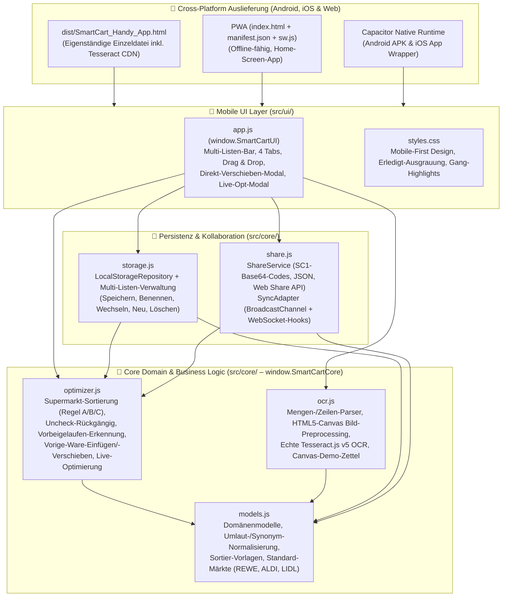
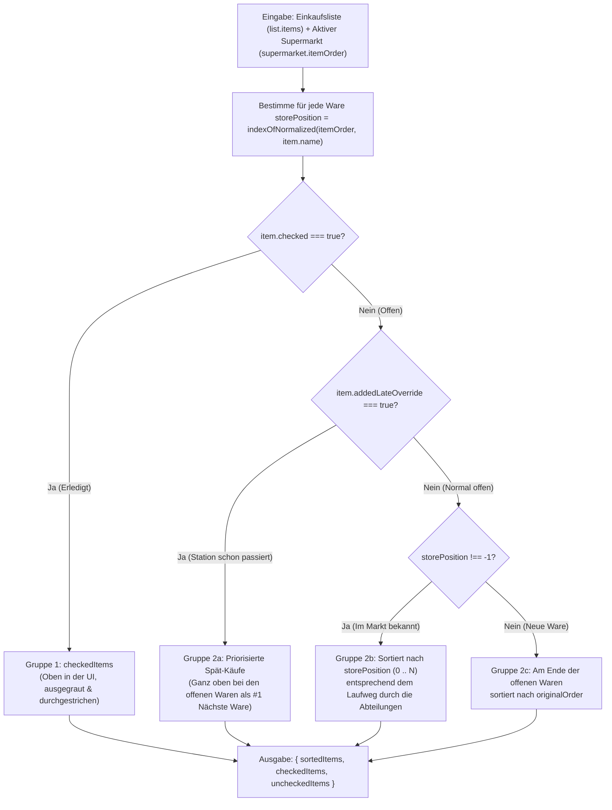

# 📐 SmartCart – Gesamtarchitektur, Algorithmen & Vollständige Funktionsreferenz

Dieses Dokument beschreibt die technische Gesamtarchitektur, die mathematisch-logischen Algorithmen der Supermarkt-Laufweg-Optimierung sowie **jedes einzelne Modul und jede einzelne Funktion** der SmartCart Einkaufslisten-App (Aufgabe, Parameter, Rückgabewerte und konkrete technische Umsetzung). Darüber hinaus enthält es die Roadmap zur Weiterentwicklung (Echtzeit-Kollaboration, Store-Deployment) sowie die Anleitung für das GitHub-Projekt.

---

## Inhaltsverzeichnis

1. [Gesamtarchitektur & Schichtenmodell](#1-gesamtarchitektur--schichtenmodell)
   - [Architektur-Übersicht (Mermaid-Diagramm)](#11-architektur-übersicht-mermaid-diagramm)
   - [Die 5 Architektur-Schichten im Detail](#12-die-5-architektur-schichten-im-detail)
2. [Algorithmen im Detail](#2-algorithmen-im-detail)
   - [Supermarkt-Reihenfolge-Optimierung & Gruppierung (Regel A, B, C)](#21-supermarkt-reihenfolge-optimierung--gruppierung-regel-a-b-c)
   - [Rückgängig-Logik (Uncheck / Wiederherstellung der Laufposition)](#22-rückgängig-logik-uncheck--wiederherstellung-der-laufposition)
   - [Selbstlernender Live-Optimierungs-Algorithmus](#23-selbstlernender-live-optimierungs-algorithmus)
   - [Intelligentes nachträgliches Hinzufügen („Bereits vorbeigelaufen“-Erkennung)](#24-intelligentes-nachträgliches-hinzufügen-bereits-vorbeigelaufen-erkennung)
   - [Präzises Einfügen & Verschieben von Supermarkt-Waren über die vorige Ware & Drag-and-Drop](#25-präzises-einfügen--verschieben-von-supermarkt-waren-über-die-vorige-ware--drag-and-drop)
   - [Echte Kamera-OCR mit Tesseract.js v5 & HTML5-Canvas Bild-Vorverarbeitung](#26-echte-kamera-ocr-mit-tesseractjs-v5--html5-canvas-bild-vorverarbeitung)
3. [Vollständige Modul- und Funktionsreferenz](#3-vollständige-modul--und-funktionsreferenz)
   - [Modul 1: `src/core/models.js` (Domänenmodelle, Sortier-Vorlagen & Normalisierung)](#31-modul-1-srccoremodelsjs)
   - [Modul 2: `src/core/optimizer.js` (Sortier-, Vorige-Ware-, Spät-Kauf- & Live-Lern-Engine)](#32-modul-2-srccoreoptimizerjs)
   - [Modul 3: `src/core/ocr.js` (Text-Parser, Tesseract-OCR, Bild-Preprocessing & Demo-Generator)](#33-modul-3-srccoreocrjs)
   - [Modul 4: `src/core/storage.js` (Lokale Persistenz, Multi-Listen-Verwaltung & Seeding)](#34-modul-4-srccorestoragejs)
   - [Modul 5: `src/core/share.js` (Teilen, Share-Codes, Backup & SyncAdapter)](#35-modul-5-srccoresharejs)
   - [Modul 6: `src/ui/app.js` (Mobile UI-Controller, Multi-Listen-Bar, Drag & Drop & Event-Orchestrierung)](#36-modul-6-srcuiappjs)
   - [Modul 7: `scripts/bundle-standalone.js` (Single-File-App-Bundler & Capacitor-Sync)](#37-modul-7-scriptsbundle-standalonejs)
4. [Weiterentwicklung & Roadmap (Echtzeit-Sharing, Cloud-Sync & App Stores)](#4-weiterentwicklung--roadmap-echtzeit-sharing-cloud-sync--app-stores)
5. [Empfehlung & Anleitung zum GitHub-Projekt](#5-empfehlung--anleitung-zum-github-projekt)

---

## 1. Gesamtarchitektur & Schichtenmodell

SmartCart folgt einer strikten **Clean-Architecture-Trennung** zwischen einer komplett abhängigkeitsfreien Geschäftslogik (`src/core/`) und einer reaktiven, mobil-optimierten Präsentationsschicht (`src/ui/`). Alle Kernmodule sind als universelle **UMD/IIFE-Module** konzipiert: Sie hängen ihre Exporte im Browser an `window.SmartCartCore` und exportieren sie gleichzeitig unter Node.js per CommonJS (`module.exports`). Dadurch laufen sowohl die automatisierten Unit-Tests (`tests/engine.test.js`), die Web-App (`index.html`), die eigenständige 1-Datei-Smartphone-App (`dist/SmartCart_Handy_App.html`) als auch der native Capacitor-Build (`android/` & `ios/`) auf exakt demselben Code.

### 1.1 Architektur-Übersicht (Mermaid-Diagramm)



### 1.2 Die 5 Architektur-Schichten im Detail

1. **Core Domain & Optimizer Layer ([`src/core/models.js`](file:///home/manus/.gemini/antigravity/scratch/smartcart-app/src/core/models.js), [`src/core/optimizer.js`](file:///home/manus/.gemini/antigravity/scratch/smartcart-app/src/core/optimizer.js))**
   - Kapselt sämtliche Datenstrukturen (`Item`, `Supermarket`, `ShoppingList`), die Übernahme einer bestehenden Supermarkt- oder Standard-Sortierung beim Anlegen neuer Märkte (`createSupermarketWithSorting`, `getDefaultItemOrder`), die sprachliche Normalisierung deutscher Artikelnamen (inklusive Umlaut-Faltung und 48 Synonym-/Plural-Äquivalenzgruppen wie `Apfel ↔ Äpfel`, `Brötchen ↔ Semmeln`, `Klopapier ↔ Toilettenpapier`) sowie alle Sortier-, Positionierungs- (`addSupermarketKnownItemAfter`, `moveSupermarketItemAfter`, `reorderSupermarketItem`) und Lern-Algorithmen.
2. **OCR & Foto-Erkennungs-Pipeline ([`src/core/ocr.js`](file:///home/manus/.gemini/antigravity/scratch/smartcart-app/src/core/ocr.js))**
   - Mehrstufige Erkennungspipeline für abfotografierte Einkaufszettel: Führt für echte Kamerafotos eine automatische HTML5-Canvas-Bildoptimierung (`preprocessImageForOcr`: Skalierung, Graustufen-Histogramm, Auto-Levels-Kontrastspreizung und Hintergrund-Aufhellung) durch, lädt bei Bedarf `window.Tesseract` dynamisch nach (`ensureTesseractLoaded`) und liest den echten deutschen Text per `Tesseract.recognize(..., 'deu')` aus. Unterstützt außerdem 3 isolierte Canvas-Demo-Einkaufszettel (`GENERATED_SAMPLE_DATA_URLS`), ohne jemals echte Nutzerfotos mit Demo-Daten zu vermischen, sowie den regulären Ausdrucks-Parser (`parseShoppingLine`), der Mengenangaben (`2x`, `500g`, `1,5L`, `2 Dosen`) sauber vom Artikelnamen trennt.
3. **Lokale Persistenz & Multi-Listen-Verwaltung ([`src/core/storage.js`](file:///home/manus/.gemini/antigravity/scratch/smartcart-app/src/core/storage.js))**
   - Das `LocalStorageRepository` kapselt alle Lese- und Schreibzugriffe auf `window.localStorage` unter versionierten Schlüsseln (`smartcart_supermarkets_v1`, `smartcart_lists_v1`, `smartcart_active_list_id_v1`). Es verwaltet beliebig viele benannte Einkaufszettel (`createNewShoppingList`, `renameShoppingList`, `duplicateShoppingList`, `switchShoppingList`, `deleteShoppingList`, `saveActiveList`). Falls `localStorage` (z. B. in Node.js-Tests oder im strikten Inkognito-Modus) nicht verfügbar ist, schaltet `resolveStorageBackend` transparent auf einen In-Memory-Speicher (`createMemoryStorage`) um.
4. **Share- & Sync-Layer ([`src/core/share.js`](file:///home/manus/.gemini/antigravity/scratch/smartcart-app/src/core/share.js))**
   - `ShareService` serialisiert Einkaufslisten und Supermarkt-Konfigurationen in menschenlesbare WhatsApp-/Telegram-Nachrichten sowie in kompakte Base64-Token mit dem Präfix `SC1:`.
   - `SyncAdapter` synchronisiert Änderungen (inklusive aller gespeicherten Einkaufslisten) heute bereits in Echtzeit über die Browser-`BroadcastChannel`-API zwischen offenen Tabs/Fenstern und stellt definierte Transport-Hooks (`remoteTransport`) für zukünftige Cloud-/CRDT-Synchronisation bereit.
5. **Mobile UI, PWA & Capacitor Cross-Platform Layer ([`src/ui/app.js`](file:///home/manus/.gemini/antigravity/scratch/smartcart-app/src/ui/app.js), [`src/ui/styles.css`](file:///home/manus/.gemini/antigravity/scratch/smartcart-app/src/ui/styles.css), [`scripts/bundle-standalone.js`](file:///home/manus/.gemini/antigravity/scratch/smartcart-app/scripts/bundle-standalone.js))**
   - Ein ohne externe Frameworks geschriebener, schneller Mobile-Controller mit 4 Hauptansichten (*Einkaufszettel*, *Foto-Scanner*, *Supermärkte*, *Teilen & App*), prominenter Einkaufszettel-Verwaltungsleiste, Touch-/Maus-Drag-and-Drop für die Supermarkt-Sortierung, nativer Kamera-Anbindung, Service-Worker-Caching (`sw.js`) und Capacitor-Konfiguration (`capacitor.config.json`) für Android und iOS.

---

## 2. Algorithmen im Detail

### 2.1 Supermarkt-Reihenfolge-Optimierung & Gruppierung (Regel A, B, C)

Die Funktion `sortShoppingList(listOrItems, supermarket)` in [`src/core/optimizer.js`](file:///home/manus/.gemini/antigravity/scratch/smartcart-app/src/core/optimizer.js#L39-L106) berechnet bei jeder Änderung und bei jedem Wechsel des Supermarkts die optimale Darstellungsreihenfolge.

Dabei gelten drei streng priorisierte Regeln:

- **Regel A – Abgehakte Waren ausgegraut nach ganz oben (`checkedItems`)**:
  Alle Waren mit `item.checked === true` werden aus der aktiven Laufstrecke herausgenommen und im oberen Listenbereich (*„Bereits abgehakt (Erledigt)“*) ausgegraut und durchgestrichen dargestellt. Innerhalb der erledigten Waren bleiben sie nach ihrer Supermarkt-Position (`storePosition`) sortiert.
  *Vorteil*: Unterhalb des erledigten Blocks stehen **ausschließlich offene Waren** lückenlos in der exakten Laufreihenfolge des Supermarkts untereinander.
- **Regel C – Vorrang für nachträglich hinzugefügte Waren, deren Abteilung bereits passiert wurde (`addedLateOverride === true`)**:
  Unter den offenen Waren (`uncheckedItems`) werden alle Artikel mit dem Flag `addedLateOverride: true` an **Index 0 (ganz oben unter den offenen Waren)** gesetzt. Wurden mehrere solcher Artikel hinzugefügt, steht der zuletzt hinzugefügte ganz oben (`b.originalOrder - a.originalOrder`).
- **Regel B – Supermarkt-Laufreihenfolge für reguläre offene Waren (`supermarket.itemOrder`)**:
  Alle übrigen offenen Waren werden über `indexOfNormalized(supermarket.itemOrder, item.name)` auf ihren 0-basierten Positionsindex im gewählten Supermarkt abgebildet:
  - Ist die Ware im Supermarkt bekannt (`pos !== -1`), wird aufsteigend nach `posA - posB` sortiert.
  - Ist eine Ware im gewählten Supermarkt noch unbekannt (`pos === -1`), wird sie hinter den bekannten Waren in ihrer ursprünglichen Eingabereihenfolge (`originalOrder`) eingereiht (und kann beim Abhaken durch die Live-Optimierung automatisch gelernt werden).



---

### 2.2 Rückgängig-Logik (Uncheck / Wiederherstellung der Laufposition)

Wenn der Nutzer im oberen Bereich *„Bereits abgehakt (Erledigt)“* auf eine bereits abgehakte Ware tippt, um das Abhaken rückgängig zu machen, führt `toggleItemCheck(list, supermarket, itemId)` ([`src/core/optimizer.js`](file:///home/manus/.gemini/antigravity/scratch/smartcart-app/src/core/optimizer.js#L296-L328)) folgende Schritte aus:

1. Die Eigenschaften der Ware werden zurückgesetzt auf:
   - `checked: false`
   - `checkedAt: null`
   - `addedLateOverride: false`
2. Anschließend wird `sortShoppingList(updatedRawItems, supermarket)` aufgerufen.
3. Da `checked` nun `false` ist, fällt die Ware zurück in die Menge der offenen Waren (`uncheckedItems`) und wird anhand ihres Index `indexOfNormalized(supermarket.itemOrder, item.name)` **wieder exakt an ihrer richtigen Supermarkt-Station** zwischen den anderen offenen Waren einsortiert.

---

### 2.3 Selbstlernender Live-Optimierungs-Algorithmus

Die Funktion **Live-Optimierung** lässt sich direkt im Header der Einkaufsliste per Schalter (`list.liveOptimizationEnabled`) ein- und ausschalten.

#### Ablauf beim Abhaken einer offenen Ware (`toggleItemCheck` & `applyLiveOptimizationUpdate`)

```mermaid
sequenceDiagram
    actor User as Nutzer im Supermarkt
    participant UI as Mobile UI (app.js)
    participant Opt as Optimizer (optimizer.js)
    participant Store as Storage (storage.js)

    User->>UI: Tippt auf offene Ware W (z. B. "Milch") zum Abhaken
    UI->>Opt: toggleItemCheck(list, supermarket, itemId)
    Opt->>Opt: Berechne aktuelle uncheckedItems in Laufreihenfolge
    Opt->>Opt: Ermittle targetUncheckedIdx von W
    Opt->>Opt: skippedItems = alle offenen Waren vor W (ohne addedLateOverride)
    Opt->>Opt: Setze W auf checked = true, checkedAt = Date.now()
    
    alt liveOptimizationEnabled === true UND skippedItems.length > 0
        Opt-->>UI: { action: 'checked', outOfOrderDetected: true, checkedItem: W, skippedItems, promptMessage }
        UI->>User: Öffnet Modal: "Reihenfolge im Supermarkt anpassen?<br/>Du hast „Milch“ vor „Hackfleisch“ abgehakt..."
        alt Nutzer klickt "Ja, Reihenfolge anpassen"
            User->>UI: Bestätigt Anpassung
            UI->>Opt: applyLiveOptimizationUpdate(supermarket, checkedItem, skippedItems)
            Opt->>Opt: Entfernt "Milch" aus alter Position in itemOrder<br/>und fügt "Milch" direkt VOR dem ersten skippedItem ("Hackfleisch") ein
            Opt-->>UI: Aktualisierter Supermarket + neu sortierte Einkaufsliste
            UI->>Store: Speichert aktualisierten Supermarkt & Liste
        else Nutzer klickt "Nein, nur abhaken"
            User->>UI: Lehnt Anpassung ab
            UI->>UI: Schließt Modal (Supermarkt-Reihenfolge bleibt unverändert)
        end
    else liveOptimizationEnabled === false ODER W war bereits die 1. offene Ware
        Opt-->>UI: { action: 'checked', outOfOrderDetected: false }
        UI->>Store: Speichert abgehakte Liste ohne Rückfrage
    end
```

1. **Erkennung einer Reihenfolge-Abweichung**:
   Bevor die Ware `target` auf `checked: true` gesetzt wird, prüft `toggleItemCheck`, an welchem Index `targetUncheckedIdx` sich die Ware innerhalb der aktuellen `uncheckedItems` befindet.
   - Falls `targetUncheckedIdx > 0` (und die Ware kein `addedLateOverride` hatte), hat der Nutzer alle offenen Waren im Bereich `uncheckedItems.slice(0, targetUncheckedIdx)` (gefiltert auf `!item.addedLateOverride`) im Gang übersprungen (`skippedItems`).
   - Ist `list.liveOptimizationEnabled === true` und `skippedItems.length > 0`, liefert `toggleItemCheck` das Flag `outOfOrderDetected: true` sowie den deutschen Rückfragetext `promptMessage` zurück.
   - Ist `list.liveOptimizationEnabled === false`, ist `outOfOrderDetected` immer `false` – es erfolgt keinerlei Rückfrage.
2. **Dynamisches Umhängen in der Supermarkt-Konfiguration (`applyLiveOptimizationUpdate`)**:
   Bestätigt der Nutzer den Dialog mit *„Ja, Reihenfolge anpassen“*, wird `applyLiveOptimizationUpdate(supermarket, checkedItemName, skippedItemNames)` ([`src/core/optimizer.js`](file:///home/manus/.gemini/antigravity/scratch/smartcart-app/src/core/optimizer.js#L341-L404)) ausgeführt:
   - Falls `checkedItemName` bereits in `supermarket.itemOrder` enthalten war, wird es zunächst an seiner alten Stelle entfernt (`order.splice(existingCheckedIdx, 1)`).
   - Danach wird der kleinste Index `targetInsertIdx` unter allen übersprungenen Waren (`skippedItemNames`) in `order` gesucht.
   - `checkedItemName` wird mittels `order.splice(targetInsertIdx, 0, canonicalCheckedName)` **unmittelbar vor** der ersten übersprungenen Ware eingefügt. Falls noch keine der beteiligten Waren in `itemOrder` existierte, werden beide in der neu gelernten Reihenfolge ans Ende von `itemOrder` angehängt.

---

### 2.4 Intelligentes nachträgliches Hinzufügen („Bereits vorbeigelaufen“-Erkennung)

Fällt dem Nutzer **während des Einkaufs** (nachdem er bereits erste Waren im Markt abgehakt hat) noch ein Artikel ein, prüft `addItemToList(list, supermarket, { name, quantity, category })` ([`src/core/optimizer.js`](file:///home/manus/.gemini/antigravity/scratch/smartcart-app/src/core/optimizer.js#L124-L175)) automatisch, ob der Nutzer die reguläre Abteilung dieser Ware im Supermarkt bereits passiert hat:

1. **Positionsbestimmung der neuen Ware**:
   Es wird `pos = indexOfNormalized(supermarket.itemOrder, name)` ermittelt.
2. **Abgleich mit bereits abgehakten Waren**:
   Falls `pos !== -1` (die Ware hat einen festen Platz im Markt), iteriert der Algorithmus über alle aktuell bereits abgehakten Waren (`existing.checked === true`) auf dem Einkaufszettel und bestimmt deren Marktposition `checkedPos = indexOfNormalized(supermarket.itemOrder, existing.name)`.
3. **Entscheidungskriterium (`checkedPos > pos`)**:
   - **Fall 1: `checkedPos > pos` trifft für mindestens eine abgehakte Ware zu (`passedByItems.length > 0`)**:
     Der Nutzer hat bereits Waren im Einkaufswagen, die im Supermarkt *weiter hinten* (näher Richtung Kasse) liegen als die neu hinzugefügte Ware. Er ist also an der Position der neuen Ware schon vorbeigelaufen!
     - `wasAddedLate` wird auf `true` gesetzt.
     - Die neue Ware erhält `addedLateOverride: true`.
     - Durch **Regel C** in `sortShoppingList` wird diese Ware sofort auf **Platz 1 der offenen Waren** (direkt unter den erledigten Waren) gesetzt und in der UI mit einem orangenen Highlight-Rahmen, dem Badge *„⚡ Nachträglich hinzugefügt • Als Nächstes (Station schon passiert)“* sowie einem erklärenden Toast-Hinweis versehen.
   - **Fall 2: Keine abgehakte Ware liegt hinter `pos` (`passedByItems.length === 0`)**:
     Die Abteilung der neuen Ware liegt auf dem normalen Weg noch vor dem Nutzer.
     - `wasAddedLate` ist `false`, `addedLateOverride` ist `false`.
     - Die Ware wird regulär an ihrer zukünftigen Laufposition `pos` unter den offenen Waren einsortiert.

---

### 2.5 Präzises Einfügen & Verschieben von Supermarkt-Waren über die vorige Ware & Drag-and-Drop

Um das Einrichten und Anpassen einer Supermarkt-Laufreihenfolge (`supermarket.itemOrder`) mit Dutzenden Stationen auf dem Smartphone maximal komfortabel zu machen, kombiniert SmartCart drei komplementäre Mechanismen:

1. **Einfügen neuer Waren anhand der vorigen Ware (`addSupermarketKnownItemAfter`)**:
   - Statt nur pauschal „Am Anfang“ oder „Am Ende“ einzufügen, gibt der Nutzer beim Hinzufügen einer neuen Ware die **vorige Ware** an (unterstützt durch ein Autocomplete-Suchfeld `<datalist id="storeExistingItemsDatalist">`).
   - Ist `previousItemName === '__START__'` (oder `'Ganz am Anfang (Position 1)'`), wird die Ware per `order.unshift(clean)` direkt auf Position 1 (Index `0`) gesetzt.
   - Entspricht `previousItemName` einer vorhandenen Ware (`prevIdx = indexOfNormalized(order, previousItemName)`), wird die neue Ware per `order.splice(prevIdx + 1, 0, clean)` **unmittelbar hinter** dieser vorigen Ware eingefügt.
   - Bleibt das Feld leer, wird die Ware am Ende angehängt.
2. **Gezieltes Verschieben bestehender Waren über den `⇄`-Dialog (`moveSupermarketItemAfter`)**:
   - Jede Zeile im Supermarkt-Konfigurator besitzt neben den `↑`/`↓`-Pfeilen einen `⇄`-Button (*„Gezielt verschieben“*).
   - Im sich öffnenden Modal kann der Nutzer entweder *„⬆️ Ganz an den Anfang (Position 1)“* wählen oder per Autocomplete-Feld bzw. Schnellauswahl-Chip die neue **vorige Ware** antippen, hinter die das Produkt sofort springt.
3. **Touch- & Maus-Drag-and-Drop über das `☰`-Handle (`bindStoreOrderDragAndDrop` & `reorderSupermarketItem`)**:
   - Auf Desktop-Browsern nutzt `#store-order-list` natives HTML5 Drag & Drop (`dragstart`, `dragover`, `drop`, `dragend`).
   - Auf Smartphones (Android/iOS) fängt ein dedizierter Touch-Controller (`touchstart`, `touchmove` mit `document.elementFromPoint`, `touchend`) das Ziehen am `☰`-Griff ab, hebt die Zielzeile visuell hervor (`.drag-over`) und führt beim Loslassen `reorderSupermarketItem(store, fromIdx, toIdx)` aus.

---

### 2.6 Echte Kamera-OCR mit Tesseract.js v5 & HTML5-Canvas Bild-Vorverarbeitung

Beim Fotografieren eines echten Einkaufszettels im Tab *„Foto-Scanner“* durchläuft das Bild eine mehrstufige Pipeline in [`src/core/ocr.js`](file:///home/manus/.gemini/antigravity/scratch/smartcart-app/src/core/ocr.js):

1. **Strikte Trennung zwischen Demo-Zetteln und echten Nutzerfotos (`detectPresetFromSource`)**:
   - Nur wenn der Nutzer explizit auf einen der 3 Demo-Buttons (`'wochenende'`, `'fruehstueck'`, `'italienisch'`) tippt – deren generierte Data-URLs im `Set` `GENERATED_SAMPLE_DATA_URLS` registriert sind –, werden die Demo-Zeilen verwendet.
   - Für jedes echte Kamerafoto oder Galeriebild liefert `detectPresetFromSource` garantiert `null`, sodass **niemals** falsche Demo-Artikel für ein echtes Foto angezeigt werden.
2. **Automatische Bild-Vorverarbeitung auf HTML5-Canvas (`preprocessImageForOcr`)**:
   - Smartphone-Fotos haben oft 12–48 Megapixel und ungleichmäßige Schatten auf dem Papier.
   - `preprocessImageForOcr` skaliert das Bild proportional auf maximal `1800px` Kantenlänge (bzw. vergrößert sehr kleine Bilder auf mindestens `700px`), wandelt alle Pixel nach der Luminanzformel `0.299*R + 0.587*G + 0.114*B` in Graustufen um und berechnet ein 256-Stufen-Histogramm.
   - Anhand des 3 %- und 90 %-Perzentils erfolgt eine **Auto-Levels-Kontrastspreizung** kombiniert mit einer Schwellenwert-Aufhellung des Papierhintergrunds (`norm > 190 → 255` Weiß) und Abdunklung der Stiftschrift (`norm < 90 → norm * 0.45`).
3. **Dynamisches Laden & Ausführen von Tesseract.js (`ensureTesseractLoaded` & `recognizeImageShoppingList`)**:
   - Ist `window.Tesseract` noch nicht geladen, injiziert `ensureTesseractLoaded` automatisch Tesseract.js v5 von jsDelivr (mit Fallback auf unpkg).
   - Anschließend führt `Tesseract.recognize(processedImage, 'deu', { logger })` die deutsche Texterkennung durch, meldet den prozentualen Fortschritt live an die UI und übergibt den erkannten Rohtext an `parseShoppingText(rawText)`.

---

## 3. Vollständige Modul- und Funktionsreferenz

Im Folgenden sind **alle 7 Module** und **jede einzelne Funktion** des Projekts mit ihren Parametern, Rückgabewerten, ihrer fachlichen Aufgabe (*„Was macht die Funktion?“*) und ihrer konkreten technischen Implementierung (*„Wie ist sie aktuell umgesetzt?“*) dokumentiert.

---

### 3.1 Modul 1: `src/core/models.js`

**Pfad**: [`src/core/models.js`](file:///home/manus/.gemini/antigravity/scratch/smartcart-app/src/core/models.js)  
**Verantwortung**: Domänenmodelle (`Item`, `Supermarket`, `ShoppingList`), Übernahme von Sortier-Vorlagen beim Anlegen neuer Supermärkte, sprachliche Normalisierung deutscher Artikelnamen, Synonym-/Plural-Auflösung, Abteilungs-Erkennung und Standard-Supermärkte (`REWE`, `ALDI`, `LIDL`).

#### 1. `generateId(prefix = 'id')`
- **Parameter**: `prefix` (`string`, optional, Standard: `'id'`) – Präfix für die generierte ID (z. B. `'item'`, `'store'`, `'list'`).
- **Rückgabewert**: `string` – Eindeutige ID im Format `<prefix>_<timestampBase36>_<randomBase36>`.
- **Was macht die Funktion?** Erzeugt eine kollisionsfreie, menschenlesbare eindeutige ID für Waren, Supermärkte und Einkaufslisten.
- **Wie ist sie aktuell umgesetzt?** Kombiniert `Date.now().toString(36)` mit einem 6-stelligen Zufallsstring aus `Math.random().toString(36).substring(2, 8)` per Template-String.

#### 2. `normalizeItemName(name)`
- **Parameter**: `name` (`string`) – Roher Artikelname (z. B. `"  Äpfel (Bio) "`).
- **Rückgabewert**: `string` – Normalisierter Vergleichsschlüssel (z. B. `"aepfel bio"`).
- **Was macht die Funktion?** Bereinigt und normalisiert deutsche Artikelnamen für einen fehlertoleranten Vergleich zwischen Benutzereingaben und Supermarkt-Konfigurationen (unabhängig von Groß-/Kleinschreibung, Umlauten oder Sonderzeichen).
- **Wie ist sie aktuell umgesetzt?** Prüft auf `null`/`undefined`, wandelt in Kleinbuchstaben um (`.toLowerCase()`), ersetzt deutsche Umlaute explizit (`ä -> ae`, `ö -> oe`, `ü -> ue`, `ß -> ss`), führt eine Unicode-NFD-Dekomposition durch, entfernt diakritische Zeichen per Regex `/[\u0300-\u036f]/g`, ersetzt Nicht-Alphanumerika durch Leerzeichen und reduziert mehrfache Leerzeichen auf ein einzelnes.

#### 3. `getCanonicalItemKey(name)`
- **Parameter**: `name` (`string`) – Artikelname im Singular, Plural oder als Synonym (z. B. `"Vollmilch"`, `"Brötchen"`, `"Semmeln"`, `"Klopapier"`).
- **Rückgabewert**: `string` – Kanonischer Grundbegriff (z. B. `"milch"`, `"broetchen"`, `"toilettenpapier"`).
- **Was macht die Funktion?** Führt deutsche Singular-/Pluralformen und gängige regionale Synonyme auf einen gemeinsamen kanonischen Schlüssel zusammen, damit z. B. `"Apfel"` auf dem Einkaufszettel zuverlässig die Station `"Äpfel"` im Supermarkt findet.
- **Wie ist sie aktuell umgesetzt?** Beim Laden des Moduls werden 48 Äquivalenzgruppen (`EQUIVALENCE_GROUPS`) in eine schnelle `Map` (`SYNONYM_LOOKUP`) geladen, die jeden normalisierten Begriff auf das erste Element seiner Gruppe abbildet. `getCanonicalItemKey` ruft `normalizeItemName(name)` auf und schlägt den Wert in `SYNONYM_LOOKUP` nach (mit Fallback auf den normalisierten Namen selbst).

#### 4. `indexOfNormalized(itemOrder, itemName)`
- **Parameter**:
  - `itemOrder` (`string[]`) – Geordnetes Array der Warennamen eines Supermarkts.
  - `itemName` (`string`) – Gesuchter Artikelname.
- **Rückgabewert**: `number` – 0-basierter Index in `itemOrder` oder `-1`, falls nicht enthalten.
- **Was macht die Funktion?** Sucht die genaue Laufweg-Position einer Ware innerhalb der Supermarkt-Konfiguration.
- **Wie ist sie aktuell umgesetzt?** Zweistufige Suche: In einer ersten `for`-Schleife wird auf exakte Übereinstimmung von `normalizeItemName(itemOrder[i]) === targetNorm` geprüft. Wird kein Treffer gefunden, prüft eine zweite Schleife auf Synonym-/Plural-Gleichheit über `getCanonicalItemKey(itemOrder[i]) === targetCanonical`.

#### 5. `guessItemCategory(name)`
- **Parameter**: `name` (`string`) – Name der Ware.
- **Rückgabewert**: `string` – Deutsche Abteilungsbezeichnung (`'Obst & Gemüse'`, `'Backwaren'`, `'Kühlregal & Milch'`, `'Fleisch & Wurst'`, `'Trockensortiment'`, `'Getränke'`, `'Tiefkühl'`, `'Haushalt & Drogerie'` oder `'Sonstiges'`).
- **Was macht die Funktion?** Ordnet jedem Artikelnamen automatisch eine passende Supermarkt-Abteilung für UI-Badges zu.
- **Wie ist sie aktuell umgesetzt?** Ermittelt den kanonischen Schlüssel via `getCanonicalItemKey(name)` und durchsucht ein vordefiniertes Array aus 8 Abteilungs-Objekten mittels `.some((term) => key === term || key.includes(term))`.

#### 6. `createItem({ id, name, quantity, category, checked, checkedAt, addedLateOverride, originalOrder })`
- **Parameter**: Options-Objekt mit `id` (`string`), `name` (`string`), `quantity` (`string|number`, Standard `'1x'`), `category` (`string|null`), `checked` (`boolean`, Standard `false`), `checkedAt` (`number|null`), `addedLateOverride` (`boolean`, Standard `false`), `originalOrder` (`number`, Standard `0`).
- **Rückgabewert**: `Item`-Objekt (`{ id, name, normalizedName, quantity, category, checked, checkedAt, addedLateOverride, originalOrder }`).
- **Was macht die Funktion?** Erzeugt ein validiertes, normiertes Einkaufslisten-Artikel-Objekt.
- **Wie ist sie aktuell umgesetzt?** Trimmt `name` und `quantity`, berechnet `normalizedName` über `normalizeItemName`, bestimmt bei fehlender `category` die Abteilung per `guessItemCategory`, setzt `checkedAt` auf `Date.now()` wenn `checked === true` (sonst `null`) und stellt sicher, dass `addedLateOverride` bei bereits abgehakten Artikeln immer `false` ist.

#### 7. `createSupermarket({ id, name, icon, color, itemOrder, sourceSupermarketId, supermarkets, updatedAt })`
- **Parameter**: Options-Objekt mit `id` (`string`), `name` (`string`), `icon` (`string`, Standard `'🛒'`), `color` (`string`, Standard `'#2563eb'`), `itemOrder` (`string[]`), optional `sourceSupermarketId` (`string`) & `supermarkets` (`Supermarket[]`), `updatedAt` (`number|null`).
- **Rückgabewert**: `Supermarket`-Objekt (`{ id, name, icon, color, itemOrder, updatedAt }`).
- **Was macht die Funktion?** Erzeugt eine validierte und duplikatfreie Supermarkt-Konfiguration. Wird kein `itemOrder`, dafür aber `sourceSupermarketId` übergeben, delegiert sie automatisch an `createSupermarketWithSorting`.
- **Wie ist sie aktuell umgesetzt?** Prüft zunächst auf `sourceSupermarketId`; iteriert danach über `itemOrder`, normalisiert jeden Eintrag mit `normalizeItemName` und nutzt ein `Set` (`seen`), um doppelte Einträge herauszufiltern, während die exakte Reihenfolge erhalten bleibt.

#### 8. `getDefaultSupermarkets()`
- **Parameter**: Keine.
- **Rückgabewert**: `Supermarket[]` – Array mit 3 vollständig konfigurierten deutschen Standard-Supermärkten (`REWE`, `ALDI`, `LIDL`).
- **Was macht die Funktion?** Liefert frische Instanzen der drei Standard-Supermärkte mit jeweils 46 typischen Waren in realistischer, marktspezifischer Laufreihenfolge (z. B. startet REWE mit Obst & Gemüse → Backwaren → Fleisch/Wurst → Kühlregal, während ALDI mit Backwaren → Obst & Gemüse → Trockensortiment → Kühlwand startet).
- **Wie ist sie aktuell umgesetzt?** Ruft dreimal `createSupermarket(...)` mit den kuratierten `itemOrder`-Listen für `'rewe'`, `'aldi'` und `'lidl'` auf und gibt das Array zurück (zusätzlich als Konstante `DEFAULT_SUPERMARKETS` exportiert).

#### 9. `getDefaultItemOrder()`
- **Parameter**: Keine.
- **Rückgabewert**: `string[]` – Frische Kopie der Standard-Warenreihenfolge (46 Waren aus `DEFAULT_SUPERMARKETS[0].itemOrder`).
- **Was macht die Funktion?** Liefert die Standard-Laufreihenfolge als unabhängiges Array, wenn beim Anlegen eines neuen Supermarkts die Option *„Standard (Standard-Sortierung)“* gewählt wird.
- **Wie ist sie aktuell umgesetzt?** Klont `DEFAULT_SUPERMARKETS[0].itemOrder` per Spread-Operator `[...baseStore.itemOrder]`.

#### 10. `createSupermarketWithSorting({ id, name, icon = '🛒', color = '#2563eb', sourceSupermarketId = 'default', supermarkets = [], itemOrder = null, updatedAt = null })`
- **Parameter**: Options-Objekt mit `id` (`string`, optional), `name` (`string`), `icon` (`string`), `color` (`string`), `sourceSupermarketId` (`string`, Standard `'default'` oder ID/Name eines bestehenden Marktes), `supermarkets` (`Supermarket[]`), `itemOrder` (`string[]|null`), `updatedAt` (`number|null`).
- **Rückgabewert**: `Supermarket` – Neu angelegter Supermarkt mit der übernommenen Warenreihenfolge.
- **Was macht die Funktion?** Erstellt einen neuen Supermarkt und übernimmt dessen initiale Sortierung (`itemOrder`) entweder aus der Standard-Sortierung (`sourceSupermarketId === 'default'`) oder als Kopie eines bestehenden Supermarkts aus `supermarkets`.
- **Wie ist sie aktuell umgesetzt?** Prüft, ob `sourceSupermarketId` vom Wert `'default'` abweicht, sucht den Quell-Supermarkt per ID oder normalisiertem Namen in `supermarkets` (mit Fallback auf `DEFAULT_SUPERMARKETS`), kopiert dessen `itemOrder` (`[...sourceStore.itemOrder]`) oder nutzt `getDefaultItemOrder()` und gibt das Ergebnis über `createSupermarket` zurück.

#### 11. `createShoppingList({ id, name, supermarketId, liveOptimizationEnabled, items, updatedAt })`
- **Parameter**: Options-Objekt mit `id` (`string`), `name` (`string`, Standard `'Mein Einkaufszettel'`), `supermarketId` (`string`, Standard `'rewe'`), `liveOptimizationEnabled` (`boolean`, Standard `true`), `items` (`Array`), `updatedAt` (`number|null`).
- **Rückgabewert**: `ShoppingList`-Objekt (`{ id, name, supermarketId, liveOptimizationEnabled, items, updatedAt }`).
- **Was macht die Funktion?** Erzeugt ein normiertes Einkaufslisten-Objekt inklusive normalisierter `Item`-Einträge.
- **Wie ist sie aktuell umgesetzt?** Konvertiert alle Elemente in `items` über `createItem` (unter Beibehaltung von `originalOrder`), setzt Standardwerte für `supermarketId` (`'rewe'`) und `liveOptimizationEnabled` (`true`) und vergibt einen `updatedAt`-Zeitstempel.

---

### 3.2 Modul 2: `src/core/optimizer.js`

**Pfad**: [`src/core/optimizer.js`](file:///home/manus/.gemini/antigravity/scratch/smartcart-app/src/core/optimizer.js)  
**Verantwortung**: Sortier-Engine für Supermarkt-Laufwege, Rückgängig-Logik beim Uncheck, „Bereits vorbeigelaufen“-Erkennung beim nachträglichen Hinzufügen, selbstlernende Live-Optimierung sowie präzises Einfügen und Verschieben von Waren hinter einer benannten vorigen Ware.

#### 1. `sortShoppingList(listOrItems, supermarket)`
- **Parameter**:
  - `listOrItems` (`ShoppingList | Item[]`) – Einkaufslisten-Objekt oder Array von Artikeln.
  - `supermarket` (`Supermarket`) – Aktive Supermarkt-Konfiguration mit `itemOrder`.
- **Rückgabewert**: `{ sortedItems: Item[], checkedItems: Item[], uncheckedItems: Item[] }`.
- **Was macht die Funktion?** Sortiert alle Artikel einer Einkaufsliste nach den drei SmartCart-Kernregeln (Regel A: Abgehakte nach oben; Regel C: Spät hinzugefügte Artikel mit `addedLateOverride` an die Spitze der offenen Artikel; Regel B: Alle weiteren offenen Artikel in der Laufreihenfolge `supermarket.itemOrder`).
- **Wie ist sie aktuell umgesetzt?** Klont zunächst alle Items und annotiert jedes Item mit `storePosition = indexOfNormalized(itemOrder, item.name)`. Danach werden die Items per `.filter()` in `checkedItems` und `uncheckedItems` aufgeteilt. `checkedItems` werden nach `storePosition` sortiert. `uncheckedItems` werden mit einer mehrstufigen Comparator-Funktion sortiert (zuerst `addedLateOverride === true`, danach bekannte `storePosition` aufsteigend, zuletzt unbekannte Artikel nach `originalOrder`) und schließlich zu `sortedItems = [...checkedItems, ...uncheckedItems]` zusammengefügt.

#### 2. `addItemToList(list, supermarket, { name, quantity = '1x', category = null })`
- **Parameter**:
  - `list` (`ShoppingList`) – Aktuelle Einkaufsliste.
  - `supermarket` (`Supermarket`) – Aktiver Supermarkt.
  - `{ name, quantity, category }` (`Object`) – Daten der neuen Ware.
- **Rückgabewert**: `{ list: ShoppingList, addedItem: Item, wasAddedLate: boolean, passedByItems: Item[] }`.
- **Was macht die Funktion?** Fügt eine Ware zur Einkaufsliste hinzu und erkennt automatisch, ob der Nutzer die Position dieser Ware im Supermarkt bereits passiert hat (anhand bereits abgehakter Waren mit höherem Positionsindex). Falls ja, wird die neue Ware sofort als nächste offene Ware ganz oben eingereiht.
- **Wie ist sie aktuell umgesetzt?** Bestimmt `pos = indexOfNormalized(itemOrder, name)`. Wenn `pos !== -1`, durchläuft eine Schleife alle existierenden Items der Liste: Ist ein Item bereits abgehakt (`existing.checked === true`) und hat `checkedPos = indexOfNormalized(itemOrder, existing.name)` mit `checkedPos > pos`, wird es in `passedByItems` gesammelt. Ist `passedByItems.length > 0`, wird `wasAddedLate = true` und am neuen Item `addedLateOverride: true` gesetzt. Anschließend wird die Liste mit `sortShoppingList` neu sortiert.

#### 3. `addMultipleItemsToList(list, supermarket, itemInputs = [])`
- **Parameter**:
  - `list` (`ShoppingList`) – Aktuelle Einkaufsliste.
  - `supermarket` (`Supermarket`) – Aktiver Supermarkt.
  - `itemInputs` (`Array<{ name: string, quantity?: string, category?: string }>`) – Liste hinzuzufügender Waren (z. B. aus dem Foto-/OCR-Scanner).
- **Rückgabewert**: `{ list: ShoppingList, addedItems: Item[], lateItems: Item[] }`.
- **Was macht die Funktion?** Fügt mehrere Waren in einem Schritt hinzu und wendet für jede einzelne Ware die „Bereits vorbeigelaufen“-Erkennung an.
- **Wie ist sie aktuell umgesetzt?** Iteriert über `itemInputs`, ignoriert leere Einträge, ruft für jedes Element `addItemToList` auf und sammelt alle hinzugefügten Artikel in `addedItems` sowie alle Artikel mit `wasAddedLate === true` in `lateItems`.

#### 4. `toggleItemCheck(list, supermarket, itemId)`
- **Parameter**:
  - `list` (`ShoppingList`) – Aktuelle Einkaufsliste.
  - `supermarket` (`Supermarket`) – Aktiver Supermarkt.
  - `itemId` (`string`) – ID der angeklickten Ware.
- **Rückgabewert**: `{ list: ShoppingList, action: 'checked'|'unchecked'|'noop', outOfOrderDetected: boolean, checkedItem?: Item, uncheckedItem?: Item, skippedItems: Item[], promptMessage: string|null }`.
- **Was macht die Funktion?** Schaltet den Erledigt-Status einer Ware um. Beim Abhaken prüft sie (sofern `liveOptimizationEnabled` aktiv ist), ob der Nutzer frühere offene Waren übersprungen hat, und generiert die deutsche Rückfrage für das Live-Optimierungs-Modal. Beim Rückgängig-Machen (Uncheck) setzt sie den Status zurück und sortiert die Ware wieder exakt an ihrer Supermarkt-Position unter den offenen Waren ein.
- **Wie ist sie aktuell umgesetzt?** Berechnet vor der Statusänderung `const { uncheckedItems } = sortShoppingList(list, supermarket)`.
  - Wenn `!target.checked` (Abhaken): Ermittelt `targetUncheckedIdx`. Falls `targetUncheckedIdx > 0` und `!target.addedLateOverride`, werden alle davor liegenden offenen Waren ohne `addedLateOverride` per `uncheckedItems.slice(0, targetUncheckedIdx)` als `skippedItems` extrahiert. Das Item erhält `checked: true`, `checkedAt: Date.now()`, `addedLateOverride: false`. Wenn `Boolean(list.liveOptimizationEnabled) && skippedItems.length > 0`, wird `outOfOrderDetected = true` und `promptMessage` befüllt.
  - Wenn `target.checked` (Uncheck / Rückgängig): Setzt `checked: false`, `checkedAt: null`, `addedLateOverride: false` und sortiert die Liste über `sortShoppingList` neu, wodurch das Item exakt an seinen `storePosition`-Index zurückkehrt.

#### 5. `applyLiveOptimizationUpdate(supermarket, checkedItemName, skippedItemNames)`
- **Parameter**:
  - `supermarket` (`Supermarket`) – Zu aktualisierende Supermarkt-Konfiguration.
  - `checkedItemName` (`string | Item`) – Name oder Objekt der vorgezogenen Ware.
  - `skippedItemNames` (`Array<string | Item> | string`) – Übersprungene Waren.
- **Rückgabewert**: `Supermarket` – Neue Supermarkt-Konfiguration mit aktualisiertem `itemOrder`.
- **Was macht die Funktion?** Lernt eine neue Laufreihenfolge im Supermarkt, indem die zuerst abgehakte Ware (`checkedItemName`) in `supermarket.itemOrder` direkt **vor** die erste übersprungene Ware (`skippedItemNames`) verschoben bzw. eingefügt wird.
- **Wie ist sie aktuell umgesetzt?** Extrahiert die bereinigten Namen aus Strings oder Item-Objekten. Kopiert `supermarket.itemOrder`, entfernt `checkedItemName` an seiner bisherigen Position (falls vorhanden via `indexOfNormalized` + `splice`), sucht den kleinste Index `targetInsertIdx` aller `skippedItemNames` im Array und fügt `canonicalCheckedName` per `order.splice(targetInsertIdx, 0, canonicalCheckedName)` unmittelbar davor ein. Sind auch die übersprungenen Waren noch nicht in `itemOrder` enthalten, werden `canonicalCheckedName` und danach die `skippedItemNames` ans Ende angehängt.

#### 6. `changeListSupermarket(list, newSupermarket)`
- **Parameter**: `list` (`ShoppingList`), `newSupermarket` (`Supermarket`).
- **Rückgabewert**: `ShoppingList` – Aktualisierte und für `newSupermarket` neu sortierte Einkaufsliste.
- **Was macht die Funktion?** Wechselt den Supermarkt einer Einkaufsliste und passt die Reihenfolge aller Waren sofort an den neuen Markt an.
- **Wie ist sie aktuell umgesetzt?** Ruft `sortShoppingList(list.items, newSupermarket)` auf und gibt ein neues Listen-Objekt mit `supermarketId: newSupermarket.id` und den neu sortierten `items` zurück.

#### 7. `setLiveOptimization(list, enabled)`
- **Parameter**: `list` (`ShoppingList`), `enabled` (`boolean`).
- **Rückgabewert**: `ShoppingList` – Einkaufsliste mit aktualisiertem Flag `liveOptimizationEnabled`.
- **Was macht die Funktion?** Schaltet die Live-Optimierung für die Einkaufsliste ein oder aus.
- **Wie ist sie aktuell umgesetzt?** Gibt eine flache Kopie von `list` mit `liveOptimizationEnabled: Boolean(enabled)` und neuem `updatedAt`-Zeitstempel zurück.

#### 8. `removeItemFromList(list, supermarket, itemId)`
- **Parameter**: `list` (`ShoppingList`), `supermarket` (`Supermarket`), `itemId` (`string`).
- **Rückgabewert**: `ShoppingList` – Bereinigte und sortierte Einkaufsliste.
- **Was macht die Funktion?** Löscht einen einzelnen Artikel anhand seiner `itemId` von der Einkaufsliste.
- **Wie ist sie aktuell umgesetzt?** Filtert `list.items` über `.filter((item) => item.id !== itemId)` und sortiert das Ergebnis mit `sortShoppingList`.

#### 9. `updateItemInList(list, supermarket, itemId, updates = {})`
- **Parameter**: `list` (`ShoppingList`), `supermarket` (`Supermarket`), `itemId` (`string`), `updates` (`{ name?: string, quantity?: string }`).
- **Rückgabewert**: `ShoppingList` – Aktualisierte und neu sortierte Einkaufsliste.
- **Was macht die Funktion?** Ändert den Namen oder die Menge eines bestehenden Artikels und sortiert die Liste bei Namensänderung automatisch neu ein.
- **Wie ist sie aktuell umgesetzt?** Ersetzt das Ziel-Item per `.map()` durch einen neuen `createItem`-Aufruf mit den neuen Werten und ruft `sortShoppingList` auf.

#### 10. `clearCheckedItems(list, supermarket)`
- **Parameter**: `list` (`ShoppingList`), `supermarket` (`Supermarket`).
- **Rückgabewert**: `ShoppingList` – Einkaufsliste, die nur noch die offenen Waren enthält.
- **Was macht die Funktion?** Entfernt alle bereits abgehakten Waren aus der oberen Erledigt-Sektion.
- **Wie ist sie aktuell umgesetzt?** Filtert `list.items` auf `!item.checked` und übergibt die verbleibenden Artikel an `sortShoppingList`.

#### 11. `uncheckAllItems(list, supermarket)`
- **Parameter**: `list` (`ShoppingList`), `supermarket` (`Supermarket`).
- **Rückgabewert**: `ShoppingList` – Vollständig zurückgesetzte Einkaufsliste in Supermarkt-Laufreihenfolge.
- **Was macht die Funktion?** Setzt alle Artikel einer Einkaufsliste wieder auf „offen“ (`checked: false`), z. B. für die Wiederverwendung eines Standard-Wocheneinkaufs.
- **Wie ist sie aktuell umgesetzt?** Setzt für jedes Item `checked: false`, `checkedAt: null` und `addedLateOverride: false` und sortiert anschließend über `sortShoppingList`.

#### 12. `reorderSupermarketItem(supermarket, fromIndex, toIndex)`
- **Parameter**: `supermarket` (`Supermarket`), `fromIndex` (`number`), `toIndex` (`number`).
- **Rückgabewert**: `Supermarket` – Aktualisierte Supermarkt-Konfiguration.
- **Was macht die Funktion?** Verschiebt eine Ware innerhalb der Laufreihenfolge (`supermarket.itemOrder`) von Position `fromIndex` nach `toIndex` (genutzt für Drag & Drop sowie die `↑`/`↓`-Pfeilbuttons).
- **Wie ist sie aktuell umgesetzt?** Prüft die Array-Grenzen, entnimmt das Element mit `order.splice(fromIndex, 1)` und fügt es mit `order.splice(toIndex, 0, moved)` an der Zielposition wieder ein.

#### 13. `attachStorePositionMetadata(updatedStore, meta = {})` & `isStartMarker(prev)` *(interne Hilfsfunktionen)*
- **Parameter**: `updatedStore` (`Supermarket`), `meta` (`Object`) bzw. `prev` (`any`).
- **Rückgabewert**: `Supermarket` mit nicht-aufzählbaren Metadaten-Properties bzw. `boolean`.
- **Was machen die Funktionen?** `attachStorePositionMetadata` versieht das zurückgegebene `Supermarket`-Objekt per `Object.defineProperties` mit nicht-enumerablen Feldern (`.supermarket`, `.insertedAtIndex`, `.newIndex`, `.foundPrevious`, `.previousItem`, `.movedItem`), sodass Aufrufer das Ergebnis sowohl direkt als `Supermarket` als auch per Destructuring `{ supermarket, insertedAtIndex, foundPrevious }` verwenden können. `isStartMarker` erkennt Schlüsselwörter für Position 1 (`'__START__'`, `'anfang'`, `'ganz am anfang'`, `'position 1'`).

#### 14. `addSupermarketKnownItemAfter(supermarket, itemName, previousItemName = null)`
- **Parameter**:
  - `supermarket` (`Supermarket`) – Zu aktualisierender Supermarkt.
  - `itemName` (`string`) – Name der neu einzufügenden (oder neu zu positionierenden) Ware.
  - `previousItemName` (`string|null`, optional) – Name der vorigen Ware im Markt oder `'__START__'` für Position 1.
- **Rückgabewert**: `Supermarket` (inklusive `.supermarket`, `.insertedAtIndex`, `.newIndex`, `.foundPrevious`, `.previousItem`, `.movedItem`).
- **Was macht die Funktion?** Fügt eine Ware exakt hinter der angegebenen *vorigen Ware* (`previousItemName`) in `supermarket.itemOrder` ein (oder an Position 1 bei `'__START__'`, bzw. am Ende, wenn keine vorige Ware angegeben wurde).
- **Wie ist sie aktuell umgesetzt?** Entfernt `itemName` zunächst an einer eventuell bestehenden alten Position. Prüft dann per `isStartMarker(previousItemName)` auf Position 1 (`order.unshift(clean)`). Andernfalls sucht sie `prevIdx = indexOfNormalized(order, previousItemName)` und fügt die Ware per `order.splice(prevIdx + 1, 0, clean)` direkt dahinter ein (mit Fallback auf `order.push(clean)`).

#### 15. `moveSupermarketItemAfter(supermarket, itemNameOrIndex, previousItemName)`
- **Parameter**:
  - `supermarket` (`Supermarket`) – Zu aktualisierender Supermarkt.
  - `itemNameOrIndex` (`string | number`) – Name oder aktueller 0-basierter Index der zu verschiebenden Ware.
  - `previousItemName` (`string|null`) – Name der vorigen Ware, hinter die verschoben werden soll, oder `'__START__'` für Position 1.
- **Rückgabewert**: `Supermarket` (inklusive `.supermarket`, `.insertedAtIndex`, `.newIndex`, `.foundPrevious`, `.previousItem`, `.movedItem`).
- **Was macht die Funktion?** Verschiebt eine bestehende Ware innerhalb von `supermarket.itemOrder` gezielt direkt hinter `previousItemName` (oder an den Anfang auf Position 1).
- **Wie ist sie aktuell umgesetzt?** Ermittelt den aktuellen Index `currentIdx` (per Index oder `indexOfNormalized`), entnimmt die Ware per `splice`, sucht den neuen Zielindex von `previousItemName` und fügt die Ware bei `prevIdx + 1` (bzw. Index `0` bei `isStartMarker`) wieder ein.

#### 16. `addSupermarketKnownItem(supermarket, itemName, insertIndex = -1)`
- **Parameter**: `supermarket` (`Supermarket`), `itemName` (`string`), `insertIndex` (`number|string`, optional, Standard `-1` = am Ende).
- **Rückgabewert**: `Supermarket` – Aktualisierte Supermarkt-Konfiguration.
- **Was macht die Funktion?** Fügt eine neue bekannte Ware an einem numerischen Index (oder bei Übergabe eines Strings als `insertIndex` via `addSupermarketKnownItemAfter` hinter einer benannten Ware) in `supermarket.itemOrder` ein.
- **Wie ist sie aktuell umgesetzt?** Delegiert bei `typeof insertIndex === 'string'` an `addSupermarketKnownItemAfter`; entfernt andernfalls eventuelle Duplikate und fügt das Element per `splice` bei `insertIndex` oder per `push` am Ende ein.

#### 17. `removeSupermarketKnownItem(supermarket, itemName)`
- **Parameter**: `supermarket` (`Supermarket`), `itemName` (`string`).
- **Rückgabewert**: `Supermarket` – Aktualisierte Supermarkt-Konfiguration ohne die entfernte Ware.
- **Was macht die Funktion?** Löscht eine Ware aus der gespeicherten Laufreihenfolge eines Supermarkts.
- **Wie ist sie aktuell umgesetzt?** Filtert `supermarket.itemOrder` über `normalizeItemName(entry) !== normalizeItemName(itemName)` und erzeugt über `createSupermarket` das aktualisierte Markt-Objekt.

---

### 3.3 Modul 3: `src/core/ocr.js`

**Pfad**: [`src/core/ocr.js`](file:///home/manus/.gemini/antigravity/scratch/smartcart-app/src/core/ocr.js)  
**Verantwortung**: Text- und Zeilen-Parser für Einkaufszettel, HTML5-Canvas-Bildvorverarbeitung (`preprocessImageForOcr`), dynamisches Laden und Ausführen von echter Tesseract.js v5 OCR (`ensureTesseractLoaded`, `recognizeImageShoppingList`) sowie Generierung der 3 isolierten Demo-Einkaufszettel-Fotos (`generateSamplePhotoDataUrl`).

#### 1. `getSamplePhotoPresets()`
- **Parameter**: Keine.
- **Rückgabewert**: `Array<Preset>` – Array der 3 integrierten Demo-Einkaufszettel-Vorlagen (`wochenende`, `fruehstueck`, `italienisch`).
- **Was macht die Funktion?** Liefert die Metadaten, Papier-/Stiftfarben und Textzeilen der 3 Beispiel-Einkaufszettel.
- **Wie ist sie aktuell umgesetzt?** Gibt `Object.values(SAMPLE_PHOTO_PRESETS)` zurück.

#### 2. `parseShoppingLine(rawLine)`
- **Parameter**: `rawLine` (`string`) – Einzelne Textzeile aus einem OCR-Scan oder Textfeld (z. B. `"- 2 Dosen Passierte Tomaten"` oder `"[ ] 500g Hackfleisch"`).
- **Rückgabewert**: `{ name: string, quantity: string, category: string, rawLine: string } | null`.
- **Was macht die Funktion?** Zerlegt eine einzelne Einkaufszettel-Zeile in Artikelname, Mengenangabe und Supermarkt-Abteilung und filtert Überschriften (`"Einkaufszettel Samstag"`) oder Leerzeilen als `null` heraus.
- **Wie ist sie aktuell umgesetzt?** Entfernt zuerst Aufzählungszeichen, Checkboxen (`[ ]`, `☐`, `-`, `•`) und Nummerierungen (`1.`) am Zeilenanfang per Regex. Prüft gegen `HEADER_NOISE_PATTERNS`. Wendet anschließend drei spezialisierte reguläre Ausdrücke an:
  1. `leadingUnitRegex`: Erkennt vorangestellte Mengen mit Einheit (`2x Milch`, `500g Mehl`, `1,5L Orangensaft`, `2 Dosen Passierte Tomaten`).
  2. `trailingUnitRegex`: Erkennt nachgestellte Mengen (`Milch (2L)`, `Tomaten - 500g`, `Cola 1,5L`).
  3. `leadingCountRegex`: Erkennt reine Stückzahlen am Anfang (`6 Brötchen` → `quantity: '6x'`, `name: 'Brötchen'`).

#### 3. `parseShoppingText(rawText)`
- **Parameter**: `rawText` (`string`) – Mehrzeiliger Text oder komma-/semikolongetrennte Liste.
- **Rückgabewert**: `Array<{ name: string, quantity: string, category: string, rawLine: string }>`.
- **Was macht die Funktion?** Wandelt einen kompletten Einkaufszettel-Text in ein Array strukturierter Artikel-Objekte um.
- **Wie ist sie aktuell umgesetzt?** Teilt `rawText` an Zeilenumbrüchen (`/\r?\n/`). Besteht der Text nur aus einer einzigen Zeile mit Semikolons oder mehreren Kommas (ohne Dezimalzahlen wie `1,5L` zu zerreißen, via `/[;]|,(?!\d)/`), wird an diesen getrennt. Jede Teilzeile wird mit `parseShoppingLine` geparst.

#### 4. `utf8ToBase64(str)` *(interne Hilfsfunktion)*
- **Parameter**: `str` (`string`).
- **Rückgabewert**: `string` – Base64-kodierter String.
- **Was macht die Funktion?** Kodiert UTF-8-Strings (inklusive deutscher Umlaute) sicher in Base64 sowohl im Browser als auch in Node.js.
- **Wie ist sie aktuell umgesetzt?** Nutzt `Buffer.from(str, 'utf8').toString('base64')` in Node.js und `btoa(unescape(encodeURIComponent(str)))` im Browser.

#### 5. `generateSamplePhotoDataUrl(presetName = 'wochenende')`
- **Parameter**: `presetName` (`string`, optional: `'wochenende'`, `'fruehstueck'`, `'italienisch'`).
- **Rückgabewert**: `string` – Bild-Data-URL (`data:image/png;base64,...` im Browser bzw. `data:image/svg+xml;base64,...` in Node.js).
- **Was macht die Funktion?** Zeichnet ein täuschend echtes Foto eines handgeschriebenen Einkaufszettels (mit Holz-Hintergrund, leicht gedrehtem Notizblockpapier, Schlagschatten, Klebestreifen, Linienblatt, gezeichneten Checkboxen und Handschrift-Font), damit der Nutzer die Foto-Erkennung jederzeit mit einem Tipp testen kann.
- **Wie ist sie aktuell umgesetzt?** Erstellt im Browser ein `<canvas width="600" height="760">`, zeichnet mittels 2D-Kontext den Zettel und registriert die erzeugte Data-URL sowohl in `GENERATED_SAMPLE_DATA_URLS` (`Set`) als auch in `GENERATED_DATAURL_REGISTRY` (`Map`). In einer Headless-/Node-Umgebung ohne DOM-Canvas generiert sie ein SVG-Bild mit dem Attribut `data-smartcart-preset` als Base64-Data-URL.

#### 6. `detectPresetFromSource(imageSource)`
- **Parameter**: `imageSource` (`string | Object`).
- **Rückgabewert**: `Preset | null`.
- **Was macht die Funktion?** Prüft streng, ob eine übergebene Bildquelle explizit einem der 3 Demo-Einkaufszettel entspricht. Gibt für echte Nutzerfotos immer `null` zurück.
- **Wie ist sie aktuell umgesetzt?** Vergleicht `imageSource` mit den Schlüsseln in `SAMPLE_PHOTO_PRESETS`, prüft ob die Data-URL in `GENERATED_SAMPLE_DATA_URLS` bzw. `GENERATED_DATAURL_REGISTRY` registriert wurde, und dekodiert bei SVG-Data-URLs das Tag `data-smartcart-preset`.

#### 7. `ensureTesseractLoaded(onProgress)`
- **Parameter**: `onProgress` (`Function`, optional) – Fortschritts-Callback.
- **Rückgabewert**: `Promise<Object | null>` – Aufgelöstes `window.Tesseract`-Objekt oder `null` (falls offline/Node.js ohne Mock).
- **Was macht die Funktion?** Stellt sicher, dass die Tesseract.js v5 OCR-Engine im Browser bereitsteht, und lädt sie bei Bedarf dynamisch per `<script>`-Tag nach.
- **Wie ist sie aktuell umgesetzt?** Prüft zuerst `root.Tesseract` bzw. `window.Tesseract`. Ist bereits ein `<script src*="tesseract">` im DOM, wartet sie bis zu 4,5 Sekunden auf dessen Initialisierung. Andernfalls injiziert sie nacheinander die CDN-URLs (`https://cdn.jsdelivr.net/npm/tesseract.js@5/dist/tesseract.min.js` mit Fallback auf `unpkg.com`) per Promise und gibt `window.Tesseract` zurück.

#### 8. `preprocessImageForOcr(imageSource)`
- **Parameter**: `imageSource` (`string | File | Blob | HTMLImageElement | HTMLCanvasElement | Object`).
- **Rückgabewert**: `Promise<string | *>` – Optimierte PNG-Data-URL für Tesseract.js (oder Originalquelle in Node.js).
- **Was macht die Funktion?** Bereitet ein Kamerafoto auf einem HTML5-Canvas optimal für die optische Zeichenerkennung vor (Skalierung, Graustufen-Konvertierung, Auto-Levels-Kontrastspreizung und Hintergrund-Bereinigung).
- **Wie ist sie aktuell umgesetzt?** Lädt das Bild in ein `Image`-Objekt, skaliert die längste Seite in den Bereich `700px .. 1800px`, zeichnet es auf ein `<canvas>`, berechnet das Luminanz-Histogramm aller Pixel, ermittelt das 3 %- und 90 %-Perzentil (`minLum`, `maxLum`), spreizt den Kontrast über diesen Bereich und hellt helle Papierpixel (`> 190`) auf reines Weiß (`255`) auf, während dunkle Schriftpixel (`< 90`) verstärkt werden.

#### 9. `recognizeImageShoppingList(imageSource, onProgress)`
- **Parameter**:
  - `imageSource` (`string | File | Blob | Object`) – Bild-Data-URL, Kamera-Datei (`File`), Preset-Name oder Text-Objekt.
  - `onProgress` (`Function`, optional) – Callback `({ status: string, progress: number }) => void` für den Fortschrittsbalken.
- **Rückgabewert**: `Promise<{ text: string, items: Array, source: string, confidence: number, presetId: string|null, error: string|null }>`.
- **Was macht die Funktion?** Führt die optische Texterkennung (OCR) auf einem Einkaufszettel-Foto aus und liefert sowohl den erkannten Rohtext als auch die geparsten Waren zurück.
- **Wie ist sie aktuell umgesetzt?** Arbeitet in 3 klar getrennten Stufen:
  1. **Stufe 1 (Explizites Demo-Preset)**: Nur wenn `detectPresetFromSource(imageSource)` ein generiertes Demo-Foto erkennt, werden die Demo-Zeilen extrahiert (`source: 'sample-preset-ocr'`).
  2. **Stufe 2 (Direktes Text-Objekt)**: Enthält `imageSource.text` bereits Text, wird dieser direkt über `parseShoppingText` geparst (`source: 'direct-text'`).
  3. **Stufe 3 (Echte Foto-OCR mit Preprocessing & Tesseract.js)**: Für jedes echte Foto wird zuerst `preprocessImageForOcr(imageSource)` und `ensureTesseractLoaded(onProgress)` aufgerufen. Anschließend führt `tesseract.recognize(processedImage, 'deu', { logger })` (bzw. `createWorker('deu')` als API-Fallback) die deutsche Texterkennung aus (`source: 'tesseract-ocr'`). Wird kein Text erkannt oder ist Tesseract offline nicht verfügbar, gibt die Funktion sauber `{ text: '', items: [], source: 'ocr-error', confidence: 0, error: '...' }` zurück – niemals Fake-Demo-Waren.

---

### 3.4 Modul 4: `src/core/storage.js`

**Pfad**: [`src/core/storage.js`](file:///home/manus/.gemini/antigravity/scratch/smartcart-app/src/core/storage.js)  
**Verantwortung**: Dauerhafte Speicherung der Supermarkt-Konfigurationen und beliebig vieler benannter Einkaufslisten im Browser (`localStorage`) mit automatischem In-Memory-Fallback für Node.js und Erststart-Seeding.

#### 1. `createMemoryStorage()`
- **Parameter**: Keine.
- **Rückgabewert**: `{ getItem(key), setItem(key, value), removeItem(key), clear() }`.
- **Was macht die Funktion?** Stellt ein `localStorage`-kompatibles Speicher-Backend im Arbeitsspeicher bereit (für Unit-Tests unter Node.js oder restriktive Browser-Umgebungen).
- **Wie ist sie aktuell umgesetzt?** Kapselt eine JavaScript-`Map` mit den vier Web-Storage-Standardmethoden.

#### 2. `resolveStorageBackend(customStorage)` *(interne Hilfsfunktion)*
- **Parameter**: `customStorage` (`Object`, optional).
- **Rückgabewert**: Storage-Backend-Objekt.
- **Was macht die Funktion?** Wählt das beste verfügbare Speicher-Backend aus.
- **Wie ist sie aktuell umgesetzt?** Nutzt `customStorage` falls übergeben; testet andernfalls `root.localStorage` durch probeweises Schreiben und Löschen von `'__smartcart_test__'` in einem `try/catch`-Block und fällt bei Fehlern auf `createMemoryStorage()` zurück.

#### 3. `createDefaultSeedShoppingList(supermarket)`
- **Parameter**: `supermarket` (`Supermarket`, optional, Standard: erster Standard-Supermarkt `REWE`).
- **Rückgabewert**: `ShoppingList` – Fertig sortierte Beispiel-Einkaufsliste (*„Wocheneinkauf“*).
- **Was macht die Funktion?** Erzeugt beim allerersten App-Start eine realistische Einkaufsliste mit 8 Waren (davon 2 bereits abgehakt am Markteingang – *Äpfel* und *Brötchen* – sowie 6 offene Waren in Laufreihenfolge), damit der Nutzer die Zweiteilung und die Vorbeigelaufen-Erkennung sofort live erleben kann.
- **Wie ist sie aktuell umgesetzt?** Erstellt 8 `Item`-Objekte über `createItem`, sortiert sie mit `sortShoppingList(rawItems, targetStore)` und gibt das Ergebnis über `createShoppingList` zurück.

#### 4. Klasse `LocalStorageRepository` (sowie statische Methoden & Instanz `storageRepository`)
Alle Methoden von `LocalStorageRepository` können sowohl auf einer Instanz (`new LocalStorageRepository(customStorage)`) als auch direkt über `storageRepository` oder statisch (`LocalStorageRepository.loadState()`) aufgerufen werden:

- **`constructor(storageBackend)`**: Initialisiert `this.storage = resolveStorageBackend(storageBackend)`.
- **`_readJson(key, fallbackValue)`**: Liest einen JSON-String aus `this.storage.getItem(key)`, parst ihn mit `JSON.parse` und gibt bei Fehlern `fallbackValue` zurück.
- **`_writeJson(key, value)`**: Serialisiert `value` mit `JSON.stringify` und speichert es unter `key`.
- **`loadSupermarkets()`**: Lädt alle Supermärkte unter `smartcart_supermarkets_v1`. Falls noch keine gespeichert sind, werden automatisch die 3 Standard-Märkte (`REWE`, `ALDI`, `LIDL`) über `getDefaultSupermarkets()` erzeugt, gespeichert und zurückgegeben.
- **`saveSupermarkets(supermarkets)`**: Normalisiert jedes Element im Array mit `createSupermarket` und speichert das Array unter `smartcart_supermarkets_v1`.
- **`resetDefaultSupermarkets()`**: Setzt gespeicherte Supermärkte bei programmatischem Aufruf (z. B. in Unit-Tests) auf die 3 Standard-Märkte (`getDefaultSupermarkets()`) zurück (in der UI bewusst nicht mehr als Button eingeblendet, um versehentliches Überschreiben eigener Märkte zu verhindern).
- **`getSupermarketById(supermarketId)`**: Sucht in `loadSupermarkets()` nach der übergebenen `supermarketId` und gibt bei Nichtfinden den ersten verfügbaren Markt zurück.
- **`upsertSupermarket(supermarket)`**: Aktualisiert einen bestehenden Supermarkt anhand seiner `id` oder fügt ihn neu zur Liste hinzu und speichert sofort.
- **`deleteSupermarket(supermarketId)`**: Entfernt einen Supermarkt anhand seiner `id`, stellt aber sicher, dass immer mindestens ein Supermarkt erhalten bleibt.
- **`loadShoppingLists()`**: Lädt alle gespeicherten Einkaufslisten aus `smartcart_lists_v1`. Ist der Speicher leer, wird über `createDefaultSeedShoppingList` eine initiale Liste (*„Wocheneinkauf“*) angelegt und als aktiv gesetzt.
- **`saveShoppingLists(lists)`**: Validiert alle Listen im Array über `createShoppingList` und speichert sie in `smartcart_lists_v1`.
- **`getActiveListId()` / `setActiveListId(listId)`**: Liest bzw. speichert die ID der aktuell ausgewählten Einkaufsliste unter `smartcart_active_list_id_v1`.
- **`getActiveList()`**: Lädt die aktive Einkaufsliste anhand von `getActiveListId()`, ermittelt den zugehörigen Supermarkt via `getSupermarketById` und gibt die Liste frisch sortiert (`sortShoppingList`) zurück.
- **`upsertShoppingList(list)`**: Aktualisiert eine Einkaufsliste im Array `smartcart_lists_v1` oder fügt sie neu hinzu.
- **`saveActiveList(list)`**: Speichert die übergebene Einkaufsliste via `upsertShoppingList` innerhalb von `smartcart_lists_v1` und markiert ihre ID als aktive Liste.
- **`createNewShoppingList({ id, name = 'Neuer Einkaufszettel', supermarketId, liveOptimizationEnabled = true, items = [] })`**: Erstellt einen neuen benannten Einkaufszettel, sortiert eventuelle Start-Artikel für den gewählten Markt, speichert ihn in `smartcart_lists_v1`, aktiviert ihn sofort und gibt ihn zurück.
- **`renameShoppingList(listId, newName)`**: Benennt den Einkaufszettel mit `listId` (oder bei Aufruf mit nur einem String-Parameter `renameShoppingList(newName)` den aktuell aktiven Einkaufszettel) um, speichert das aktualisierte Listen-Array und gibt die Liste sortiert zurück.
- **`duplicateShoppingList(listId, newName)`**: Erstellt eine Kopie eines bestehenden Einkaufszettels unter neuer ID und neuem Namen (Standard: `"<Name> (Kopie)"`), aktiviert die Kopie und gibt sie zurück.
- **`switchShoppingList(listId)`**: Setzt `listId` über `setActiveListId(listId)` als aktiven Einkaufszettel und gibt das frisch geladene und sortierte Listen-Objekt via `getActiveList()` zurück.
- **`deleteShoppingList(listId)`**: Löscht einen Einkaufszettel aus `smartcart_lists_v1`. War es die aktive Liste, schaltet die Methode automatisch auf die erste verbleibende gespeicherte Liste um; wurde die allerletzte Liste gelöscht, legt sie automatisch einen neuen leeren Einkaufszettel (*„Mein Einkaufszettel“*) an.
- **`loadState()`**: Lädt in einem einzigen Aufruf `{ supermarkets, lists, activeList, activeSupermarket }`.
- **`clearAll()`**: Entfernt alle `STORAGE_KEYS` aus dem Speicher.

---

### 3.5 Modul 5: `src/core/share.js`

**Pfad**: [`src/core/share.js`](file:///home/manus/.gemini/antigravity/scratch/smartcart-app/src/core/share.js)  
**Verantwortung**: Export und Import von Einkaufslisten, Supermarkt-Konfigurationen und Komplett-Backups per Text, `SC1:`-Share-Code, JSON-Download und Web Share API sowie Echtzeit-Synchronisations-Adapter (`SyncAdapter`).

#### 1. `encodeUtf8Base64(str)` & `decodeUtf8Base64(b64)` *(interne Hilfsfunktionen)*
- **Parameter**: `str` (`string`) bzw. `b64` (`string`).
- **Rückgabewert**: Base64-String bzw. dekodierter UTF-8-String.
- **Was machen die Funktionen?** Plattformübergreifende UTF-8-sichere Base64-Kodierung und -Dekodierung für Browser und Node.js.
- **Wie sind sie aktuell umgesetzt?** Nutzen `Buffer.from(...)` unter Node.js und `btoa`/`atob` kombiniert mit `encodeURIComponent`/`decodeURIComponent` im Browser.

#### 2. `formatListAsPlainText(list, supermarket, shareCode = '')`
- **Parameter**: `list` (`ShoppingList`), `supermarket` (`Supermarket`), `shareCode` (`string`, optional).
- **Rückgabewert**: `string` – Formatierter deutscher Nachrichtentext für WhatsApp, Telegram, Signal oder E-Mail.
- **Was macht die Funktion?** Erstellt eine übersichtliche Textdarstellung des Einkaufszettels, getrennt nach offenen Waren (in Supermarkt-Laufreihenfolge mit Pfeil `➡️` auf die nächste Ware) und bereits erledigten Waren (`☑ ~Name~`), optional ergänzt um den kopierbaren `SC1:`-Import-Code.
- **Wie ist sie aktuell umgesetzt?** Ruft `sortShoppingList(list, supermarket)` auf und baut ein Zeilen-Array mit Emoji-Markierungen und Mengenklammern zusammen.

#### 3. `encodeShareCode(payload)`
- **Parameter**: `payload` (`Object`) – Beliebiges SmartCart-Export-Objekt.
- **Rückgabewert**: `string` – Kompakter Share-Code mit Präfix `'SC1:'` gefolgt vom Base64-Payload.
- **Was macht die Funktion?** Verpackt eine Einkaufsliste oder Supermarkt-Konfiguration in einen einzeiligen Code zum schnellen Kopieren und Versenden per Messenger.
- **Wie ist sie aktuell umgesetzt?** Serialisiert `payload` mit `JSON.stringify` und hängt das Ergebnis von `encodeUtf8Base64` an das Präfix `SC1:` an.

#### 4. `decodeShareCode(codeOrJson)`
- **Parameter**: `codeOrJson` (`string`) – Ein `SC1:...`-Code, eine komplette WhatsApp-Nachricht, die irgendwo einen `SC1:...`-Code enthält, oder ein roher JSON-String.
- **Rückgabewert**: `{ valid: boolean, type?: string, list?: ShoppingList, supermarket?: Supermarket, supermarkets?: Supermarket[], lists?: ShoppingList[], error?: string }`.
- **Was macht die Funktion?** Liest und validiert importierte Share-Codes oder JSON-Backups und stellt daraus saubere Domänen-Objekte wieder her.
- **Wie ist sie aktuell umgesetzt?** Sucht zuerst per Regex `/SC1:([A-Za-z0-9+/=_-]+)/` nach einem eingebetteten Share-Token (selbst wenn der Nutzer die gesamte WhatsApp-Nachricht inkl. Begleittext eingefügt hat) und dekodiert diesen via `decodeUtf8Base64`. Anschließend wird der JSON-String geparst und enthaltene `list`- bzw. `supermarket`-Objekte über `createShoppingList` und `createSupermarket` normalisiert.

#### 5. `exportShoppingList(list, supermarket = null)`
- **Parameter**: `list` (`ShoppingList`), `supermarket` (`Supermarket|null`).
- **Rückgabewert**: `{ payload: Object, json: string, shareCode: string, shareText: string }`.
- **Was macht die Funktion?** Exportiert eine Einkaufsliste inklusive der zugehörigen Supermarkt-Konfiguration in allen drei Formaten (JSON, `SC1:`-Code und Messenger-Text).
- **Wie ist sie aktuell umgesetzt?** Erstellt ein versioniertes Payload-Objekt (`type: 'shopping_list'`), generiert daraus `json`, `shareCode` (`encodeShareCode`) und `shareText` (`formatListAsPlainText`).

#### 6. `exportSupermarket(supermarket)`
- **Parameter**: `supermarket` (`Supermarket`).
- **Rückgabewert**: `{ payload: Object, json: string, shareCode: string, shareText: string }`.
- **Was macht die Funktion?** Exportiert ausschließlich die Laufreihenfolge-Konfiguration eines einzelnen Supermarkts zum Teilen mit Familienmitgliedern oder Freunden, die im selben Markt einkaufen.
- **Wie ist sie aktuell umgesetzt?** Erzeugt ein Payload-Objekt vom Typ `'supermarket'` mit dem bereinigten Markt-Objekt und generiert JSON, Share-Code und Beschreibungstext.

#### 7. `exportFullBackup({ supermarkets = [], lists = [] })`
- **Parameter**: `{ supermarkets, lists }` (`Object`).
- **Rückgabewert**: `{ payload: Object, json: string, shareCode: string }`.
- **Was macht die Funktion?** Erstellt ein Komplett-Backup aller gespeicherten Supermärkte und aller gespeicherten Einkaufslisten.
- **Wie ist sie aktuell umgesetzt?** Bündelt alle normalisierten Märkte und Listen in einem Payload vom Typ `'backup'` und gibt JSON sowie `SC1:`-Share-Code zurück.

#### 8. `shareViaWebApi({ title, text, url })`
- **Parameter**: Options-Objekt mit `title` (`string`), `text` (`string`), `url` (`string`, optional).
- **Rückgabewert**: `Promise<{ method: 'web-share'|'clipboard'|'aborted'|'manual', success: boolean }>`.
- **Was macht die Funktion?** Öffnet auf Smartphones den nativen Android-/iOS-Teilen-Dialog (`navigator.share`) oder kopiert den Text automatisch in die Zwischenablage, wenn die Web Share API auf Desktop-Geräten nicht verfügbar ist.
- **Wie ist sie aktuell umgesetzt?** Prüft `typeof navigator.share === 'function'`, ruft `await navigator.share(shareData)` auf und fällt bei Nichtverfügbarkeit auf `navigator.clipboard.writeText(text)` zurück.

#### 9. `downloadJsonFile(payloadOrJson, filename = 'smartcart-export.json')`
- **Parameter**: `payloadOrJson` (`Object | string`), `filename` (`string`).
- **Rückgabewert**: `boolean` – `true` bei erfolgreichem Download-Start.
- **Was macht die Funktion?** Löst im Browser den Datei-Download einer `.json`-Backup-Datei aus.
- **Wie ist sie aktuell umgesetzt?** Erzeugt ein `Blob` vom Typ `application/json`, generiert eine Objekt-URL via `URL.createObjectURL(blob)`, klickt programmatisch auf ein temporäres `<a download="...">`-Element und gibt die URL nach 1 Sekunde wieder frei.

#### 10. Klasse `SyncAdapter`
- **Methoden**:
  - `constructor(channelName = 'smartcart_live_sync_v1')`
  - `connect() -> boolean`
  - `disconnect() -> void`
  - `onRemoteUpdate(callback) -> Function (unsubscribe)`
  - `publishUpdate(type, data) -> Object (envelope)`
  - `getStatus() -> { connected: boolean, clientId: string, transport: string }`
- **Was macht die Klasse?** Stellt die Echtzeit-Synchronisationsschicht bereit: Verbindet mehrere offene Browser-Tabs sofort über `BroadcastChannel` und bietet einen Plug-in-Punkt (`this.remoteTransport`) für WebSocket-/Supabase-/Firebase-Echtzeit-Kanäle.
- **Wie ist sie aktuell umgesetzt?** Vergibt pro Instanz eine eindeutige `clientId`, öffnet bei `connect()` einen `BroadcastChannel(this.channelName)`, filtert eigene Nachrichten anhand von `senderId !== this.clientId` heraus und verteilt eingehende Updates an alle via `onRemoteUpdate` registrierten Listener.

---

### 3.6 Modul 6: `src/ui/app.js`

**Pfad**: [`src/ui/app.js`](file:///home/manus/.gemini/antigravity/scratch/smartcart-app/src/ui/app.js)  
**Verantwortung**: Mobiler UI-Controller (`window.SmartCartUI`), State-Verwaltung (`supermarkets`, `shoppingLists`, `shoppingList`, `dragState`), Einkaufszettel-Verwaltungsleiste, DOM-Rendering der 4 App-Tabs, Live-Optimierungs-Modal, Gezielt-Verschieben-Modal (`⇄`), Touch-/Mouse-Drag-and-Drop (`☰`), echte Tesseract-OCR-Interaktion und Event-Handling.

#### Initialisierung, State & Navigation

1. **`getRepository()`** *(interne Hilfsfunktion)*
   - **Parameter**: Keine. **Rückgabewert**: `LocalStorageRepository | null`.
   - **Was macht die Funktion?** Liefert die aktive Persistenz-Instanz (`Core.storageRepository` bzw. `Core.LocalStorageRepository`).
2. **`initSmartCartApp()`**
   - **Parameter**: Keine. **Rückgabewert**: `void`.
   - **Was macht die Funktion?** Startet die gesamte Anwendung nach dem Laden des DOMs.
   - **Wie ist sie aktuell umgesetzt?** Ruft nacheinander `loadInitialState()`, `initRealtimeSync()`, `bindEventListeners()`, `renderApp()`, `renderOcrPreviewFromText('')` (leerer Bereitschaftszustand ohne Fake-Daten) und `registerServiceWorkerIfSupported()` auf.
3. **`initRealtimeSync()`**
   - **Parameter**: Keine. **Rückgabewert**: `void`.
   - **Was macht die Funktion?** Aktiviert die Live-Synchronisation zwischen mehreren Tabs/Fenstern.
   - **Wie ist sie aktuell umgesetzt?** Instanziiert `new Core.SyncAdapter()`, ruft `.connect()` auf und aktualisiert bei eingehenden `'state_updated'`-Events `state.supermarkets`, `state.shoppingLists` und `state.shoppingList` inkl. `renderApp()`.
4. **`loadInitialState()`**
   - **Parameter**: Keine. **Rückgabewert**: `void`.
   - **Was macht die Funktion?** Lädt alle gespeicherten Supermärkte, die Liste aller gespeicherten Einkaufszettel (`state.shoppingLists`) und den aktiven Einkaufszettel (`state.shoppingList`) beim Start aus dem `LocalStorageRepository` (oder legt beim Erststart Beispieldaten an).
   - **Wie ist sie aktuell umgesetzt?** Ruft `repo.loadSupermarkets()`, `repo.loadShoppingLists()` und `repo.getActiveList()` auf, sortiert die aktive Liste über `Core.sortShoppingList` und speichert den initialisierten Zustand via `saveAppState()`.
5. **`createInitialStarterList(supermarket)`**
   - **Parameter**: `supermarket` (`Supermarket`). **Rückgabewert**: `ShoppingList`.
   - **Was macht die Funktion?** Erstellt eine reichhaltige Beispiel-Einkaufsliste mit 10 typischen Artikeln (Bananen, Tomaten, Brötchen, Vollmilch, Butter, Eier, Spaghetti, Passierte Tomaten, Mineralwasser, Tiefkühlpizza).
   - **Wie ist sie aktuell umgesetzt?** Behält ID und Name des aktuellen Einkaufszettels bei, erzeugt eine Liste via `Core.createShoppingList` und fügt die 10 Artikel über `Core.addMultipleItemsToList(list, supermarket, starterItems)` sortiert ein.
6. **`getActiveSupermarket()`**
   - **Parameter**: Keine. **Rückgabewert**: `Supermarket`.
   - **Was macht die Funktion?** Gibt das Supermarkt-Objekt zurück, das aktuell für den Einkaufszettel ausgewählt ist.
   - **Wie ist sie aktuell umgesetzt?** Sucht in `state.supermarkets` nach `state.shoppingList.supermarketId` mit Fallback auf `state.supermarkets[0]`.
7. **`getConfigSupermarket()`**
   - **Parameter**: Keine. **Rückgabewert**: `Supermarket`.
   - **Was macht die Funktion?** Gibt das Supermarkt-Objekt zurück, das im Tab *„Supermärkte“* gerade zur Bearbeitung der Laufreihenfolge ausgewählt ist.
   - **Wie ist sie aktuell umgesetzt?** Sucht in `state.supermarkets` nach `state.configSelectedStoreId` mit Fallback auf `getActiveSupermarket()`.
8. **`saveAppState()`**
   - **Parameter**: Keine. **Rückgabewert**: `void`.
   - **Was macht die Funktion?** Speichert sowohl alle Supermärkte als auch den aktiven Einkaufszettel (inkl. Synchronisation in `state.shoppingLists`) dauerhaft und benachrichtigt verbundene Sync-Clients.
   - **Wie ist sie aktuell umgesetzt?** Ruft `repo.saveSupermarkets(state.supermarkets)`, `repo.saveActiveList(state.shoppingList)`, `repo.loadShoppingLists()` sowie `state.syncAdapter.publishUpdate('state_updated', ...)` auf.
9. **`switchTab(tabId)`**
   - **Parameter**: `tabId` (`'tab-list' | 'tab-ocr' | 'tab-stores' | 'tab-share'`). **Rückgabewert**: `void`.
   - **Was macht die Funktion?** Schaltet die sichtbare Hauptansicht der App um.
   - **Wie ist sie aktuell umgesetzt?** Setzt die CSS-Klasse `.active` auf der gewählten `.tab-view`-Section und dem zugehörigen `.nav-tab`-Button in der Bottom-Navigation und aktualisiert bei Bedarf den Supermarkt-Konfigurator.

#### Einkaufszettel-Verwaltung (Speichern, Benennen, Wechseln, Neu & Löschen)

10. **`renderShoppingListsBar()`**
    - **Parameter**: Keine. **Rückgabewert**: `void`.
    - **Was macht die Funktion?** Rendert die Einkaufszettel-Verwaltungsleiste (`#shopping-lists-card`) ganz oben im Tab *„Einkaufszettel“* mit dem Dropdown `#shoppingListSelect` (zeigt für jeden gespeicherten Zettel Namen, offene/erledigte Waren und den Markt an, z. B. `📋 Wocheneinkauf (6 offen / 2 erledigt • REWE)`) sowie das Anzahl-Badge `#shopping-lists-count-badge`.
    - **Wie ist sie aktuell umgesetzt?** Iteriert über `state.shoppingLists`, zählt pro Liste offene und erledigte Artikel und generiert die `<option>`-Einträge.
11. **`handleSwitchShoppingList(listId)`**
    - **Parameter**: `listId` (`string`). **Rückgabewert**: `void`.
    - **Was macht die Funktion?** Wechselt bei Auswahl im Dropdown `#shoppingListSelect` sofort zum gewählten gespeicherten Einkaufszettel.
    - **Wie ist sie aktuell umgesetzt?** Ruft `repo.switchShoppingList(listId)` auf, sortiert die geladene Liste für ihren zugeordneten Supermarkt, aktualisiert `state.shoppingList`, rendert die App neu und zeigt einen Toast an.
12. **`openShoppingListModal(mode = 'create')`**
    - **Parameter**: `mode` (`'create' | 'rename'`). **Rückgabewert**: `void`.
    - **Was macht die Funktion?** Öffnet das Modal `#shopping-list-modal` zum Anlegen eines neuen Einkaufszettels (inkl. Name und Supermarkt-Auswahl) oder zum Umbenennen des aktuellen Einkaufszettels.
    - **Wie ist sie aktuell umgesetzt?** Setzt `state.pendingListModalMode = mode`, konfiguriert Titel, Eingabefeld `#shopping-list-modal-name` und Supermarkt-Dropdown `#shopping-list-modal-store` und blendet das Modal über `.open` ein.
13. **`closeShoppingListModal()`**
    - **Parameter**: Keine. **Rückgabewert**: `void`.
    - **Was macht die Funktion?** Schließt das Einkaufszettel-Modal (`#shopping-list-modal`).
    - **Wie ist sie aktuell umgesetzt?** Setzt `state.pendingListModalMode = null` und entfernt die Klasse `.open`.
14. **`handleShoppingListModalSubmit(event)`**
    - **Parameter**: `event` (`Event`). **Rückgabewert**: `void`.
    - **Was macht die Funktion?** Verarbeitet das Absenden des Einkaufszettel-Modals und delegiert je nach `state.pendingListModalMode` an `handleCreateNewShoppingList` oder `handleRenameShoppingList`.
    - **Wie ist sie aktuell umgesetzt?** Liest Name und Supermarkt-ID aus den Modal-Feldern, schließt das Modal und ruft die entsprechende Handler-Funktion auf.
15. **`handleCreateNewShoppingList(nameOrEvent, supermarketId)`**
    - **Parameter**: `nameOrEvent` (`string | Event`), `supermarketId` (`string`, optional). **Rückgabewert**: `void`.
    - **Was macht die Funktion?** Legt einen neuen benannten Einkaufszettel an, speichert ihn in `state.shoppingLists` und aktiviert ihn sofort.
    - **Wie ist sie aktuell umgesetzt?** Öffnet bei Aufruf ohne String-Namen das Modal (`openShoppingListModal('create')`); ruft andernfalls `repo.createNewShoppingList({ name, supermarketId, liveOptimizationEnabled: true, items: [] })` auf, aktualisiert `state.shoppingLists` & `state.shoppingList`, rendert neu und zeigt einen Erfolgs-Toast.
16. **`handleRenameShoppingList(newNameOrEvent)`**
    - **Parameter**: `newNameOrEvent` (`string | Event`). **Rückgabewert**: `void`.
    - **Was macht die Funktion?** Benennt den aktuellen Einkaufszettel um.
    - **Wie ist sie aktuell umgesetzt?** Öffnet bei Klick-Event `openShoppingListModal('rename')`; ruft bei Übergabe eines Strings `repo.renameShoppingList(state.shoppingList.id, cleanName)` auf, speichert, rendert die App neu und zeigt einen Toast.
17. **`handleSaveShoppingList()`**
    - **Parameter**: Keine. **Rückgabewert**: `void`.
    - **Was macht die Funktion?** Speichert den aktuellen Einkaufszettel bei Klick auf `💾 Speichern` explizit unter seinem Namen in der Einkaufszettel-Verwaltung und bestätigt dies per Toast (*„💾 Einkaufszettel ‚[Name]‘ gespeichert“*).
    - **Wie ist sie aktuell umgesetzt?** Aktualisiert `state.shoppingList.updatedAt`, ruft `saveAppState()` und `renderApp()` auf und gibt die Toast-Bestätigung aus.
18. **`handleDeleteShoppingList()`**
    - **Parameter**: Keine. **Rückgabewert**: `void`.
    - **Was macht die Funktion?** Löscht den aktuell ausgewählten Einkaufszettel (nach Sicherheitsabfrage via `window.confirm`, falls Waren enthalten sind) und wechselt zum nächsten gespeicherten Einkaufszettel.
    - **Wie ist sie aktuell umgesetzt?** Ruft `repo.deleteShoppingList(currentList.id)` und `repo.getActiveList()` auf, aktualisiert `state.shoppingLists` & `state.shoppingList` und rendert die UI neu.

#### Einkaufszettel, Abhaken, Rückgängig & Live-Optimierung

19. **`selectSupermarket(supermarketId)`**
    - **Parameter**: `supermarketId` (`string`). **Rückgabewert**: `void`.
    - **Was macht die Funktion?** Wechselt den Supermarkt des Einkaufszettels per Fingertipp und passt sofort die Reihenfolge aller Waren an den neuen Markt an.
    - **Wie ist sie aktuell umgesetzt?** Ruft `Core.changeListSupermarket(state.shoppingList, newStore)` auf, speichert, rendert die App neu und zeigt einen Bestätigungs-Toast an.
20. **`handleToggleLiveOptimization(enabled)`**
    - **Parameter**: `enabled` (`boolean`). **Rückgabewert**: `void`.
    - **Was macht die Funktion?** Schaltet den Schalter *„Live-Optimierung“* auf dem Einkaufszettel ein oder aus.
    - **Wie ist sie aktuell umgesetzt?** Aktualisiert die Liste über `Core.setLiveOptimization(state.shoppingList, enabled)`, speichert den Zustand, aktualisiert das Header-Badge (`renderLiveOptimizationHeader()`) und zeigt einen Status-Toast.
21. **`handleAddItemSubmit(event)`**
    - **Parameter**: `event` (`Event`, optional). **Rückgabewert**: `void`.
    - **Was macht die Funktion?** Liest Artikelname und Menge aus der Eingabeleiste, fügt die Ware hinzu und informiert den Nutzer per Spezial-Toast, falls die Ware aufgrund bereits abgehakter späterer Waren direkt als nächste offene Ware eingereiht wurde (`wasAddedLate === true`).
    - **Wie ist sie aktuell umgesetzt?** Verhindert das Standard-Formular-Submit, liest `#add-item-name` und `#add-item-qty`, ruft `Core.addItemToList(state.shoppingList, activeStore, { name, quantity })` auf, leert die Eingabefelder, rendert die Liste neu und unterscheidet beim Toast zwischen `result.wasAddedLate === true` und normaler Einsortierung.
22. **`handleItemToggleCheck(itemId)`**
    - **Parameter**: `itemId` (`string`). **Rückgabewert**: `void`.
    - **Was macht die Funktion?** Verarbeitet das Antippen einer offenen oder bereits erledigten Ware (Abhaken bzw. Rückgängig-Machen).
    - **Wie ist sie aktuell umgesetzt?** Ruft `Core.toggleItemCheck(state.shoppingList, activeStore, itemId)` auf, speichert und rendert die UI. Wurde eine Ware abgehakt und `result.outOfOrderDetected === true` erkannt, öffnet sie automatisch das Modal `openLiveOptimizationModal(...)`. Wurde eine erledigte Ware wieder aktiviert (`result.action === 'unchecked'`), zeigt sie einen Toast, dass die Ware wieder an ihrer optimierten Supermarkt-Position eingereiht wurde.
23. **`openLiveOptimizationModal(checkResult)`**
    - **Parameter**: `checkResult` (`{ supermarket, checkedItem, skippedItems, promptMessage }`). **Rückgabewert**: `void`.
    - **Was macht die Funktion?** Zeigt den modalen Dialog an, der den Nutzer fragt, ob die Supermarkt-Konfiguration an die tatsächliche Abhak-Reihenfolge angepasst werden soll.
    - **Wie ist sie aktuell umgesetzt?** Speichert `checkResult` in `state.pendingLiveOpt`, befüllt `#live-opt-modal-text` und `#live-opt-modal-details` mit den Namen der vorgezogenen und übersprungenen Waren und blendet `#live-opt-modal` über die Klasse `.open` ein.
24. **`confirmLiveOptimizationUpdate()`**
    - **Parameter**: Keine. **Rückgabewert**: `void`.
    - **Was macht die Funktion?** Führt nach Klick auf *„Ja, Reihenfolge anpassen“* die gelernte Reihenfolge-Änderung in der Supermarkt-Konfiguration durch.
    - **Wie ist sie aktuell umgesetzt?** Ruft `Core.applyLiveOptimizationUpdate(supermarket, checkedItem, skippedItems)` auf, ersetzt den aktualisierten Supermarkt in `state.supermarkets`, sortiert die Einkaufsliste neu, schließt das Modal, speichert und zeigt einen Erfolgs-Toast.
25. **`closeLiveOptimizationModal()`**
    - **Parameter**: Keine. **Rückgabewert**: `void`.
    - **Was macht die Funktion?** Schließt das Live-Optimierungs-Modal bei Klick auf *„Nein, nur abhaken“*, ohne die Supermarkt-Konfiguration zu verändern.
    - **Wie ist sie aktuell umgesetzt?** Setzt `state.pendingLiveOpt = null` und entfernt die Klasse `.open` von `#live-opt-modal`.
26. **`handleRemoveItem(itemId, event)`**
    - **Parameter**: `itemId` (`string`), `event` (`Event`, optional). **Rückgabewert**: `void`.
    - **Was macht die Funktion?** Löscht einen einzelnen Artikel bei Klick auf das `✕`-Symbol.
    - **Wie ist sie aktuell umgesetzt?** Stoppt das Event-Bubbling (`event.stopPropagation()`), ruft `Core.removeItemFromList` auf, speichert und rendert neu.
27. **`handleClearCheckedItems()`**
    - **Parameter**: Keine. **Rückgabewert**: `void`.
    - **Was macht die Funktion?** Entfernt alle erledigten Artikel auf einmal.
    - **Wie ist sie aktuell umgesetzt?** Ruft `Core.clearCheckedItems(state.shoppingList, activeStore)` auf, speichert und rendert neu.
28. **`seedDemoShoppingList()`**
    - **Parameter**: Keine. **Rückgabewert**: `void`.
    - **Was macht die Funktion?** Befüllt den aktuellen Einkaufszettel auf Wunsch mit der 10-teiligen Beispiel-Einkaufsliste.
    - **Wie ist sie aktuell umgesetzt?** Ruft `createInitialStarterList(activeStore)` auf, speichert und rendert neu.

#### Rendering-Funktionen des Einkaufszettels

29. **`renderApp()`**
    - **Parameter**: Keine. **Rückgabewert**: `void`.
    - **Was macht die Funktion?** Synchronisiert das gesamte DOM mit dem aktuellen `state`.
    - **Wie ist sie aktuell umgesetzt?** Ruft `renderHeaderAndStorePills()`, `renderShoppingListsBar()`, `renderLiveOptimizationHeader()`, `renderShoppingListView()`, `renderQuickSuggestions()` und – falls der Supermarkt-Tab aktiv ist – `renderSupermarketConfigurator()` auf.
30. **`renderHeaderAndStorePills()`**
    - **Parameter**: Keine. **Rückgabewert**: `void`.
    - **Was macht die Funktion?** Aktualisiert den Untertitel (`<Listenname> • <Marktname> (<N> Stationen)`), den Fortschrittszähler (`X / Y erledigt`) und rendert die klickbaren Supermarkt-Auswahl-Buttons (*REWE*, *ALDI*, *LIDL* + eigene Märkte).
    - **Wie ist sie aktuell umgesetzt?** Berechnet die Anzahl erledigter Artikel und erzeugt für jeden Markt in `state.supermarkets` einen `<button class="store-pill" data-store-id="...">`.
31. **`renderLiveOptimizationHeader()`**
    - **Parameter**: Keine. **Rückgabewert**: `void`.
    - **Was macht die Funktion?** Aktualisiert Schalterstellung, Status-Badge (*„Ein“* / *„Aus“*) und Erklärungstext der Live-Optimierung.
    - **Wie ist sie aktuell umgesetzt?** Liest `state.shoppingList.liveOptimizationEnabled` und setzt Klassen sowie Textinhalte von `#live-opt-card`, `#live-opt-badge`, `#live-opt-toggle` und `#live-opt-desc`.
32. **`renderShoppingListView()`**
    - **Parameter**: Keine. **Rückgabewert**: `void`.
    - **Was macht die Funktion?** Rendert die zweigeteilte Einkaufsliste: Oben die ausgegraute Sektion *„Bereits abgehakt (Erledigt)“* (mit Rückgängig-Hinweis bei jedem Artikel) und direkt darunter *„Noch einzukaufen (Optimierte Reihenfolge)“* mit Gang-Nummern, Abteilungs-Badges, Hervorhebung der nächsten Ware (`👉 Nächste Ware im Gang`) und Spät-Kauf-Priorisierung (`⚡ Nachträglich hinzugefügt • Als Nächstes`).
    - **Wie ist sie aktuell umgesetzt?** Zerlegt die Liste über `Core.sortShoppingList(state.shoppingList, activeStore)` in `checkedItems` und `uncheckedItems` und generiert das HTML für `#checked-items-list` und `#unchecked-items-list`.
33. **`renderQuickSuggestions()`**
    - **Parameter**: Keine. **Rückgabewert**: `void`.
    - **Was macht die Funktion?** Zeigt bis zu 10 Schnellauswahl-Chips (`+ Äpfel`, `+ Milch`, ...) für Waren des aktiven Supermarkts an, die noch nicht auf der Einkaufsliste stehen.
    - **Wie ist sie aktuell umgesetzt?** Filtert `activeStore.itemOrder` gegen ein `Set` der bereits auf der Liste vorhandenen normalisierten Artikelnamen und rendert `<button class="suggestion-chip">` Elemente.

#### Foto-Scanner / Echte Tesseract.js OCR-Funktionen (`#tab-ocr`)

34. **`handleOcrFileUpload(event)`**
    - **Parameter**: `event` (`Event`). **Rückgabewert**: `Promise<void>`.
    - **Was macht die Funktion?** Nimmt ein mit der Smartphone-Kamera aufgenommenes oder aus der Galerie gewähltes Foto entgegen, zeigt das Vorschaubild an, leert alte Textvorschauen und führt die echte Tesseract.js-Texterkennung (inkl. Bild-Vorverarbeitung) aus.
    - **Wie ist sie aktuell umgesetzt?** Liest die Datei über `readFileAsDataUrl(file)`, zeigt den Fortschritt (`⏳ Bild wird für Texterkennung optimiert…`, `🔍 Tesseract OCR liest Text (%)…`) in `#ocr-status-box` an und ruft `await Core.recognizeImageShoppingList(dataUrl, onProgress)` auf. Bei Erfolg schreibt sie den erkannten Text in `#ocr-raw-textarea` und aktualisiert die Vorschau via `renderOcrPreviewFromText`; bei unlesbarem Foto oder fehlender Offline-Engine zeigt sie eine klare Hinweismeldung ohne Fake-Artikel an.
35. **`handleLoadDemoPhoto(presetName)`**
    - **Parameter**: `presetName` (`string`). **Rückgabewert**: `Promise<void>`.
    - **Was macht die Funktion?** Erzeugt per Klick eines der 3 integrierten Demo-Einkaufszettel-Fotos auf Canvas und lässt es durch die Demo-OCR-Pipeline laufen.
    - **Wie ist sie aktuell umgesetzt?** Ruft `Core.generateSamplePhotoDataUrl(presetName)` und `await Core.recognizeImageShoppingList(sampleDataUrl)` auf und stellt Bild sowie erkannte Artikel dar.
36. **`renderOcrPreviewFromText(rawText)`**
    - **Parameter**: `rawText` (`string`). **Rückgabewert**: `void`.
    - **Was macht die Funktion?** Parst den Text im OCR-Editorfeld live bei jeder Änderung und zeigt für jede erkannte Ware den Namen, die Menge und die zugehörige Supermarkt-Station an.
    - **Wie ist sie aktuell umgesetzt?** Ruft `Core.parseShoppingText(rawText)` auf, speichert das Ergebnis in `state.parsedOcrItems` und rendert die Vorschau-Elemente in `#ocr-parsed-list`.
37. **`handleImportOcrItems()`**
    - **Parameter**: Keine. **Rückgabewert**: `void`.
    - **Was macht die Funktion?** Übernimmt alle erkannten Waren aus dem Foto-Scanner in den aktiven Einkaufszettel (inkl. automatischer Laufweg-Sortierung und „Bereits vorbeigelaufen“-Prüfung) und wechselt zurück zum Einkaufszettel-Tab.
    - **Wie ist sie aktuell umgesetzt?** Übergibt `state.parsedOcrItems` an `Core.addMultipleItemsToList(state.shoppingList, activeStore, state.parsedOcrItems)`, speichert, wechselt zu `'tab-list'` und zeigt einen Toast (inkl. Hinweis auf eventuell sofort als Nächstes priorisierte Waren `result.lateItems`).

#### Supermarkt-Konfigurator (`#tab-stores`: Sortier-Vorlage, Vorige Ware, Drag & Drop `☰` & Direkt-Verschieben `⇄`)

38. **`renderSupermarketConfigurator()`**
    - **Parameter**: Keine. **Rückgabewert**: `void`.
    - **Was macht die Funktion?** Rendert die komplette Bearbeitungsansicht im Tab *„Supermärkte“*:
      1. das Markt-Auswahl-Dropdown `#config-store-select`,
      2. das Vorlagen-Dropdown `#newStoreTemplateSelect` (*„Sortierung übernehmen von: Standard / Supermarkt: ...“*) für neue Märkte,
      3. die Autocomplete-Datalist `#storeExistingItemsDatalist` aller vorhandenen Waren für das Feld *„Vorige Ware im Markt“*,
      4. die sortierbare Warenliste `#store-order-list` mit Zieh-Griff `☰`, `⇄` Direkt-Verschieben-Button, `↑`/`↓`-Pfeilen und `✕`-Löschen-Button.
    - **Wie ist sie aktuell umgesetzt?** Befüllt `#config-store-select`, `#newStoreTemplateSelect` und `#storeExistingItemsDatalist` dynamisch aus `state.supermarkets` bzw. `configStore.itemOrder` und rendert für jede Station ein `<li class="store-order-item" draggable="true" data-item-index="...">`.
39. **`handleCreateSupermarket(event)`**
    - **Parameter**: `event` (`Event`). **Rückgabewert**: `void`.
    - **Was macht die Funktion?** Erstellt einen neuen Supermarkt (z. B. *„EDEKA Center“*) und übernimmt dabei die in `#newStoreTemplateSelect` ausgewählte Sortierung (`Standard-Sortierung` oder die Laufreihenfolge eines bestehenden Supermarkts).
    - **Wie ist sie aktuell umgesetzt?** Liest `#new-store-name` und `#newStoreTemplateSelect`, ruft `Core.createSupermarketWithSorting({ name, sourceSupermarketId, supermarkets: state.supermarkets })` auf, fügt den neuen Markt zu `state.supermarkets` hinzu, aktiviert ihn und bestätigt die übernommene Sortier-Vorlage per Toast.
40. **`handleRenameSupermarket()`**
    - **Parameter**: Keine. **Rückgabewert**: `void`.
    - **Was macht die Funktion?** Benennt den ausgewählten Supermarkt per Eingabedialog um.
    - **Wie ist sie aktuell umgesetzt?** Fragt den neuen Namen über `window.prompt` ab, aktualisiert `store.name` und speichert.
41. **`handleDeleteSupermarket()`**
    - **Parameter**: Keine. **Rückgabewert**: `void`.
    - **Was macht die Funktion?** Löscht den aktuell im Konfigurator ausgewählten Supermarkt (solange mehr als 1 Markt existiert).
    - **Wie ist sie aktuell umgesetzt?** Filtert `state.supermarkets` und schaltet die aktive Liste bei Bedarf auf den ersten verbleibenden Markt um.
42. **`isStartPositionKeyword(rawValue)`** *(interne Hilfsfunktion)*
    - **Parameter**: `rawValue` (`string`). **Rückgabewert**: `boolean`.
    - **Was macht die Funktion?** Prüft, ob die Eingabe im Feld „Vorige Ware“ bedeutet, dass die Ware ganz an den Anfang (Position 1) gesetzt werden soll (`'__start__'`, `'anfang'`, `'ganz am anfang (position 1)'`, `'pos. 1'`, `'eingang'`).
43. **`handleMoveStoreItem(index, direction)`**
    - **Parameter**: `index` (`number`), `direction` (`'up' | 'down'`). **Rückgabewert**: `void`.
    - **Was macht die Funktion?** Verschiebt eine Ware in der Supermarkt-Laufreihenfolge per Pfeilbutton um eine Position Richtung Eingang (`'up'`) oder Richtung Kasse (`'down'`).
    - **Wie ist sie aktuell umgesetzt?** Berechnet `toIndex` und ruft `Core.reorderSupermarketItem(store, index, toIndex)` sowie `Core.changeListSupermarket` auf.
44. **`handleDragReorderStoreItem(fromIndex, toIndex)`**
    - **Parameter**: `fromIndex` (`number`), `toIndex` (`number`). **Rückgabewert**: `void`.
    - **Was macht die Funktion?** Verschiebt eine Ware nach einer Drag-and-Drop-Aktion (Maus oder Touch am `☰`-Griff) von `fromIndex` auf `toIndex`.
    - **Wie ist sie aktuell umgesetzt?** Validiert die Indizes, ruft `Core.reorderSupermarketItem(store, fromIndex, toIndex)` auf, sortiert die aktive Einkaufsliste neu, speichert und zeigt einen Toast mit der neuen Positionsnummer (`toIndex + 1`) an.
45. **`openMoveStoreItemModal(itemName, currentIndex)`**
    - **Parameter**: `itemName` (`string`), `currentIndex` (`number`). **Rückgabewert**: `void`.
    - **Was macht die Funktion?** Öffnet bei Klick auf `⇄` das Modal `#move-store-item-modal` zum gezielten Verschieben einer Ware hinter eine beliebige andere Ware oder an Position 1.
    - **Wie ist sie aktuell umgesetzt?** Speichert `{ itemName, currentIndex }` in `state.pendingMoveItem`, leert `#moveStoreItemPreviousInput`, rendert für alle anderen Waren des Marktes klickbare Schnellauswahl-Chips (`#move-item-picker-list`) und öffnet das Modal.
46. **`closeMoveStoreItemModal()`**
    - **Parameter**: Keine. **Rückgabewert**: `void`.
    - **Was macht die Funktion?** Schließt das Direkt-Verschieben-Modal (`#move-store-item-modal`).
    - **Wie ist sie aktuell umgesetzt?** Setzt `state.pendingMoveItem = null` und entfernt die Klasse `.open`.
47. **`handleMoveStoreItemAfter(itemNameOrIndex, previousItemRaw)`**
    - **Parameter**: `itemNameOrIndex` (`string | number`), `previousItemRaw` (`string`). **Rückgabewert**: `void`.
    - **Was macht die Funktion?** Führt das gezielte Verschieben einer Ware hinter `previousItemRaw` (oder an Position 1 bei `'__START__'`) aus.
    - **Wie ist sie aktuell umgesetzt?** Wandelt Start-Schlüsselwörter über `isStartPositionKeyword` in `'__START__'` um, ruft `Core.moveSupermarketItemAfter(store, itemNameOrIndex, prevParam)` auf, aktualisiert `state.supermarkets` und `state.shoppingList`, schließt das Modal, speichert und zeigt einen Toast mit der neuen Position an.
48. **`handleAddStoreKnownItem(event)`**
    - **Parameter**: `event` (`Event`, optional). **Rückgabewert**: `void`.
    - **Was macht die Funktion?** Nimmt eine neue Ware über `#add-store-item-form` in die Supermarkt-Konfiguration auf und platziert sie exakt hinter der im Autocomplete-Feld `#storeAddItemPreviousInput` angegebenen *vorigen Ware* (bzw. auf Position 1 oder am Ende).
    - **Wie ist sie aktuell umgesetzt?** Liest `#new-store-item-name` und `#storeAddItemPreviousInput`, ruft `Core.addSupermarketKnownItemAfter(store, name, prevParam)` auf, aktualisiert den Markt und die Einkaufsliste, leert die Eingabefelder und informiert per Toast über die genaue Einfügeposition.
49. **`handleRemoveStoreKnownItem(itemName)`**
    - **Parameter**: `itemName` (`string`). **Rückgabewert**: `void`.
    - **Was macht die Funktion?** Entfernt eine Ware aus der gespeicherten Laufreihenfolge des Supermarkts.
    - **Wie ist sie aktuell umgesetzt?** Ruft `Core.removeSupermarketKnownItem(store, itemName)` auf, aktualisiert `state.supermarkets` und speichert.
50. **`bindStoreOrderDragAndDrop(listEl)`**
    - **Parameter**: `listEl` (`HTMLElement`) – Das `<ul id="store-order-list">`-Element. **Rückgabewert**: `void`.
    - **Was macht die Funktion?** Verbindet sowohl Desktop-HTML5-Drag-and-Drop als auch mobiles Touch-Drag-and-Drop (`☰`-Griff) mit der Supermarkt-Warenliste.
    - **Wie ist sie aktuell umgesetzt?** Registriert `dragstart`, `dragover`, `drop`, `dragend` sowie `touchstart`, `touchmove` (ermittelt das Zielelement unter dem Finger via `document.elementFromPoint(touch.clientX, touch.clientY)`) und `touchend` und ruft beim Loslassen `handleDragReorderStoreItem(fromIdx, toIdx)` auf.

#### Teilen, Export/Import & Allgemeine Hilfsfunktionen (`#tab-share`)

51. **`handleShareShoppingList()`**
    - **Parameter**: Keine. **Rückgabewert**: `Promise<void>`.
    - **Was macht die Funktion?** Teilt den aktuellen Einkaufszettel samt `SC1:`-Share-Code über das native Smartphone-Share-Sheet (WhatsApp, Telegram, Signal etc.) oder kopiert ihn in die Zwischenablage.
    - **Wie ist sie aktuell umgesetzt?** Ruft `Core.exportShoppingList` und anschließend `await Core.shareViaWebApi(...)` (mit Fallback auf `copyTextToClipboard`) auf.
52. **`handleExportShareCode()`**
    - **Parameter**: Keine. **Rückgabewert**: `void`.
    - **Was macht die Funktion?** Generiert den kompakten `SC1:...`-Share-Code der aktuellen Liste und Supermarkt-Konfiguration und schreibt ihn in das Textfeld `#share-code-textarea`.
    - **Wie ist sie aktuell umgesetzt?** Ruft `Core.exportShoppingList(state.shoppingList, activeStore)` auf und weist `exported.shareCode` dem Textfeld zu.
53. **`handleImportShareCode()`**
    - **Parameter**: Keine. **Rückgabewert**: `void`.
    - **Was macht die Funktion?** Importiert einen in `#share-code-textarea` eingefügten `SC1:`-Share-Code oder JSON-String und übernimmt sowohl enthaltene Supermarkt-Konfigurationen als auch die Einkaufsliste.
    - **Wie ist sie aktuell umgesetzt?** Dekodiert den Text über `Core.decodeShareCode(raw)`, führt enthaltene Supermärkte mit `state.supermarkets` zusammen, sortiert die importierte Liste über `Core.changeListSupermarket` und wechselt zum Einkaufszettel-Tab.
54. **`handleDownloadBackupJson()`**
    - **Parameter**: Keine. **Rückgabewert**: `void`.
    - **Was macht die Funktion?** Lädt ein Komplett-Backup aller Märkte und aller gespeicherten Einkaufslisten (`state.shoppingLists`) als `.json`-Datei herunter.
    - **Wie ist sie aktuell umgesetzt?** Ruft `Core.exportFullBackup` und `Core.downloadJsonFile` mit tagesaktuellem Dateinamen auf.
55. **`bindEventListeners()`**
    - **Parameter**: Keine. **Rückgabewert**: `void`.
    - **Was macht die Funktion?** Verknüpft alle Buttons, Formulare, Listen, Drag-and-Drop-Container und Modals per Event-Delegation mit ihren Handler-Funktionen.
    - **Wie ist sie aktuell umgesetzt?** Registriert Listener für Navigation, Store-Pills, Einkaufszettel-Verwaltungsleiste (`#shoppingListSelect`, `#btnNewShoppingList`, `#btnRenameShoppingList`, `#btnSaveShoppingList`, `#btnDeleteShoppingList`), Live-Opt-Toggle, Add-Item-Form, Quick-Chips, Listen-Klicks, OCR-Inputs, Supermarkt-Editor (`#btnInsertAtStoreStart`, `⇄`-Modal, `bindStoreOrderDragAndDrop`) und Share-Buttons.
56. **`showToast(message, type = 'info')`**
    - **Parameter**: `message` (`string`), `type` (`'info' | 'success' | 'late'`). **Rückgabewert**: `void`.
    - **Was macht die Funktion?** Zeigt eine animierte, sich nach 4,2 Sekunden selbst ausblendende Benachrichtigung am unteren Bildschirmrand an.
    - **Wie ist sie aktuell umgesetzt?** Erstellt ein `<div class="toast toast-${type}">` in `#toast-container` und entfernt es per `setTimeout`.
57. **`readFileAsDataUrl(file)`**
    - **Parameter**: `file` (`File`). **Rückgabewert**: `Promise<string>`.
    - **Was macht die Funktion?** Liest eine Bilddatei asynchron als Base64-Data-URL ein.
    - **Wie ist sie aktuell umgesetzt?** Kapselt eine `FileReader`-Instanz (`reader.readAsDataURL(file)`) in einem Promise.
58. **`copyTextToClipboard(text)`**
    - **Parameter**: `text` (`string`). **Rückgabewert**: `Promise<boolean>`.
    - **Was macht die Funktion?** Kopiert einen String in die System-Zwischenablage.
    - **Wie ist sie aktuell umgesetzt?** Ruft `await navigator.clipboard.writeText(text)` in einem `try/catch`-Block auf.
59. **`escapeHtml(str)`**
    - **Parameter**: `str` (`string`). **Rückgabewert**: `string`.
    - **Was macht die Funktion?** Schützt vor XSS-Fehlern beim Einfügen von Benutzereingaben in HTML-Templates.
    - **Wie ist sie aktuell umgesetzt?** Ersetzt `&`, `<`, `>`, `"` und `'` durch ihre entsprechenden HTML-Entities.
60. **`registerServiceWorkerIfSupported()`**
    - **Parameter**: Keine. **Rückgabewert**: `void`.
    - **Was macht die Funktion?** Registriert den PWA-Service-Worker (`./sw.js`), wenn die App über HTTPS oder `localhost` läuft.
    - **Wie ist sie aktuell umgesetzt?** Prüft `'serviceWorker' in navigator` sowie `!window.__SMARTCART_STANDALONE__` und ruft `navigator.serviceWorker.register('./sw.js')` auf.

---

### 3.7 Modul 7: `scripts/bundle-standalone.js`

**Pfad**: [`scripts/bundle-standalone.js`](file:///home/manus/.gemini/antigravity/scratch/smartcart-app/scripts/bundle-standalone.js)  
**Verantwortung**: Build-Skript zur Erzeugung der eigenständigen Single-File-Smartphone-App [`dist/SmartCart_Handy_App.html`](file:///home/manus/.gemini/antigravity/scratch/smartcart-app/dist/SmartCart_Handy_App.html) sowie zur Synchronisation von `dist/` für Capacitor.

#### 1. `readAssetFile(relativePath)`
- **Parameter**: `relativePath` (`string`) – Pfad relativ zum Projekt-Wurzelverzeichnis.
- **Rückgabewert**: `string` – UTF-8-Dateiinhalt.
- **Was macht die Funktion?** Liest eine Quelldatei (`index.html`, `styles.css`, JS-Module) sicher von der Festplatte.
- **Wie ist sie aktuell umgesetzt?** Löst den Pfad mit `path.join(ROOT_DIR, relativePath)` auf, prüft die Existenz per `fs.existsSync` und liest den Inhalt mit `fs.readFileSync(fullPath, 'utf8')`.

#### 2. `inlineStylesAndScripts(htmlTemplate, cssContent, scriptBundles)`
- **Parameter**:
  - `htmlTemplate` (`string`) – Inhalt von `index.html`.
  - `cssContent` (`string`) – Inhalt von `src/ui/styles.css`.
  - `scriptBundles` (`Array<{ path: string, code: string }>`) – Geordnete Liste aller 6 Kern- und UI-Skripte.
- **Rückgabewert**: `string` – Vollständig zusammengefügtes Standalone-HTML-Dokument.
- **Was macht die Funktion?** Bettet das Web-Manifest als Base64-Data-URI, das gesamte CSS in einen `<style>`-Block und alle 6 lokalen JavaScript-Module (`models.js`, `optimizer.js`, `ocr.js`, `storage.js`, `share.js`, `app.js`) in der exakten Abhängigkeitsreihenfolge in einen einzigen `<script>`-Block vor `</body>` ein, während das externe CDN-Skript für Tesseract.js v5 (`<script src="https://cdn.jsdelivr.net/npm/tesseract.js@5/dist/tesseract.min.js" defer></script>`) im `<head>` erhalten bleibt.
- **Wie ist sie aktuell umgesetzt?** Nutzt gezielte Regex-Ersetzungen nur für lokale `./src/(core|ui)/...`-Skripte, maskiert eventuelle `</script>`-Sequenzen innerhalb des JS-Codes als `<\/script>` und setzt `window.__SMARTCART_STANDALONE__ = true`.

#### 3. `copyDirRecursiveSync(srcDir, destDir)` & `syncWebAssetsToDist()`
- **Parameter**: `srcDir` (`string`), `destDir` (`string`) bzw. keine Parameter.
- **Rückgabewert**: `void`.
- **Was macht die Funktion?** Kopiert die regulären Web-/PWA-Dateien (`index.html`, `manifest.json`, `sw.js` sowie rekursiv das Verzeichnis `src/`) nach `dist/`, damit `dist/` gleichzeitig als vollständiges `webDir` für Capacitor (Android/iOS APK-Build) dient.
- **Wie ist sie aktuell umgesetzt?** Kopiert die Wurzeldateien per `fs.copyFileSync` und durchläuft `src/` rekursiv über `fs.readdirSync` und `fs.statSync`.

#### 4. `buildStandaloneApp()`
- **Parameter**: Keine.
- **Rückgabewert**: `{ outputPath: string, sizeBytes: number, moduleCount: number }`.
- **Was macht die Funktion?** Führt den gesamten Build-Prozess aus, schreibt `dist/SmartCart_Handy_App.html` und synchronisiert alle Web-Assets über `syncWebAssetsToDist()` nach `dist/`.
- **Wie ist sie aktuell umgesetzt?** Liest alle Quell-Assets über `readAssetFile`, ruft `inlineStylesAndScripts` auf, legt den Ordner `dist/` bei Bedarf mit `fs.mkdirSync` an, schreibt die Ausgabedatei mit `fs.writeFileSync`, ruft `syncWebAssetsToDist()` auf und gibt Dateigröße sowie Modulanzahl zurück.

---

## 4. Weiterentwicklung & Roadmap (Echtzeit-Sharing, Cloud-Sync & App Stores)

Die aktuelle Architektur ist bereits gezielt darauf vorbereitet, von einer lokal gespeicherten Single-User-App mit Share-Code-Austausch zu einer **kollaborativen Multi-User-Plattform** ausgebaut zu werden:

### 4.1 Echtzeit-Sharing von Einkaufslisten (Multi-User Haushalts-Sync)
Wenn zwei Personen gleichzeitig im selben Supermarkt einkaufen, soll das Abhaken einer Ware auf Smartphone A innerhalb von Millisekunden auf Smartphone B sichtbar sein:
- **Vorbereitete Schnittstelle**: In [`src/core/share.js`](file:///home/manus/.gemini/antigravity/scratch/smartcart-app/src/core/share.js#L322-L426) ist hierfür bereits die Klasse `SyncAdapter` implementiert.
- **Ausbaustufe 1 (Supabase Realtime / Firebase Firestore)**:
  Ein leichtgewichtiger `SupabaseTransport` wird über `syncAdapter.remoteTransport = ...` eingehängt. Jede Einkaufsliste erhält eine geteilte `room_id` (z. B. per QR-Code oder Einladungs-Link `?join=<room_id>`).
- **Ausbaustufe 2 (Konfliktfreie Zusammenführung mit CRDTs / Yjs oder Last-Write-Wins auf Item-Ebene)**:
  Da jedes `Item` in `models.js` bereits eine eigene `id` sowie einen Zeitstempel `checkedAt` besitzt und jede Liste/jeder Markt `updatedAt` führt, lassen sich konkurrierende Änderungen auf Artikel-Ebene deterministisch per *Last-Write-Wins (LWW-Element-Set)* oder *Yjs* zusammenführen, ohne dass sich zwei Smartphones gegenseitig überschreiben.

### 4.2 Teilen & Community-Datenbank für Supermarkt-Konfigurationen
- **Aktueller Stand**: Supermarkt-Laufreihenfolgen (`supermarket.itemOrder`) lassen sich bereits heute per `exportSupermarket(supermarket)` als `SC1:`-Share-Code oder JSON mit Freunden teilen oder beim Anlegen eines neuen Marktes als Vorlage (`createSupermarketWithSorting`) kopieren.
- **Nächster Schritt**: Optionale Community-Vorlagen nach Postleitzahl/Filiale (z. B. *„REWE Musterstraße 12, 50667 Köln“*). Wenn mehrere Nutzer über die Live-Optimierung dieselbe Umstellung bestätigen (z. B. *„Kaffee liegt jetzt in Gang 3 vor Nudeln“*), kann die gelernte Reihenfolge anonymisiert als Filial-Vorlage vorgeschlagen werden.

### 4.3 Veröffentlichung im Google Play Store & Apple App Store
Da `capacitor.config.json` (`appId: "com.smartcart.einkaufsliste"`) bereits integriert ist, sind für ein Store-Release nur folgende Schritte nötig:
1. **Android (Google Play Store)**:
   - In `.github/workflows/android-and-web.yml` (oder lokal in Android Studio) statt `./gradlew assembleDebug` ein signiertes Android App Bundle (`./gradlew bundleRelease`) mit Upload-Keystore erzeugen.
   - Optionale native Plugins wie `@capacitor/camera` oder `@capacitor/share` ergänzen (die Web-APIs `<input capture="environment">` und `navigator.share` funktionieren in Capacitor WebViews bereits direkt).
2. **iOS (Apple App Store / TestFlight)**:
   - Auf einem macOS-System oder macOS-GitHub-Action-Runner `npx cap add ios && npx cap sync ios` ausführen und das Projekt in Xcode mit einem Apple-Developer-Zertifikat archivieren.

---

## 5. Empfehlung & Anleitung zum GitHub-Projekt

### Warum ein eigenes GitHub-Repository für SmartCart enorm sinnvoll ist

1. **Sofortige Nutzung als installierbare Handy-App über GitHub Pages (Kostenloses HTTPS-Hosting)**:
   Sobald das Repository auf GitHub liegt und *GitHub Pages* aktiviert ist, erhältst du eine feste `https://<dein-name>.github.io/HandyEinkauf/`-URL. Öffnest du diesen Link auf deinem Android-Smartphone oder iPhone, kannst du die App mit einem Fingertipp als vollwertige **Progressive Web App (PWA)** inklusive Offline-Service-Worker (`sw.js`) auf deinem Startbildschirm installieren – und den Link einfach per WhatsApp mit deiner Familie teilen.
2. **Automatischer Bau einer echten Android-APK in der Cloud (GitHub Actions)**:
   Du musst lokal auf deinem PC weder Android Studio noch das mehreren Gigabyte große Android SDK oder Java installieren. Die bereits fertige Pipeline [`.github/workflows/android-and-web.yml`](file:///home/manus/.gemini/antigravity/scratch/smartcart-app/.github/workflows/android-and-web.yml) führt bei jedem `git push` automatisch alle Unit-Tests aus, baut `dist/SmartCart_Handy_App.html` und kompiliert auf den GitHub-Servern eine fertige Android-App (`SmartCart.apk`), die direkt unter **Releases** und **Artifacts** auf das Smartphone heruntergeladen werden kann.
3. **Sichere Versionskontrolle & Weiterentwicklung**:
   Alle zukünftigen Erweiterungen (z. B. Cloud-Sync, Barcode-Scanner, Angebots-Vergleich) lassen sich sauber über Branches, Pull Requests und Issues nachverfolgen.

### Schritt-für-Schritt-Anleitung: Projekt zu GitHub hochladen

Das lokale Projektverzeichnis `/home/manus/.gemini/antigravity/scratch/smartcart-app` ist bereits als sauberes Git-Repository vorbereitet:

```bash
# 1. Im Projektordner Änderungen prüfen und committen:
cd /home/manus/.gemini/antigravity/scratch/smartcart-app
git status

# 2. Zu GitHub hochladen:
git push -u origin main
```

**Nach dem Push auf GitHub:**
- **PWA aktivieren**: Gehe im GitHub-Repository auf **Settings → Pages → Source: Deploy from a branch (`main` / `/ (root)`)**. Nach ca. 60 Sekunden ist deine Einkaufslisten-App weltweit über HTTPS auf jedem Smartphone erreichbar und installierbar.
- **Android-APK herunterladen**: Über den Direktlink **[SmartCart.apk](https://github.com/SunamTH/HandyEinkauf/releases/latest/download/SmartCart.apk)** unter GitHub Releases oder im Reiter **Actions → SmartCart Web, PWA & Android APK Build**.
