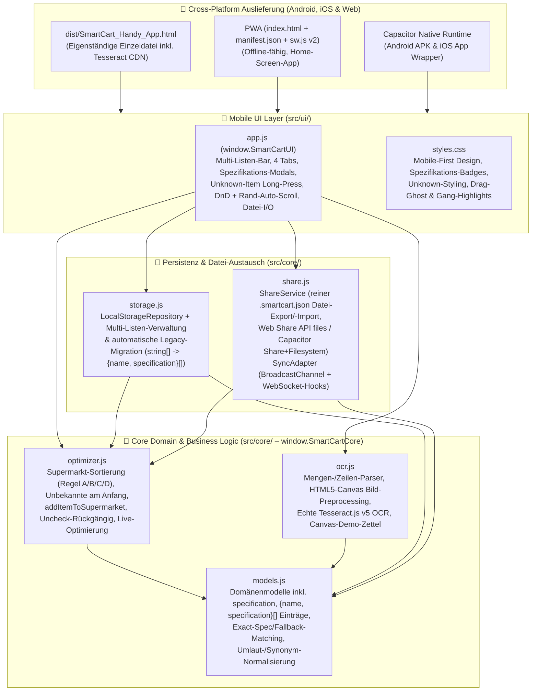
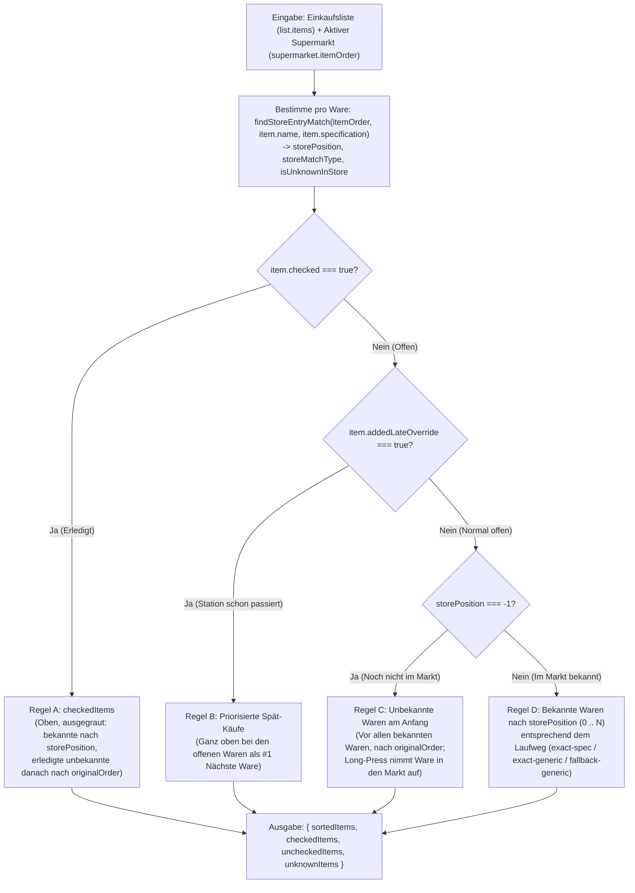

# 📐 SmartCart – Gesamtarchitektur, Algorithmen & Vollständige Funktionsreferenz

**Version:** `1.1.0`

Dieses Dokument beschreibt die technische Gesamtarchitektur, die mathematisch-logischen Algorithmen der Supermarkt-Laufweg-Optimierung (inklusive Spezifikations-Matching, Behandlung unbekannter Waren, Drag-and-Drop Auto-Scroll und rein dateibasiertem Listen-Export/-Import) sowie **jedes einzelne Modul und jede einzelne Funktion** der SmartCart Einkaufslisten-App (Aufgabe, Parameter, Rückgabewerte und konkrete technische Umsetzung). Darüber hinaus enthält es die Roadmap zur Weiterentwicklung (Echtzeit-Kollaboration, Store-Deployment) sowie die Anleitung für das GitHub-Projekt.

---

## Inhaltsverzeichnis

1. [Gesamtarchitektur & Schichtenmodell](#1-gesamtarchitektur--schichtenmodell)
   - [Architektur-Übersicht (Mermaid-Diagramm)](#11-architektur-übersicht-mermaid-diagramm)
   - [Die 5 Architektur-Schichten im Detail](#12-die-5-architektur-schichten-im-detail)
2. [Algorithmen im Detail](#2-algorithmen-im-detail)
   - [Supermarkt-Reihenfolge-Optimierung & Gruppierung (Regel A, B, C, D)](#21-supermarkt-reihenfolge-optimierung--gruppierung-regel-a-b-c-d)
   - [Spezifikations-/Marken-Matching & Mehrfach-Koexistenz im Supermarkt](#22-spezifikations-marken-matching--mehrfach-koexistenz-im-supermarkt)
   - [Unbekannte Waren am Listenanfang & Long-Press-Aufnahme](#23-unbekannte-waren-am-listenanfang--long-press-aufnahme)
   - [Rückgängig-Logik (Uncheck / Wiederherstellung der Laufposition)](#24-rückgängig-logik-uncheck--wiederherstellung-der-laufposition)
   - [Selbstlernender Live-Optimierungs-Algorithmus](#25-selbstlernender-live-optimierungs-algorithmus)
   - [Intelligentes nachträgliches Hinzufügen („Bereits vorbeigelaufen“-Erkennung)](#26-intelligentes-nachträgliches-hinzufügen-bereits-vorbeigelaufen-erkennung)
   - [Präzises Einfügen, Verschieben & Drag-and-Drop mit automatischem Rand-Scrollen](#27-präzises-einfügen-verschieben--drag-and-drop-mit-automatischem-rand-scrollen)
   - [Echte Kamera-OCR mit Tesseract.js v5 & HTML5-Canvas Bild-Vorverarbeitung](#28-echte-kamera-ocr-mit-tesseractjs-v5--html5-canvas-bild-vorverarbeitung)
   - [Ausschließlich dateibasierter Export & Import (`.smartcart.json`)](#29-ausschließlich-dateibasierter-export--import-smartcartjson)
3. [Vollständige Modul- und Funktionsreferenz](#3-vollständige-modul--und-funktionsreferenz)
   - [Modul 1: `src/core/models.js` (Domänenmodelle, Spezifikationen, Sortier-Vorlagen & Normalisierung)](#31-modul-1-srccoremodelsjs)
   - [Modul 2: `src/core/optimizer.js` (Sortier-, Unbekannte-Waren-, Vorige-Ware-, Spät-Kauf- & Live-Lern-Engine)](#32-modul-2-srccoreoptimizerjs)
   - [Modul 3: `src/core/ocr.js` (Text-Parser, Tesseract-OCR, Bild-Preprocessing & Demo-Generator)](#33-modul-3-srccoreocrjs)
   - [Modul 4: `src/core/storage.js` (Lokale Persistenz, Multi-Listen-Verwaltung, Legacy-Migration & Seeding)](#34-modul-4-srccorestoragejs)
   - [Modul 5: `src/core/share.js` (Datei-Export/-Import `.smartcart.json` & SyncAdapter)](#35-modul-5-srccoresharejs)
   - [Modul 6: `src/ui/app.js` (Mobile UI-Controller, Spezifikationen, Long-Press, DnD-Auto-Scroll & Datei-I/O)](#36-modul-6-srcuiappjs)
   - [Modul 7: `scripts/bundle-standalone.js` (Single-File-App-Bundler & Capacitor-Sync)](#37-modul-7-scriptsbundle-standalonejs)
4. [Weiterentwicklung & Roadmap (Echtzeit-Sharing, Cloud-Sync & App Stores)](#4-weiterentwicklung--roadmap-echtzeit-sharing-cloud-sync--app-stores)
5. [Empfehlung & Anleitung zum GitHub-Projekt](#5-empfehlung--anleitung-zum-github-projekt)

---

## 1. Gesamtarchitektur & Schichtenmodell

SmartCart folgt einer strikten **Clean-Architecture-Trennung** zwischen einer komplett abhängigkeitsfreien Geschäftslogik (`src/core/`) und einer reaktiven, mobil-optimierten Präsentationsschicht (`src/ui/`). Alle Kernmodule sind als universelle **UMD/IIFE-Module** konzipiert: Sie hängen ihre Exporte im Browser an `window.SmartCartCore` und exportieren sie gleichzeitig unter Node.js per CommonJS (`module.exports`). Dadurch laufen sowohl die automatisierten Unit-Tests (`tests/engine.test.js` und `tests/share.test.js`), die Web-App (`index.html`), die eigenständige 1-Datei-Smartphone-App (`dist/SmartCart_Handy_App.html`) als auch der native Capacitor-Build (`android/` & `ios/`) auf exakt demselben Code.

### 1.1 Architektur-Übersicht (Mermaid-Diagramm)



### 1.2 Die 5 Architektur-Schichten im Detail

1. **Core Domain & Optimizer Layer ([`src/core/models.js`](file:///home/manus/.gemini/antigravity/scratch/smartcart-app/src/core/models.js), [`src/core/optimizer.js`](file:///home/manus/.gemini/antigravity/scratch/smartcart-app/src/core/optimizer.js))**
   - Kapselt sämtliche Datenstrukturen (`Item` mit `specification`/`normalizedSpecification`, `Supermarket` mit kanonischen `{ name, specification }[]`-Einträgen in `itemOrder`, `ShoppingList`), die Übernahme einer bestehenden Supermarkt- oder Standard-Sortierung beim Anlegen neuer Märkte (`createSupermarketWithSorting`, `getDefaultItemOrder`), die sprachliche Normalisierung deutscher Artikelnamen (inklusive Umlaut-Faltung und 48 Synonym-/Plural-Äquivalenzgruppen), das zweistufige Spezifikations-Matching (`findStoreEntryMatch`) sowie alle Sortier-, Positionierungs- (`addItemToSupermarket`, `updateSupermarketKnownItem`, `addSupermarketKnownItemAfter`, `moveSupermarketItemAfter`, `reorderSupermarketItem`) und Lern-Algorithmen.
2. **OCR & Foto-Erkennungs-Pipeline ([`src/core/ocr.js`](file:///home/manus/.gemini/antigravity/scratch/smartcart-app/src/core/ocr.js))**
   - Mehrstufige Erkennungspipeline für abfotografierte Einkaufszettel: Führt für echte Kamerafotos eine automatische HTML5-Canvas-Bildoptimierung (`preprocessImageForOcr`: Skalierung, Graustufen-Histogramm, Auto-Levels-Kontrastspreizung und Hintergrund-Aufhellung) durch, lädt bei Bedarf `window.Tesseract` dynamisch nach (`ensureTesseractLoaded`) und liest den echten deutschen Text per `Tesseract.recognize(..., 'deu')` aus. Unterstützt außerdem 3 isolierte Canvas-Demo-Einkaufszettel (`GENERATED_SAMPLE_DATA_URLS`), ohne jemals echte Nutzerfotos mit Demo-Daten zu vermischen, sowie den regulären Ausdrucks-Parser (`parseShoppingLine`), der Mengenangaben (`2x`, `500g`, `1,5L`, `2 Dosen`) sauber vom Artikelnamen trennt.
3. **Lokale Persistenz, Multi-Listen-Verwaltung & Legacy-Migration ([`src/core/storage.js`](file:///home/manus/.gemini/antigravity/scratch/smartcart-app/src/core/storage.js))**
   - Das `LocalStorageRepository` kapselt alle Lese- und Schreibzugriffe auf `window.localStorage` unter versionierten Schlüsseln (`smartcart_supermarkets_v1`, `smartcart_lists_v1`, `smartcart_active_list_id_v1`). Es verwaltet beliebig viele benannte Einkaufszettel (`createNewShoppingList`, `renameShoppingList`, `duplicateShoppingList`, `switchShoppingList`, `deleteShoppingList`, `saveActiveList`) und migriert ältere gespeicherte Daten (Supermärkte mit `string[]`-`itemOrder` und Artikel ohne `specification`-Feld) beim Laden vollautomatisch und verlustfrei. Falls `localStorage` nicht verfügbar ist, schaltet `resolveStorageBackend` transparent auf `createMemoryStorage()` um.
4. **Datei-Export/-Import & Sync-Layer ([`src/core/share.js`](file:///home/manus/.gemini/antigravity/scratch/smartcart-app/src/core/share.js))**
   - `ShareService` realisiert den **ausschließlich dateibasierten** Export und Import von Einkaufslisten im Format `.smartcart.json` (Format-Version 2, abwärtskompatibel zu v1-Dateien). Exportierte Dateien werden auf dem Gerät gespeichert (`saveShoppingListFile` via Capacitor Filesystem oder Browser-Blob-Download) oder direkt als Datei über WhatsApp, E-Mail und Messenger geteilt (`shareShoppingListFile` via Capacitor Share+Filesystem oder Web Share API Level 2 `navigator.share({ files })` mit `canShare`-Prüfung). Alle älteren Share-Methoden (`SC1:`-Codes, Text-/Zwischenablage-Share, separates Markt-/Backup-Share) wurden vollständig entfernt.
   - `SyncAdapter` synchronisiert Änderungen im selben Browser weiterhin über die `BroadcastChannel`-API zwischen offenen Tabs/Fenstern und stellt Transport-Hooks (`remoteTransport`) für zukünftige Echtzeit-Synchronisation bereit.
5. **Mobile UI, PWA & Capacitor Cross-Platform Layer ([`src/ui/app.js`](file:///home/manus/.gemini/antigravity/scratch/smartcart-app/src/ui/app.js), [`src/ui/styles.css`](file:///home/manus/.gemini/antigravity/scratch/smartcart-app/src/ui/styles.css), [`scripts/bundle-standalone.js`](file:///home/manus/.gemini/antigravity/scratch/smartcart-app/scripts/bundle-standalone.js))**
   - Ein ohne externe Frameworks geschriebener, schneller Mobile-Controller mit 4 Hauptansichten (*Einkaufszettel*, *Foto-Scanner*, *Supermärkte*, *Export / Import*), prominenter Einkaufszettel-Verwaltungsleiste, Spezifikations-Eingabe- und Bearbeitungs-Modals (`#edit-item-modal`, `#edit-store-item-modal`), Long-Press-Geste für unbekannte Waren (`bindUnknownItemLongPress`), Touch-/Maus-Drag-and-Drop mit automatischem Rand-Scrollen (`requestAnimationFrame`), nativer Kamera-Anbindung, Service-Worker-Caching (`sw.js`, `smartcart-pwa-v2`) und Capacitor-Konfiguration (`capacitor.config.json`) für Android und iOS.

---

## 2. Algorithmen im Detail

### 2.1 Supermarkt-Reihenfolge-Optimierung & Gruppierung (Regel A, B, C, D)

Die Funktion `sortShoppingList(listOrItems, supermarket)` in [`src/core/optimizer.js`](file:///home/manus/.gemini/antigravity/scratch/smartcart-app/src/core/optimizer.js#L49-L126) berechnet bei jeder Änderung und bei jedem Wechsel des Supermarkts die optimale Darstellungsreihenfolge.

Dabei gelten vier streng priorisierte Regeln:

- **Regel A – Abgehakte Waren ausgegraut nach ganz oben (`checkedItems`)**:
  Alle Waren mit `item.checked === true` werden aus der aktiven Laufstrecke herausgenommen und im oberen Listenbereich (*„Bereits abgehakt (Erledigt)“*) ausgegraut und durchgestrichen dargestellt. Innerhalb von `checkedItems` werden bekannte Waren aufsteigend nach ihrer Supermarkt-Position (`storePosition`) sortiert; abgehakte unbekannte Waren (`storePosition === -1`) folgen dahinter in ihrer ursprünglichen Reihenfolge (`originalOrder`).
- **Regel B – Vorrang für nachträglich hinzugefügte bekannte Waren, deren Abteilung bereits passiert wurde (`addedLateOverride === true`)**:
  Unter den offenen Waren (`uncheckedItems`) werden alle Artikel mit dem Flag `addedLateOverride: true` an **Index 0 (ganz oben unter den offenen Waren)** gesetzt. Wurden mehrere solcher Artikel hinzugefügt, steht der zuletzt hinzugefügte ganz oben (`b.originalOrder - a.originalOrder`).
- **Regel C – Noch nicht im Supermarkt vorhandene Waren ganz am Anfang (`isUnknownInStore === true` / `storePosition === -1`)**:
  Unbekannte offene Waren, für die `findStoreEntryMatch(supermarket.itemOrder, item.name, item.specification)` keinen Treffer liefert (`storePosition === -1`), werden **ganz an den Anfang der offenen Einkaufsliste (vor allen bekannten Supermarkt-Waren)** in ihrer `originalOrder` eingereiht. So fallen fehlende Artikel sofort ins Auge und können per **Long-Press** direkt in den Supermarkt aufgenommen werden.
- **Regel D – Supermarkt-Laufreihenfolge für reguläre bekannte offene Waren (`supermarket.itemOrder`)**:
  Alle übrigen bekannten offenen Waren (`storePosition !== -1`) folgen aufsteigend nach `posA - posB` (bei gleicher Position Tie-Break über `originalOrder`).



---

### 2.2 Spezifikations-/Marken-Matching & Mehrfach-Koexistenz im Supermarkt

Jeder Einkaufslisten-Artikel trägt `specification` (bereinigter Anzeigetext, Standard `''`) sowie `normalizedSpecification`. Jeder Eintrag in `supermarket.itemOrder` hat kanonisch die Struktur `{ name: string, specification: string }`.

1. **Normalisierung von Spezifikationen (`normalizeSpecification`)**:
   - Unicode-NFC-Normalisierung, `trim()`, Umwandlung in Kleinbuchstaben (`toLowerCase()`) und Zusammenfassen mehrfacher interner Leerzeichen auf ein einzelnes Leerzeichen.
   - Bewusst **keine** Synonym- oder Fuzzy-Erweiterung bei Marken/Spezifikationen, damit z. B. `Oatly` und `Weihenstephan` strikt getrennt bleiben.
2. **Eindeutigkeit & Mehrfach-Koexistenz (`getStoreEntryKey`)**:
   - Der Deduplizierungsschlüssel eines Supermarkt-Eintrags lautet `"<normalizedName>::<normalizedSpecification>"` (z. B. `"milch::"`, `"milch::weihenstephan"`, `"milch::oatly"`).
   - Dadurch können in einem Supermarkt beliebig viele spezifizierte Einträge derselben Warengruppe **und** zusätzlich ein unspezifizierter Basis-Eintrag gleichzeitig an unterschiedlichen Positionen im Laufweg existieren.
   - Alle Bearbeitungsfunktionen (`findExactStoreEntryIndex`, `addSupermarketKnownItem*`, `moveSupermarketItemAfter`, `updateSupermarketKnownItem`, `removeSupermarketKnownItem`) arbeiten auf dieser exakten `(name, specification)`-Identität bzw. dem Zeilen-Index.
3. **Matching-Regel (`findStoreEntryMatch`)**:
   - **Fall 1 – Einkaufslisten-Ware HAT eine Spezifikation (`targetNormSpec !== ''`)**:
     1. Suche exakten `normalizedName` + exakte `normalizedSpecification` → `matchType: 'exact-spec'`.
     2. Suche kanonisches Namens-Synonym (`getCanonicalItemKey`) + exakte `normalizedSpecification` → `matchType: 'exact-spec'`.
     3. **Fallback**: Falls kein exakter Spezifikations-Treffer existiert, suche allgemeinen Supermarkt-Eintrag derselben Warengruppe **ohne Spezifikation** (`normSpec === ''`, erst `normalizedName`, dann Synonym) → `matchType: 'fallback-generic'`.
     4. Sonst kein Treffer (`index: -1`, `matchType: 'none'` → unbekannt). Eine abweichende Spezifikation (z. B. `Milch (Alpro)` vs. `Milch (Oatly)`) matcht **niemals** aufeinander.
   - **Fall 2 – Einkaufslisten-Ware hat KEINE Spezifikation (`targetNormSpec === ''`)**:
     1. Suche ausschließlich Einträge mit `normSpec === ''` (erst `normalizedName`, dann Synonym) → `matchType: 'exact-generic'`.
     2. Existiert im Markt nur ein spezifizierter Eintrag (z. B. nur `Milch (Oatly)`), gilt die unspezifizierte `Milch` als **nicht im Markt vorhanden** (`index: -1`, `matchType: 'none'`).

---

### 2.3 Unbekannte Waren am Listenanfang & Long-Press-Aufnahme

1. **Platzierung & Abhak-Verhalten**:
   - Offene Waren mit `storePosition === -1` (`isUnknownInStore: true`) stehen per **Regel C** am Anfang der offenen Waren (nach eventuellen `addedLateOverride`-Artikeln, aber vor allen bekannten Supermarkt-Waren) und erhalten in der UI die Klasse `.unknown-in-store` sowie das Attribut `data-unknown-item="true"`.
   - Beim **Abhaken** wechselt eine unbekannte Ware sauber in den erledigten Bereich (`checkedItems`), wo sie hinter den abgehakten bekannten Waren nach `originalOrder` einsortiert wird.
   - In `toggleItemCheck` werden unbekannte Waren am Listenanfang beim Ermitteln von `skippedItems` explizit ausgeblendet (`item.storePosition !== -1`), sodass das Abhaken regulärer bekannter Waren keine falsche Live-Optimierungs-Rückfrage wegen davor stehender unbekannter Artikel auslöst.
2. **Aufnahme per Long-Press (`bindUnknownItemLongPress` & `addItemToSupermarket`)**:
   - Ein Gedrückthalten von **550 ms** (Pointer Events mit Touch-/Maus-Fallback; visuelles Feedback `.long-pressing` ab 110 ms; Abbruch bei Bewegung `> 10 px` oder Scroll-Event; unterdrücktes Kontextmenü und deaktiviertes iOS-Touch-Callout) ruft `handleAddUnknownItemToSupermarket(itemId)` auf.
   - Der Core-Aufruf `addItemToSupermarket(supermarket, item, { list })` fügt den Eintrag `{ name, specification }` ans Ende der Supermarkt-Sortierliste an (ohne bestehende identische Einträge zu duplizieren) und sortiert die Einkaufsliste sofort neu.
   - Nach dem Loslassen verhindert eine pointerId-sichere Klick-Unterdrückung (inklusive `window`-Release-Cleanup für durch `renderApp()` entfernte Touch-DOM-Knoten), dass der abschließende Touch-Release versehentlich ein Abhaken auslöst oder den nächsten normalen Tap verschluckt.

---

### 2.4 Rückgängig-Logik (Uncheck / Wiederherstellung der Laufposition)

Wenn der Nutzer im oberen Bereich *„Bereits abgehakt (Erledigt)“* auf eine bereits abgehakte Ware tippt, um das Abhaken rückgängig zu machen, führt `toggleItemCheck(list, supermarket, itemId)` ([`src/core/optimizer.js`](file:///home/manus/.gemini/antigravity/scratch/smartcart-app/src/core/optimizer.js#L330-L361)) folgende Schritte aus:

1. Die Eigenschaften der Ware werden zurückgesetzt auf:
   - `checked: false`
   - `checkedAt: null`
   - `addedLateOverride: false`
2. Anschließend wird `sortShoppingList(updatedRawItems, supermarket)` aufgerufen.
3. Da `checked` nun `false` ist, fällt die Ware zurück in die Menge der offenen Waren (`uncheckedItems`) und wird anhand ihres Treffers aus `findStoreEntryMatch(supermarket.itemOrder, item.name, item.specification)` **wieder exakt an ihrer richtigen Supermarkt-Station** (bzw. bei weiterhin unbekannten Waren wieder am Listenanfang) einsortiert.

---

### 2.5 Selbstlernender Live-Optimierungs-Algorithmus

Die Funktion **Live-Optimierung** lässt sich direkt im Header der Einkaufsliste per Schalter (`list.liveOptimizationEnabled`) ein- und ausschalten.

#### Ablauf beim Abhaken einer offenen Ware (`toggleItemCheck` & `applyLiveOptimizationUpdate`)

```mermaid
sequenceDiagram
    actor User as Nutzer im Supermarkt
    participant UI as Mobile UI (app.js)
    participant Opt as Optimizer (optimizer.js)
    participant Store as Storage (storage.js)

    User->>UI: Tippt auf offene Ware W (z. B. "Milch (Oatly)") zum Abhaken
    UI->>Opt: toggleItemCheck(list, supermarket, itemId)
    Opt->>Opt: Berechne aktuelle uncheckedItems in Laufreihenfolge
    Opt->>Opt: Prüfe targetIsKnown (storePosition !== -1) und targetUncheckedIdx
    Opt->>Opt: skippedItems = bekannte offene Waren vor W (ohne addedLateOverride & ohne unbekannte)
    Opt->>Opt: Setze W auf checked = true, checkedAt = Date.now()

    alt liveOptimizationEnabled === true UND targetIsKnown UND skippedItems.length > 0
        Opt-->>UI: { action: 'checked', outOfOrderDetected: true, checkedItem: W, skippedItems, promptMessage }
        UI->>User: Öffnet Modal: "Reihenfolge im Supermarkt anpassen?<br/>Du hast „Milch (Oatly)“ vor „Hackfleisch“ abgehakt..."
        alt Nutzer klickt "Ja, Reihenfolge anpassen"
            User->>UI: Bestätigt Anpassung
            UI->>Opt: applyLiveOptimizationUpdate(supermarket, checkedItem, skippedItems)
            Opt->>Opt: Platziert exakten Eintrag W (mit Spezifikation) direkt VOR dem ersten skippedItem
            Opt-->>UI: Aktualisierter Supermarket + neu sortierte Einkaufsliste
            UI->>Store: Speichert aktualisierten Supermarkt & Liste
        else Nutzer klickt "Nein, nur abhaken"
            User->>UI: Lehnt Anpassung ab
            UI->>UI: Schließt Modal (Supermarkt-Reihenfolge bleibt unverändert)
        end
    else liveOptimizationEnabled === false ODER W unbekannt ODER keine übersprungenen bekannten Waren
        Opt-->>UI: { action: 'checked', outOfOrderDetected: false }
        UI->>Store: Speichert abgehakte Liste ohne Rückfrage
    end
```

1. **Erkennung einer Reihenfolge-Abweichung**:
   Bevor die Ware `target` auf `checked: true` gesetzt wird, prüft `toggleItemCheck`, ob `target` im Supermarkt bekannt ist (`targetIsKnown`) und an welchem Index `targetUncheckedIdx` sie innerhalb von `uncheckedItems` steht.
   - Falls `!wasLateOverride && targetIsKnown && targetUncheckedIdx > 0`, werden alle davor liegenden bekannten offenen Waren ohne `addedLateOverride` (`!item.addedLateOverride && item.storePosition !== -1`) als `skippedItems` gesammelt. Unbekannte Waren am Listenanfang werden dabei bewusst ignoriert.
   - Ist `list.liveOptimizationEnabled === true` und `skippedItems.length > 0`, liefert `toggleItemCheck` das Flag `outOfOrderDetected: true` sowie den deutschen Rückfragetext `promptMessage` (inkl. formatierter Spezifikationen über `formatItemDisplayName`) zurück.
2. **Dynamisches Umhängen unter Erhalt der Spezifikation (`applyLiveOptimizationUpdate`)**:
   Bestätigt der Nutzer den Dialog mit *„Ja, Reihenfolge anpassen“*, wird `applyLiveOptimizationUpdate(supermarket, checkedItemOrName, skippedItemsOrNames)` ([`src/core/optimizer.js`](file:///home/manus/.gemini/antigravity/scratch/smartcart-app/src/core/optimizer.js#L376-L448)) ausgeführt:
   - Es wird gezielt nach dem **exakten** Eintrag `(name, specification)` gesucht (`findExactStoreEntryIndex` bzw. `exact-spec`/`exact-generic`). Trägt die abgehakte Ware eine eigene Spezifikation, die bisher nur per Fallback über die allgemeine Warengruppe gematcht hatte, bleibt der allgemeine Eintrag unangetastet und die spezifizierte Ware wird als eigener Eintrag direkt vor dem ersten `skippedItem` eingefügt.

---

### 2.6 Intelligentes nachträgliches Hinzufügen („Bereits vorbeigelaufen“-Erkennung)

Fällt dem Nutzer **während des Einkaufs** (nachdem er bereits erste Waren im Markt abgehakt hat) noch ein Artikel ein, prüft `addItemToList(list, supermarket, { name, specification, quantity, category })` ([`src/core/optimizer.js`](file:///home/manus/.gemini/antigravity/scratch/smartcart-app/src/core/optimizer.js#L144-L205)) automatisch, ob der Nutzer die reguläre Abteilung dieser Ware im Supermarkt bereits passiert hat:

1. **Positionsbestimmung der neuen Ware**:
   Es wird `pos = indexOfNormalized(supermarket.itemOrder, name, cleanSpec)` ermittelt.
2. **Abgleich mit bereits abgehakten Waren**:
   Falls `pos !== -1` (die Ware hat einen festen Platz im Markt), iteriert der Algorithmus über alle aktuell bereits abgehakten Waren (`existing.checked === true`) auf dem Einkaufszettel und bestimmt deren Marktposition `checkedPos = indexOfNormalized(supermarket.itemOrder, existing.name, existing.specification)`.
3. **Entscheidungskriterium (`checkedPos > pos`)**:
   - **Fall 1: `checkedPos > pos` trifft für mindestens eine abgehakte Ware zu (`passedByItems.length > 0`)**:
     `wasAddedLate` und `addedLateOverride` werden auf `true` gesetzt. Durch **Regel B** in `sortShoppingList` erscheint die Ware sofort als erste offene Ware ganz oben mit orangenem Highlight und Toast-Hinweis.
   - **Fall 2: Keine abgehakte Ware liegt hinter `pos` (`passedByItems.length === 0`)**:
     Die Ware wird regulär an ihrer zukünftigen Laufposition `pos` (bzw. bei unbekannten Waren am Listenanfang gemäß Regel C) einsortiert.

---

### 2.7 Präzises Einfügen, Verschieben & Drag-and-Drop mit automatischem Rand-Scrollen

Um das Einrichten und Anpassen einer Supermarkt-Laufreihenfolge (`supermarket.itemOrder`) mit Dutzenden Stationen auf dem Smartphone und Desktop maximal komfortabel zu machen, kombiniert SmartCart vier komplementäre Mechanismen:

1. **Einfügen neuer Waren (mit optionaler Spezifikation) anhand der vorigen Ware (`addSupermarketKnownItemAfter`)**:
   - Im Formular `#add-store-item-form` können Artikelname (`#new-store-item-name`), optionale Spezifikation (`#new-store-item-spec`) sowie die **vorige Ware** (`#storeAddItemPreviousInput` mit `<datalist id="storeExistingItemsDatalist">`, inkl. formatierter Anzeige `"Name (Spezifikation)"`) angegeben werden.
   - Bei `'__START__'` wird an Position 1 (Index `0`) eingefügt, bei gefundener voriger Ware per `resolvePreviousItemIndex` unmittelbar dahinter (`prevIdx + 1`), sonst am Ende.
2. **Bearbeiten bestehender Supermarkt-Einträge (`openEditStoreItemModal` & `updateSupermarketKnownItem`)**:
   - Über den `✎`-Button jeder Zeile lassen sich Name und Spezifikation eines Supermarkt-Eintrags jederzeit ändern, ohne seine Position zu verlieren.
3. **Gezieltes Verschieben über den `⇄`-Dialog (`moveSupermarketItemAfter`)**:
   - Jede Zeile besitzt neben `↑`/`↓` einen `⇄`-Button (*„Gezielt verschieben“*). Im Modal `#move-store-item-modal` kann Position 1 oder per Suche/Schnellauswahl-Chip die neue vorige Ware (inkl. Spezifikation) gewählt werden.
4. **Touch- & Maus-Drag-and-Drop (`☰`) mit kontinuierlichem Rand-Auto-Scroll (`bindStoreOrderDragAndDrop`)**:
   - **Scroll-Container & sichtbare Grenzen**: `getDragScrollContainer(listEl)` erkennt automatisch den tatsächlichen Scroll-Container (`window` oder einen scrollbaren Ancestor). `getVisibleDragBounds(scrollContainer)` zieht automatisch die Höhe des sticky `.app-header` oben und der fixierten `.bottom-nav` unten ab, sodass die Auto-Scroll-Zonen (ca. 72 px am oberen und unteren Rand) immer im tatsächlich sichtbaren Bereich liegen.
   - **Kontinuierliche `requestAnimationFrame`-Schleife**: Sobald der Finger oder Mauszeiger beim Ziehen in die obere oder untere Randzone eintritt, berechnet `computeDragAutoScrollSpeed(clientY, bounds)` eine distanzabhängige Scrollgeschwindigkeit (sanft am Zonenrand, schneller je näher an der Kante) und scrollt in jedem Animation-Frame ruckelfrei weiter.
   - **Live-Zielaktualisierung & Mobile-Ghost**: Während des automatischen Scrollens wird fortlaufend `updateDropTargetAtPoint(clientX, clientY)` ausgeführt, damit die hervorgehobene Zielzeile (`.drag-over`) immer exakt unter dem Finger/Cursor bleibt. Beim mobilen Touch-Drag folgt eine schwebende Vorschau (`.drag-ghost`) dem Finger.
   - **Sauberes Aufräumen**: Beim Verlassen der Randzone, Loslassen (`drop`, `dragend`, `touchend`, `touchcancel`), Fenster-`blur` oder Tab-Wechsel (`switchTab`) beendet `stopDragAutoScroll()` sofort die rAF-Schleife, entfernt das Ghost-Element und setzt alle Drag-Indizes und CSS-Klassen zurück.

---

### 2.8 Echte Kamera-OCR mit Tesseract.js v5 & HTML5-Canvas Bild-Vorverarbeitung

Beim Fotografieren eines echten Einkaufszettels im Tab *„Foto-Scanner“* durchläuft das Bild eine mehrstufige Pipeline in [`src/core/ocr.js`](file:///home/manus/.gemini/antigravity/scratch/smartcart-app/src/core/ocr.js):

1. **Strikte Trennung zwischen Demo-Zetteln und echten Nutzerfotos (`detectPresetFromSource`)**:
   - Nur wenn der Nutzer explizit auf einen der 3 Demo-Buttons (`'wochenende'`, `'fruehstueck'`, `'italienisch'`) tippt – deren generierte Data-URLs im `Set` `GENERATED_SAMPLE_DATA_URLS` registriert sind –, werden die Demo-Zeilen verwendet.
   - Für jedes echte Kamerafoto oder Galeriebild liefert `detectPresetFromSource` garantiert `null`, sodass **niemals** falsche Demo-Artikel für ein echtes Foto angezeigt werden.
2. **Automatische Bild-Vorverarbeitung auf HTML5-Canvas (`preprocessImageForOcr`)**:
   - Skaliert das Bild proportional auf `700px .. 1800px` Kantenlänge, wandelt alle Pixel nach der Luminanzformel `0.299*R + 0.587*G + 0.114*B` in Graustufen um und spreizt den Kontrast anhand des 3 %- und 90 %-Perzentils (Auto-Levels + Hintergrund-Aufhellung auf Weiß und Abdunklung der Schrift).
3. **Dynamisches Laden & Ausführen von Tesseract.js (`ensureTesseractLoaded` & `recognizeImageShoppingList`)**:
   - Lädt bei Bedarf Tesseract.js v5 von jsDelivr (Fallback unpkg) nach, führt `Tesseract.recognize(processedImage, 'deu', { logger })` aus und übergibt den Rohtext an `parseShoppingText(rawText)`.

---

### 2.9 Ausschließlich dateibasierter Export & Import (`.smartcart.json`)

Um Einkaufslisten sauber und plattformübergreifend zwischen Geräten auszutauschen, unterstützt SmartCart ab Version `1.1.0` **ausschließlich dateibasierten Export und Import** in [`src/core/share.js`](file:///home/manus/.gemini/antigravity/scratch/smartcart-app/src/core/share.js). Alle früheren Share-Mechanismen (`SC1:`-Base64-Share-Codes, Plaintext-/Messenger-Text-Teilen, Zwischenablage-Kopieren, separates Supermarkt- oder Vollbackup-Sharing) wurden vollständig entfernt.

1. **Dateiformat (`.smartcart.json`, Format-Version 2)**:
   - Dateiname: `SmartCart_<bereinigter-Listenname>_YYYY-MM-DD.smartcart.json` (`buildShoppingListFilename`).
   - Struktur: `{ app: "SmartCart", format: "smartcart-shopping-list", version: 2, type: "shopping_list", exportedAt, list: { id, name, supermarketId, liveOptimizationEnabled, updatedAt, items: [...] }, supermarket: { id, name, icon, color } | null }`.
   - Jeder Artikel speichert vollständig `id`, `name`, `specification`, `quantity`, `category`, `checked`, `checkedAt`, `addedLateOverride` und `originalOrder`.
2. **Export-Pfade**:
   - **Auf Gerät speichern (`saveShoppingListFile`)**: Nutzt in einer nativen Capacitor-App `Capacitor.Plugins.Filesystem.writeFile` (Verzeichnis `DOCUMENTS`), andernfalls einen Browser-Blob-Download (`triggerBrowserDownload`).
   - **Als Datei teilen (`shareShoppingListFile`)**: Teilt **strikt als Dateianhang** (niemals als Text oder über die Zwischenablage):
     - Nativ über `Capacitor.Plugins.Filesystem` (`CACHE`) + `Capacitor.Plugins.Share.share({ files: [uri], ... })`.
     - Im Browser/PWA über Web Share API Level 2 (`navigator.share({ files: [file], title })`), abgesichert durch `navigator.canShare({ files })` (inklusive MIME-Probe für `application/json` und Fallback-Probe `text/plain`, falls ein mobiler Browser `application/json` beim Dateisharing ablehnt).
     - Nutzerabbruch (`AbortError`) wird sauber als `{ aborted: true, method: 'aborted' }` gemeldet, ohne ungewollten Download. Wird direktes Datei-Teilen vom Browser nicht unterstützt (z. B. Desktop-Browser), speichert `fallbackToSave: true` automatisch die Datei auf dem Gerät (`method: 'save-fallback'`).
3. **Import-Validierung & Modi (`readShoppingListFile`, `parseShoppingListFileContent`, `applyImportedShoppingList`)**:
   - Akzeptiert `.smartcart.json` und `.json` bis maximal **5 MB** (`MAX_IMPORT_FILE_BYTES`), entfernt optionale UTF-8-BOMs und weist leere, defekte, fremde oder veraltete `SC1:`-Daten mit klaren deutschen Fehlermeldungen ab. Ältere v1-JSON-Dateien ohne `specification`-Feld werden abwärtskompatibel eingelesen (`specification: ''`).
   - Beim Anwenden stehen drei Modi zur Wahl:
     - **`'new'` (Standard)**: Legt einen neuen benannten Einkaufszettel mit frischen IDs an (bei Namenskollision automatisch mit Suffix `(Import)`).
     - **`'merge'`**: Führt importierte Artikel in den aktuell aktiven Einkaufszettel ein und dedupliziert per `getStoreEntryKey(name, specification)` (dieselbe Ware mit unterschiedlicher Spezifikation bleibt getrennt erhalten!).
     - **`'replace'`**: Ersetzt die Artikel der aktuellen Liste unter Beibehaltung ihrer Listen-ID.
   - Der passende lokale Supermarkt wird automatisch per ID → Marktname → Fallback ermittelt (`resolveTargetSupermarket`) und die Liste unmittelbar über `sortShoppingList` sortiert, sodass sie sofort einsatzbereit ist.

---

## 3. Vollständige Modul- und Funktionsreferenz

Im Folgenden sind **alle 7 Module** und **jede einzelne Funktion** des Projekts mit ihren Parametern, Rückgabewerten, ihrer fachlichen Aufgabe (*„Was macht die Funktion?“*) und ihrer konkreten technischen Implementierung (*„Wie ist sie aktuell umgesetzt?“*) dokumentiert.

---

### 3.1 Modul 1: `src/core/models.js`

**Pfad**: [`src/core/models.js`](file:///home/manus/.gemini/antigravity/scratch/smartcart-app/src/core/models.js)  
**Verantwortung**: Domänenmodelle (`Item` mit optionaler `specification`, `Supermarket` mit `{ name, specification }[]`-Sortiereinträgen, `ShoppingList`), Übernahme von Sortier-Vorlagen beim Anlegen neuer Supermärkte, sprachliche Normalisierung deutscher Artikelnamen, Spezifikations-Normalisierung & -Matching, Synonym-/Plural-Auflösung, Abteilungs-Erkennung und Standard-Supermärkte (`REWE`, `ALDI`, `LIDL`).

#### 1. `generateId(prefix = 'id')`
- **Parameter**: `prefix` (`string`, optional, Standard: `'id'`) – Präfix für die generierte ID (z. B. `'item'`, `'store'`, `'list'`).
- **Rückgabewert**: `string` – Eindeutige ID im Format `<prefix>_<timestampBase36>_<randomBase36>`.
- **Was macht die Funktion?** Erzeugt eine kollisionsfreie, menschenlesbare eindeutige ID für Waren, Supermärkte und Einkaufslisten.
- **Wie ist sie aktuell umgesetzt?** Kombiniert `Date.now().toString(36)` mit einem 6-stelligen Zufallsstring aus `Math.random().toString(36).substring(2, 8)`.

#### 2. `normalizeItemName(name)`
- **Parameter**: `name` (`string`) – Roher Artikelname (z. B. `"  Äpfel (Bio) "`).
- **Rückgabewert**: `string` – Normalisierter Vergleichsschlüssel (z. B. `"aepfel bio"`).
- **Was macht die Funktion?** Bereinigt und normalisiert deutsche Artikelnamen für einen fehlertoleranten Vergleich zwischen Benutzereingaben und Supermarkt-Konfigurationen (unabhängig von Groß-/Kleinschreibung, Umlauten oder Sonderzeichen).
- **Wie ist sie aktuell umgesetzt?** Wandelt in Kleinbuchstaben um, ersetzt deutsche Umlaute (`ä -> ae`, `ö -> oe`, `ü -> ue`, `ß -> ss`), entfernt diakritische Zeichen via NFD-Dekomposition und bereinigt Sonder- sowie mehrfache Leerzeichen.

#### 3. `cleanSpecification(specification)` & `normalizeSpecification(specification)`
- **Parameter**: `specification` (`string | null | undefined`) – Optionale Spezifikation / Marke (z. B. `"  Weihenstephan  1,5% "`).
- **Rückgabewert**: `string` – Bereinigter Anzeigetext (`cleanSpecification`, Standard `''`) bzw. normalisierter Vergleichsschlüssel (`normalizeSpecification`, Standard `''`).
- **Was machen die Funktionen?** `cleanSpecification` trimmt den Wert für Speicherung und Anzeige. `normalizeSpecification` erzeugt den exakten Matching- und Deduplizierungsschlüssel per Unicode-NFC, `trim()`, `toLowerCase()` und Zusammenfassung interner Leerzeichen (`/\s+/g -> ' '`), bewusst ohne Synonym- oder Fuzzy-Erweiterung.

#### 4. `createStoreEntry(entryOrName, specification)` *(Alias: `normalizeStoreEntry`)*
- **Parameter**: `entryOrName` (`string | { name: string, specification?: string }`), `specification` (`string`, optional).
- **Rückgabewert**: `{ name: string, specification: string } | null`.
- **Was macht die Funktion?** Normalisiert sowohl ältere String-Einträge (`"Milch"`) als auch Objekt-Einträge (`{ name: 'Milch', specification: 'Oatly' }`) in das kanonische Supermarkt-Eintragsformat `{ name, specification }`. Gibt `null` zurück, wenn kein gültiger Produktname vorhanden ist.

#### 5. `getStoreEntryKey(entryOrName, specification)`
- **Parameter**: `entryOrName` (`string | Object`), `specification` (`string`, optional).
- **Rückgabewert**: `string` – Eindeutiger zusammengesetzter Schlüssel `"<normalizedName>::<normalizedSpecification>"` (oder `''`).
- **Was macht die Funktion?** Erzeugt den Deduplizierungs- und Identitätsschlüssel für Supermarkt-Einträge sowie den Merge-Import, sodass dieselbe Warengruppe mehrfach mit verschiedenen Spezifikationen und/oder ohne Spezifikation koexistieren kann.

#### 6. `formatItemDisplayName(itemOrName, specification)`
- **Parameter**: `itemOrName` (`string | Object`), `specification` (`string`, optional).
- **Rückgabewert**: `string` – `"Name (Spezifikation)"` falls eine Spezifikation gesetzt ist, sonst `"Name"`.
- **Was macht die Funktion?** Formatiert Artikel und Supermarkt-Einträge konsistent für Rückfragetexte, Toasts und Autocomplete-Listen.

#### 7. `getCanonicalItemKey(name)`
- **Parameter**: `name` (`string`) – Artikelname im Singular, Plural oder als Synonym (z. B. `"Vollmilch"`, `"Brötchen"`, `"Semmeln"`, `"Klopapier"`).
- **Rückgabewert**: `string` – Kanonischer Grundbegriff (z. B. `"milch"`, `"broetchen"`, `"toilettenpapier"`).
- **Was macht die Funktion?** Führt deutsche Singular-/Pluralformen und gängige regionale Synonyme über 48 `EQUIVALENCE_GROUPS` in einer `SYNONYM_LOOKUP`-Map zusammen.

#### 8. `findStoreEntryMatch(itemOrder, itemNameOrEntry, specification)`
- **Parameter**:
  - `itemOrder` (`Array<string | { name: string, specification?: string }>`) – Geordnete Sortierliste des Supermarkts.
  - `itemNameOrEntry` (`string | Object`) – Gesuchte Ware.
  - `specification` (`string`, optional) – Optionale Spezifikation.
- **Rückgabewert**: `{ index: number, matchType: 'exact-spec'|'exact-generic'|'fallback-generic'|'none', entry: { name: string, specification: string } | null }`.
- **Was macht die Funktion?** Implementiert die zweistufige Spezifikations-Matching-Regel: Hat die Einkaufslisten-Ware eine Spezifikation, wird zuerst auf exakte `normalizedSpecification` (exakter Name, dann Synonym → `'exact-spec'`) geprüft; andernfalls erfolgt der Fallback auf den unspezifizierten Warengruppen-Eintrag (`normSpec === ''` → `'fallback-generic'`). Hat die Ware keine Spezifikation, matcht sie ausschließlich Einträge mit `normSpec === ''` (`'exact-generic'`) und niemals rein spezifizierte Einträge.

#### 9. `indexOfNormalized(itemOrder, itemNameOrEntry, specification)`
- **Parameter**: `itemOrder`, `itemNameOrEntry`, optional `specification`.
- **Rückgabewert**: `number` – 0-basierter Index in `itemOrder` oder `-1`.
- **Was macht die Funktion?** Kurzform von `findStoreEntryMatch(...).index` für die Positionsbestimmung im Supermarkt inklusive Fallback-Regel.

#### 10. `findExactStoreEntryIndex(itemOrder, itemNameOrEntry, specification)`
- **Parameter**: `itemOrder`, `itemNameOrEntry`, optional `specification`.
- **Rückgabewert**: `number` – 0-basierter Index oder `-1`.
- **Was macht die Funktion?** Sucht den exakten Supermarkt-Eintrag über `getStoreEntryKey(...)` **ohne** Fallback auf unspezifizierte Einträge (genutzt für Deduplizierung, Einfügen, Bearbeiten, Verschieben und Löschen im Supermarkt).

#### 11. `guessItemCategory(nameOrEntry)`
- **Parameter**: `nameOrEntry` (`string | Object`) – Name oder Eintrag der Ware.
- **Rückgabewert**: `string` – Deutsche Abteilungsbezeichnung (`'Obst & Gemüse'`, `'Backwaren'`, `'Kühlregal & Milch'`, `'Fleisch & Wurst'`, `'Trockensortiment'`, `'Getränke'`, `'Tiefkühl'`, `'Haushalt & Drogerie'` oder `'Sonstiges'`).
- **Was macht die Funktion?** Ordnet jedem Artikelnamen automatisch eine passende Supermarkt-Abteilung für UI-Badges zu.

#### 12. `createItem({ id, name, specification, quantity, category, checked, checkedAt, addedLateOverride, originalOrder })`
- **Parameter**: Options-Objekt mit `id`, `name`, `specification` (`string`, Standard `''`), `quantity` (Standard `'1x'`), `category`, `checked`, `checkedAt`, `addedLateOverride`, `originalOrder`.
- **Rückgabewert**: `Item`-Objekt (`{ id, name, normalizedName, specification, normalizedSpecification, quantity, category, checked, checkedAt, addedLateOverride, originalOrder }`).
- **Was macht die Funktion?** Erzeugt ein validiertes, normiertes Einkaufslisten-Artikel-Objekt inklusive bereinigter und normalisierter Spezifikation.

#### 13. `createSupermarket({ id, name, icon, color, itemOrder, sourceSupermarketId, supermarkets, updatedAt })`
- **Parameter**: Options-Objekt mit `id`, `name`, `icon`, `color`, `itemOrder` (`Array<string | { name, specification }>`), optional `sourceSupermarketId` & `supermarkets`, `updatedAt`.
- **Rückgabewert**: `Supermarket`-Objekt (`{ id, name, icon, color, itemOrder: Array<{ name, specification }>, updatedAt }`).
- **Was macht die Funktion?** Erzeugt eine validierte Supermarkt-Konfiguration, migriert ältere `string[]`-Einträge transparent zu `{ name, specification }` und dedupliziert per `getStoreEntryKey` (`"<normalizedName>::<normalizedSpecification>"`), sodass unterschiedliche Spezifikationen derselben Warengruppe erhalten bleiben.

#### 14. `getDefaultSupermarkets()`
- **Parameter**: Keine.
- **Rückgabewert**: `Supermarket[]` – Array mit 3 vollständig konfigurierten deutschen Standard-Supermärkten (`REWE`, `ALDI`, `LIDL`) im kanonischen `{ name, specification }`-Format.

#### 15. `getDefaultItemOrder()`
- **Parameter**: Keine.
- **Rückgabewert**: `Array<{ name: string, specification: string }>` – Frische tiefe Kopie der Standard-Warenreihenfolge.

#### 16. `createSupermarketWithSorting({ id, name, icon = '🛒', color = '#2563eb', sourceSupermarketId = 'default', supermarkets = [], itemOrder = null, updatedAt = null })`
- **Parameter**: Options-Objekt mit optionaler `sourceSupermarketId` (`'default'` oder ID/Name eines bestehenden Marktes).
- **Rückgabewert**: `Supermarket` – Neu angelegter Supermarkt mit übernommener Warenreihenfolge (inkl. aller Spezifikationen des Quellmarkts).

#### 17. `createShoppingList({ id, name, supermarketId, liveOptimizationEnabled, items, updatedAt })`
- **Parameter**: Options-Objekt für die Einkaufsliste.
- **Rückgabewert**: `ShoppingList`-Objekt (`{ id, name, supermarketId, liveOptimizationEnabled, items, updatedAt }`).

---

### 3.2 Modul 2: `src/core/optimizer.js`

**Pfad**: [`src/core/optimizer.js`](file:///home/manus/.gemini/antigravity/scratch/smartcart-app/src/core/optimizer.js)  
**Verantwortung**: Sortier-Engine für Supermarkt-Laufwege (Regeln A–D inkl. unbekannter Waren am Anfang und Spezifikations-Matching), Aufnahme unbekannter Waren (`addItemToSupermarket`), Rückgängig-Logik beim Uncheck, „Bereits vorbeigelaufen“-Erkennung, selbstlernende Live-Optimierung sowie präzises Einfügen, Bearbeiten und Verschieben von Supermarkt-Einträgen.

#### 1. `sortShoppingList(listOrItems, supermarket)`
- **Parameter**: `listOrItems` (`ShoppingList | Item[]`), `supermarket` (`Supermarket`).
- **Rückgabewert**: `{ sortedItems: Item[], checkedItems: Item[], uncheckedItems: Item[], unknownItems: Item[] }`.
- **Was macht die Funktion?** Sortiert alle Artikel nach Regeln A–D: (A) `checkedItems` oben (bekannte nach `storePosition`, erledigte unbekannte nach `originalOrder`), (B) `addedLateOverride` zuerst unter offenen Waren, (C) unbekannte offene Waren (`isUnknownInStore: true`, `storePosition === -1`) **am Anfang** vor den bekannten offenen Waren, (D) bekannte offene Waren in Laufreihenfolge.
- **Wie ist sie aktuell umgesetzt?** Annotiert jedes geklonte Item über `findStoreEntryMatch(itemOrder, item.name, cleanSpec)` mit `specification`, `normalizedSpecification`, `storePosition`, `storeMatchType`, `matchedStoreEntry` und `isUnknownInStore` und liefert zusätzlich `unknownItems` als gefiltertes Array zurück.

#### 2. `addItemToList(list, supermarket, { name, specification = '', quantity = '1x', category = null })`
- **Parameter**: `list`, `supermarket`, `{ name, specification, quantity, category }`.
- **Rückgabewert**: `{ list: ShoppingList, addedItem: Item, wasAddedLate: boolean, passedByItems: Item[] }`.
- **Was macht die Funktion?** Fügt eine Ware (inkl. optionaler Spezifikation) zur Einkaufsliste hinzu, prüft über `indexOfNormalized(itemOrder, name, cleanSpec)` auf bereits passierte Stationen und sortiert die Liste neu.

#### 3. `addMultipleItemsToList(list, supermarket, itemInputs = [])`
- **Parameter**: `list`, `supermarket`, `itemInputs` (`Array<{ name, specification?, quantity?, category? }>`).
- **Rückgabewert**: `{ list: ShoppingList, addedItems: Item[], lateItems: Item[] }`.
- **Was macht die Funktion?** Fügt mehrere Waren in einem Schritt hinzu und wendet für jede Ware die „Bereits vorbeigelaufen“-Erkennung an.

#### 4. `toggleItemCheck(list, supermarket, itemId)`
- **Parameter**: `list`, `supermarket`, `itemId` (`string`).
- **Rückgabewert**: `{ list, action: 'checked'|'unchecked'|'noop', outOfOrderDetected, checkedItem?, uncheckedItem?, skippedItems, promptMessage }`.
- **Was macht die Funktion?** Schaltet den Erledigt-Status um. Beim Abhaken werden nur bekannte übersprungene offene Waren (`!item.addedLateOverride && item.storePosition !== -1`) gezählt, sodass unbekannte Waren am Listenanfang keine falsche Live-Optimierungs-Rückfrage auslösen; `promptMessage` verwendet `formatItemDisplayName`. Beim Uncheck wird die Ware wieder an ihrer regulären Position (bzw. bei Unbekannten am Anfang) einsortiert.

#### 5. `applyLiveOptimizationUpdate(supermarket, checkedItemOrName, skippedItemsOrNames)`
- **Parameter**: `supermarket`, `checkedItemOrName` (`string | Object`), `skippedItemsOrNames` (`Array<string | Object> | string | Object`).
- **Rückgabewert**: `Supermarket` – Aktualisierte Supermarkt-Konfiguration.
- **Was macht die Funktion?** Verschiebt bzw. fügt den exakten Eintrag `(name, specification)` der vorgezogenen Ware direkt vor der ersten übersprungenen Ware ein, ohne allgemeine Warengruppen-Einträge zu überschreiben, falls eine spezifische Marke vorgezogen wurde.

#### 6. `changeListSupermarket(list, newSupermarket)`
- **Parameter**: `list`, `newSupermarket`. **Rückgabewert**: `ShoppingList`.
- **Was macht die Funktion?** Wechselt den Supermarkt einer Einkaufsliste und sortiert alle Waren sofort neu.

#### 7. `setLiveOptimization(list, enabled)`
- **Parameter**: `list`, `enabled` (`boolean`). **Rückgabewert**: `ShoppingList`.
- **Was macht die Funktion?** Schaltet `liveOptimizationEnabled` ein oder aus.

#### 8. `removeItemFromList(list, supermarket, itemId)`
- **Parameter**: `list`, `supermarket`, `itemId`. **Rückgabewert**: `ShoppingList`.
- **Was macht die Funktion?** Entfernt einen einzelnen Artikel per `itemId` und sortiert die Liste neu.

#### 9. `updateItemInList(list, supermarket, itemId, updates = {})`
- **Parameter**: `list`, `supermarket`, `itemId`, `updates` (`{ name?, specification?, quantity?, category? }`).
- **Rückgabewert**: `ShoppingList` – Aktualisierte und neu sortierte Einkaufsliste.
- **Was macht die Funktion?** Aktualisiert Name, optionale Spezifikation, Menge oder Kategorie eines Einkaufslisten-Artikels und berechnet die Sortierung (inkl. Spezifikations-Matching) sofort neu.

#### 10. `clearCheckedItems(list, supermarket)` & `uncheckAllItems(list, supermarket)`
- **Parameter**: `list`, `supermarket`. **Rückgabewert**: `ShoppingList`.
- **Was machen die Funktionen?** Entfernen alle erledigten Waren bzw. setzen alle Waren wieder auf offen (`checked: false`) in sauberer Supermarkt-Sortierung.

#### 11. `reorderSupermarketItem(supermarket, fromIndex, toIndex)`
- **Parameter**: `supermarket`, `fromIndex`, `toIndex`. **Rückgabewert**: `Supermarket`.
- **Was macht die Funktion?** Verschiebt einen `{ name, specification }`-Eintrag per Index (genutzt für Drag & Drop mit Auto-Scroll und `↑`/`↓`).

#### 12. `attachStorePositionMetadata(updatedStore, meta)`, `isStartMarker(prev)` & `resolvePreviousItemIndex(order, previousItem)` *(interne Hilfsfunktionen)*
- **Was machen die Funktionen?** `attachStorePositionMetadata` hängt nicht-enumerable Metadaten (`.supermarket`, `.insertedAtIndex`, `.newIndex`, `.foundPrevious`, `.previousItem`, `.movedItem`) an. `isStartMarker` erkennt Position-1-Marker (`'__START__'`, `'anfang'` usw.). `resolvePreviousItemIndex` löst `previousItem` wahlweise als `{ name, specification }`-Objekt, exakten generischen Namen, formatierten Anzeigenamen `"Name (Spezifikation)"` (aus der UI-Datalist) oder Synonym auf.

#### 13. `addSupermarketKnownItemAfter(supermarket, itemOrName, previousItemName = null, specification = undefined)`
- **Parameter**: `supermarket`, `itemOrName` (`string | { name, specification? }`), `previousItemName` (`string | Object | null`), optional `specification`.
- **Rückgabewert**: `Supermarket` (mit Positionierungs-Metadaten; `movedItem`/`previousItem` sind `{ name, specification }`-Objekte bzw. `'__START__'`/`null`).
- **Was macht die Funktion?** Fügt einen Eintrag mit exakter `(name, specification)`-Identität unmittelbar hinter `previousItemName` (oder an Index `0` bzw. am Ende) ein, ohne andere Spezifikationen derselben Warengruppe zu beeinträchtigen.

#### 14. `moveSupermarketItemAfter(supermarket, itemOrIndex, previousItemName)`
- **Parameter**: `supermarket`, `itemOrIndex` (`number | string | { name, specification? }`), `previousItemName`.
- **Rückgabewert**: `Supermarket` (mit Positionierungs-Metadaten).
- **Was macht die Funktion?** Verschiebt einen bestehenden Supermarkt-Eintrag (bevorzugt per Index oder exaktem Objekt) gezielt hinter `previousItemName` oder an Position 1.

#### 15. `addSupermarketKnownItem(supermarket, itemOrName, insertIndex = -1, specification = undefined)`
- **Parameter**: `supermarket`, `itemOrName`, `insertIndex` (`number | string | Object`), optional `specification`.
- **Rückgabewert**: `Supermarket`.
- **Was macht die Funktion?** Fügt eine Ware mit optionaler Spezifikation an einem Index (oder bei Übergabe eines Strings/Objekts über `addSupermarketKnownItemAfter`) ein; dedupliziert über `findExactStoreEntryIndex`.

#### 16. `updateSupermarketKnownItem(supermarket, indexOrEntry, updates = {})`
- **Parameter**: `supermarket`, `indexOrEntry` (`number | string | { name, specification? }`), `updates` (`{ name?, specification? }`).
- **Rückgabewert**: `Supermarket` – Aktualisierte Supermarkt-Konfiguration.
- **Was macht die Funktion?** Ändert Name und/oder Spezifikation eines bestehenden Supermarkt-Eintrags an Ort und Stelle (genutzt vom Bearbeiten-Modal `#edit-store-item-modal`).

#### 17. `removeSupermarketKnownItem(supermarket, itemOrIndex, specification = undefined)`
- **Parameter**: `supermarket`, `itemOrIndex` (`number | string | { name, specification? }`), optional `specification`.
- **Rückgabewert**: `Supermarket`.
- **Was macht die Funktion?** Löscht ausschließlich den per Index oder exaktem `getStoreEntryKey(itemOrIndex, specification)` adressierten Eintrag, sodass andere Spezifikationen derselben Warengruppe erhalten bleiben.

#### 18. `addItemToSupermarket(supermarket, itemOrName, { specification, insertIndex = -1, previousItem = null, list = null } = {})`
- **Parameter**: `supermarket`, `itemOrName` (Einkaufslisten-Item oder Name), Options-Objekt (`specification`, `insertIndex`, `previousItem`, optional `list`).
- **Rückgabewert**: `{ supermarket: Supermarket, list: ShoppingList|null, added: boolean, alreadyExists: boolean, entry: { name, specification }|null, index: number }`.
- **Was macht die Funktion?** Nimmt eine noch unbekannte Einkaufslisten-Ware (inklusive optionaler Spezifikation) über Long-Press oder API in die Supermarkt-Sortierliste auf, verhindert Duplikate bei bereits exakt vorhandenem Eintrag (`alreadyExists: true`) und sortiert eine übergebene `list` sofort neu.

---

### 3.3 Modul 3: `src/core/ocr.js`

**Pfad**: [`src/core/ocr.js`](file:///home/manus/.gemini/antigravity/scratch/smartcart-app/src/core/ocr.js)  
**Verantwortung**: Text- und Zeilen-Parser für Einkaufszettel, HTML5-Canvas-Bildvorverarbeitung (`preprocessImageForOcr`), dynamisches Laden und Ausführen von echter Tesseract.js v5 OCR (`ensureTesseractLoaded`, `recognizeImageShoppingList`) sowie Generierung der 3 isolierten Demo-Einkaufszettel-Fotos (`generateSamplePhotoDataUrl`).

#### 1. `getSamplePhotoPresets()`
- **Parameter**: Keine.
- **Rückgabewert**: `Array<Preset>` – Array der 3 integrierten Demo-Einkaufszettel-Vorlagen (`wochenende`, `fruehstueck`, `italienisch`).
- **Was macht die Funktion?** Liefert die Metadaten, Papier-/Stiftfarben und Textzeilen der 3 Beispiel-Einkaufszettel.
- **Wie ist sie aktuell umgesetzt?** Gibt `Object.values(SAMPLE_PHOTO_PRESETS)` zurück.

#### 2. `parseShoppingLine(rawLine)`
- **Parameter**: `rawLine` (`string`) – Einzelne Textzeile aus einem OCR-Scan oder Textfeld (z. B. `"- 2 Dosen Passierte Tomaten"` oder `"[ ] 500g Hackfleisch"`).
- **Rückgabewert**: `{ name: string, quantity: string, category: string, rawLine: string } | null`.
- **Was macht die Funktion?** Zerlegt eine einzelne Einkaufszettel-Zeile in Artikelname, Mengenangabe und Supermarkt-Abteilung und filtert Überschriften (`"Einkaufszettel Samstag"`) oder Leerzeilen als `null` heraus.
- **Wie ist sie aktuell umgesetzt?** Entfernt zuerst Aufzählungszeichen, Checkboxen (`[ ]`, `☐`, `-`, `•`) und Nummerierungen (`1.`) am Zeilenanfang per Regex. Prüft gegen `HEADER_NOISE_PATTERNS`. Wendet anschließend drei spezialisierte reguläre Ausdrücke an:
  1. `leadingUnitRegex`: Erkennt vorangestellte Mengen mit Einheit (`2x Milch`, `500g Mehl`, `1,5L Orangensaft`, `2 Dosen Passierte Tomaten`).
  2. `trailingUnitRegex`: Erkennt nachgestellte Mengen (`Milch (2L)`, `Tomaten - 500g`, `Cola 1,5L`).
  3. `leadingCountRegex`: Erkennt reine Stückzahlen am Anfang (`6 Brötchen` → `quantity: '6x'`, `name: 'Brötchen'`).

#### 3. `parseShoppingText(rawText)`
- **Parameter**: `rawText` (`string`) – Mehrzeiliger Text oder komma-/semikolongetrennte Liste.
- **Rückgabewert**: `Array<{ name: string, quantity: string, category: string, rawLine: string }>`.
- **Was macht die Funktion?** Wandelt einen kompletten Einkaufszettel-Text in ein Array strukturierter Artikel-Objekte um.
- **Wie ist sie aktuell umgesetzt?** Teilt `rawText` an Zeilenumbrüchen (`/\r?\n/`). Besteht der Text nur aus einer einzigen Zeile mit Semikolons oder mehreren Kommas (ohne Dezimalzahlen wie `1,5L` zu zerreißen, via `/[;]|,(?!\d)/`), wird an diesen getrennt. Jede Teilzeile wird mit `parseShoppingLine` geparst.

#### 4. `utf8ToBase64(str)` *(interne Hilfsfunktion)*
- **Parameter**: `str` (`string`).
- **Rückgabewert**: `string` – Base64-kodierter String.
- **Was macht die Funktion?** Kodiert UTF-8-Strings (inklusive deutscher Umlaute) sicher in Base64 sowohl im Browser als auch in Node.js.
- **Wie ist sie aktuell umgesetzt?** Nutzt `Buffer.from(str, 'utf8').toString('base64')` in Node.js und `btoa(unescape(encodeURIComponent(str)))` im Browser.

#### 5. `generateSamplePhotoDataUrl(presetName = 'wochenende')`
- **Parameter**: `presetName` (`string`, optional: `'wochenende'`, `'fruehstueck'`, `'italienisch'`).
- **Rückgabewert**: `string` – Bild-Data-URL (`data:image/png;base64,...` im Browser bzw. `data:image/svg+xml;base64,...` in Node.js).
- **Was macht die Funktion?** Zeichnet ein täuschend echtes Foto eines handgeschriebenen Einkaufszettels (mit Holz-Hintergrund, leicht gedrehtem Notizblockpapier, Schlagschatten, Klebestreifen, Linienblatt, gezeichneten Checkboxen und Handschrift-Font), damit der Nutzer die Foto-Erkennung jederzeit mit einem Tipp testen kann.
- **Wie ist sie aktuell umgesetzt?** Erstellt im Browser ein `<canvas width="600" height="760">`, zeichnet mittels 2D-Kontext den Zettel und registriert die erzeugte Data-URL sowohl in `GENERATED_SAMPLE_DATA_URLS` (`Set`) als auch in `GENERATED_DATAURL_REGISTRY` (`Map`). In einer Headless-/Node-Umgebung ohne DOM-Canvas generiert sie ein SVG-Bild mit dem Attribut `data-smartcart-preset` als Base64-Data-URL.

#### 6. `detectPresetFromSource(imageSource)`
- **Parameter**: `imageSource` (`string | Object`).
- **Rückgabewert**: `Preset | null`.
- **Was macht die Funktion?** Prüft streng, ob eine übergebene Bildquelle explizit einem der 3 Demo-Einkaufszettel entspricht. Gibt für echte Nutzerfotos immer `null` zurück.
- **Wie ist sie aktuell umgesetzt?** Vergleicht `imageSource` mit den Schlüsseln in `SAMPLE_PHOTO_PRESETS`, prüft ob die Data-URL in `GENERATED_SAMPLE_DATA_URLS` bzw. `GENERATED_DATAURL_REGISTRY` registriert wurde, und dekodiert bei SVG-Data-URLs das Tag `data-smartcart-preset`.

#### 7. `ensureTesseractLoaded(onProgress)`
- **Parameter**: `onProgress` (`Function`, optional) – Fortschritts-Callback.
- **Rückgabewert**: `Promise<Object | null>` – Aufgelöstes `window.Tesseract`-Objekt oder `null` (falls offline/Node.js ohne Mock).
- **Was macht die Funktion?** Stellt sicher, dass die Tesseract.js v5 OCR-Engine im Browser bereitsteht, und lädt sie bei Bedarf dynamisch per `<script>`-Tag nach.
- **Wie ist sie aktuell umgesetzt?** Prüft zuerst `root.Tesseract` bzw. `window.Tesseract`. Ist bereits ein `<script src*="tesseract">` im DOM, wartet sie bis zu 4,5 Sekunden auf dessen Initialisierung. Andernfalls injiziert sie nacheinander die CDN-URLs (`https://cdn.jsdelivr.net/npm/tesseract.js@5/dist/tesseract.min.js` mit Fallback auf `unpkg.com`) per Promise und gibt `window.Tesseract` zurück.

#### 8. `preprocessImageForOcr(imageSource)`
- **Parameter**: `imageSource` (`string | File | Blob | HTMLImageElement | HTMLCanvasElement | Object`).
- **Rückgabewert**: `Promise<string | *>` – Optimierte PNG-Data-URL für Tesseract.js (oder Originalquelle in Node.js).
- **Was macht die Funktion?** Bereitet ein Kamerafoto auf einem HTML5-Canvas optimal für die optische Zeichenerkennung vor (Skalierung, Graustufen-Konvertierung, Auto-Levels-Kontrastspreizung und Hintergrund-Bereinigung).
- **Wie ist sie aktuell umgesetzt?** Lädt das Bild in ein `Image`-Objekt, skaliert die längste Seite in den Bereich `700px .. 1800px`, zeichnet es auf ein `<canvas>`, berechnet das Luminanz-Histogramm aller Pixel, ermittelt das 3 %- und 90 %-Perzentil (`minLum`, `maxLum`), spreizt den Kontrast über diesen Bereich und hellt helle Papierpixel (`> 190`) auf reines Weiß (`255`) auf, während dunkle Schriftpixel (`< 90`) verstärkt werden.

#### 9. `recognizeImageShoppingList(imageSource, onProgress)`
- **Parameter**:
  - `imageSource` (`string | File | Blob | Object`) – Bild-Data-URL, Kamera-Datei (`File`), Preset-Name oder Text-Objekt.
  - `onProgress` (`Function`, optional) – Callback `({ status: string, progress: number }) => void` für den Fortschrittsbalken.
- **Rückgabewert**: `Promise<{ text: string, items: Array, source: string, confidence: number, presetId: string|null, error: string|null }>`.
- **Was macht die Funktion?** Führt die optische Texterkennung (OCR) auf einem Einkaufszettel-Foto aus und liefert sowohl den erkannten Rohtext als auch die geparsten Waren zurück.
- **Wie ist sie aktuell umgesetzt?** Arbeitet in 3 klar getrennten Stufen:
  1. **Stufe 1 (Explizites Demo-Preset)**: Nur wenn `detectPresetFromSource(imageSource)` ein generiertes Demo-Foto erkennt, werden die Demo-Zeilen extrahiert (`source: 'sample-preset-ocr'`).
  2. **Stufe 2 (Direktes Text-Objekt)**: Enthält `imageSource.text` bereits Text, wird dieser direkt über `parseShoppingText` geparst (`source: 'direct-text'`).
  3. **Stufe 3 (Echte Foto-OCR mit Preprocessing & Tesseract.js)**: Für jedes echte Foto wird zuerst `preprocessImageForOcr(imageSource)` und `ensureTesseractLoaded(onProgress)` aufgerufen. Anschließend führt `tesseract.recognize(processedImage, 'deu', { logger })` (bzw. `createWorker('deu')` als API-Fallback) die deutsche Texterkennung aus (`source: 'tesseract-ocr'`). Wird kein Text erkannt oder ist Tesseract offline nicht verfügbar, gibt die Funktion sauber `{ text: '', items: [], source: 'ocr-error', confidence: 0, error: '...' }` zurück – niemals Fake-Demo-Waren.

---

### 3.4 Modul 4: `src/core/storage.js`

**Pfad**: [`src/core/storage.js`](file:///home/manus/.gemini/antigravity/scratch/smartcart-app/src/core/storage.js)  
**Verantwortung**: Dauerhafte Speicherung der Supermarkt-Konfigurationen und beliebig vieler benannter Einkaufslisten im Browser (`localStorage`) mit automatischem In-Memory-Fallback für Node.js und Erststart-Seeding.

#### 1. `createMemoryStorage()`
- **Parameter**: Keine.
- **Rückgabewert**: `{ getItem(key), setItem(key, value), removeItem(key), clear() }`.
- **Was macht die Funktion?** Stellt ein `localStorage`-kompatibles Speicher-Backend im Arbeitsspeicher bereit (für Unit-Tests unter Node.js oder restriktive Browser-Umgebungen).
- **Wie ist sie aktuell umgesetzt?** Kapselt eine JavaScript-`Map` mit den vier Web-Storage-Standardmethoden.

#### 2. `resolveStorageBackend(customStorage)` *(interne Hilfsfunktion)*
- **Parameter**: `customStorage` (`Object`, optional).
- **Rückgabewert**: Storage-Backend-Objekt.
- **Was macht die Funktion?** Wählt das beste verfügbare Speicher-Backend aus.
- **Wie ist sie aktuell umgesetzt?** Nutzt `customStorage` falls übergeben; testet andernfalls `root.localStorage` durch probeweises Schreiben und Löschen von `'__smartcart_test__'` in einem `try/catch`-Block und fällt bei Fehlern auf `createMemoryStorage()` zurück.

#### 3. `createDefaultSeedShoppingList(supermarket)`
- **Parameter**: `supermarket` (`Supermarket`, optional, Standard: erster Standard-Supermarkt `REWE`).
- **Rückgabewert**: `ShoppingList` – Fertig sortierte Beispiel-Einkaufsliste (*„Wocheneinkauf“*).
- **Was macht die Funktion?** Erzeugt beim allerersten App-Start eine realistische Einkaufsliste mit 8 Waren (davon 2 bereits abgehakt am Markteingang – *Äpfel* und *Brötchen* – sowie 6 offene Waren in Laufreihenfolge), damit der Nutzer die Zweiteilung und die Vorbeigelaufen-Erkennung sofort live erleben kann.
- **Wie ist sie aktuell umgesetzt?** Erstellt 8 `Item`-Objekte über `createItem`, sortiert sie mit `sortShoppingList(rawItems, targetStore)` und gibt das Ergebnis über `createShoppingList` zurück.

#### 4. `needsSupermarketMigration(stores)` & `needsShoppingListMigration(lists)` *(interne Hilfsfunktionen)*
- **Parameter**: `stores` (`Array<Object>`) bzw. `lists` (`Array<Object>`).
- **Rückgabewert**: `boolean`.
- **Was machen die Funktionen?** Prüfen beim Laden aus `localStorage`, ob noch Alt-Daten aus v1.0 vorliegen (Supermärkte mit `string[]`-`itemOrder` oder Artikel ohne `specification`/`normalizedSpecification`). Falls `true`, migrieren `loadSupermarkets()` bzw. `loadShoppingLists()` die Daten automatisch über `createSupermarket`/`createShoppingList` und persistieren das migrierte Format sofort zurück.

#### 5. Klasse `LocalStorageRepository` (sowie statische Methoden & Instanz `storageRepository`)
Alle Methoden von `LocalStorageRepository` können sowohl auf einer Instanz (`new LocalStorageRepository(customStorage)`) als auch direkt über `storageRepository` oder statisch (`LocalStorageRepository.loadState()`) aufgerufen werden:

- **`constructor(storageBackend)`**: Initialisiert `this.storage = resolveStorageBackend(storageBackend)`.
- **`_readJson(key, fallbackValue)`**: Liest einen JSON-String aus `this.storage.getItem(key)`, parst ihn mit `JSON.parse` und gibt bei Fehlern `fallbackValue` zurück.
- **`_writeJson(key, value)`**: Serialisiert `value` mit `JSON.stringify` und speichert es unter `key`.
- **`loadSupermarkets()`**: Lädt alle Supermärkte unter `smartcart_supermarkets_v1`, migriert ältere `string[]`-`itemOrder`-Einträge transparent zu `{ name, specification }[]` und erzeugt beim Erststart automatisch die 3 Standard-Märkte (`REWE`, `ALDI`, `LIDL`).
- **`saveSupermarkets(supermarkets)`**: Normalisiert jedes Element im Array mit `createSupermarket` und speichert das Array unter `smartcart_supermarkets_v1`.
- **`resetDefaultSupermarkets()`**: Setzt gespeicherte Supermärkte bei programmatischem Aufruf (z. B. in Unit-Tests) auf die 3 Standard-Märkte (`getDefaultSupermarkets()`) zurück (in der UI bewusst nicht mehr als Button eingeblendet, um versehentliches Überschreiben eigener Märkte zu verhindern).
- **`getSupermarketById(supermarketId)`**: Sucht in `loadSupermarkets()` nach der übergebenen `supermarketId` und gibt bei Nichtfinden den ersten verfügbaren Markt zurück.
- **`upsertSupermarket(supermarket)`**: Aktualisiert einen bestehenden Supermarkt anhand seiner `id` oder fügt ihn neu zur Liste hinzu und speichert sofort.
- **`deleteSupermarket(supermarketId)`**: Entfernt einen Supermarkt anhand seiner `id`, stellt aber sicher, dass immer mindestens ein Supermarkt erhalten bleibt.
- **`loadShoppingLists()`**: Lädt alle gespeicherten Einkaufslisten aus `smartcart_lists_v1` (inkl. automatischer Migration fehlender `specification`-Felder) oder legt beim Erststart über `createDefaultSeedShoppingList` die Liste *„Wocheneinkauf“* an.
- **`saveShoppingLists(lists)`**: Validiert alle Listen im Array über `createShoppingList` und speichert sie in `smartcart_lists_v1`.
- **`getActiveListId()` / `setActiveListId(listId)`**: Liest bzw. speichert die ID der aktuell ausgewählten Einkaufsliste unter `smartcart_active_list_id_v1`.
- **`getActiveList()`**: Lädt die aktive Einkaufsliste anhand von `getActiveListId()`, ermittelt den zugehörigen Supermarkt via `getSupermarketById` und gibt die Liste frisch sortiert (`sortShoppingList`) zurück.
- **`upsertShoppingList(list)`**: Aktualisiert eine Einkaufsliste im Array `smartcart_lists_v1` oder fügt sie neu hinzu.
- **`saveActiveList(list)`**: Speichert die übergebene Einkaufsliste via `upsertShoppingList` innerhalb von `smartcart_lists_v1` und markiert ihre ID als aktive Liste.
- **`createNewShoppingList({ id, name = 'Neuer Einkaufszettel', supermarketId, liveOptimizationEnabled = true, items = [] })`**: Erstellt einen neuen benannten Einkaufszettel, sortiert eventuelle Start-Artikel für den gewählten Markt, speichert ihn in `smartcart_lists_v1`, aktiviert ihn sofort und gibt ihn zurück.
- **`renameShoppingList(listId, newName)`**: Benennt den Einkaufszettel mit `listId` (oder bei Aufruf mit nur einem String-Parameter `renameShoppingList(newName)` den aktuell aktiven Einkaufszettel) um, speichert das aktualisierte Listen-Array und gibt die Liste sortiert zurück.
- **`duplicateShoppingList(listId, newName)`**: Erstellt eine Kopie eines bestehenden Einkaufszettels unter neuer ID und neuem Namen (Standard: `"<Name> (Kopie)"`), aktiviert die Kopie und gibt sie zurück.
- **`switchShoppingList(listId)`**: Setzt `listId` über `setActiveListId(listId)` als aktiven Einkaufszettel und gibt das frisch geladene und sortierte Listen-Objekt via `getActiveList()` zurück.
- **`deleteShoppingList(listId)`**: Löscht einen Einkaufszettel aus `smartcart_lists_v1`. War es die aktive Liste, schaltet die Methode automatisch auf die erste verbleibende gespeicherte Liste um; wurde die allerletzte Liste gelöscht, legt sie automatisch einen neuen leeren Einkaufszettel (*„Mein Einkaufszettel“*) an.
- **`loadState()`**: Lädt in einem einzigen Aufruf `{ supermarkets, lists, activeList, activeSupermarket }`.
- **`clearAll()`**: Entfernt alle `STORAGE_KEYS` aus dem Speicher.

---

### 3.5 Modul 5: `src/core/share.js`

**Pfad**: [`src/core/share.js`](file:///home/manus/.gemini/antigravity/scratch/smartcart-app/src/core/share.js)  
**Verantwortung**: Ausschließlich dateibasierter Export und Import von Einkaufslisten im Format `.smartcart.json` (Speichern auf Gerät, Teilen als Datei über WhatsApp/Mail/Messenger, Validierung & Import-Modi) sowie lokaler Tab-Synchronisations-Adapter (`SyncAdapter`).

#### Exportierte Konstanten
- `FILE_FORMAT_ID = 'smartcart-shopping-list'`
- `FILE_FORMAT_VERSION = 2`
- `FILE_EXTENSION = '.smartcart.json'`
- `FILE_MIME_TYPE = 'application/json'`
- `ACCEPTED_FILE_TYPES = '.smartcart.json,.json,application/json'`
- `MAX_IMPORT_FILE_BYTES = 5242880` (5 MB)

#### 1. `buildShoppingListFilename(list, date)` *(mit `sanitizeFilenameSegment`, `formatIsoDate`)*
- **Parameter**: `list` (`ShoppingList`), `date` (`Date | number | string`, optional).
- **Rückgabewert**: `string` – Plattformübergreifend sicherer Dateiname `SmartCart_<slug>_YYYY-MM-DD.smartcart.json`.
- **Was macht die Funktion?** Wandelt deutsche Umlaute (`ä -> ae` usw.) und Sonderzeichen in einen sicheren Dateinamen für Android, iOS, Windows, macOS und Linux um.

#### 2. `serializeShoppingList(list, supermarket = null, options = {})`
- **Parameter**: `list` (`ShoppingList`), `supermarket` (`Supermarket | null`), `options` (`{ date?, exportedAt?, filename? }`).
- **Rückgabewert**: `{ payload: Object, json: string, filename: string, mimeType: string }`.
- **Was macht die Funktion?** Serialisiert eine Einkaufsliste (inkl. aller Artikel-Felder wie `name`, `specification`, `quantity`, `category`, `checked`, `checkedAt`, `addedLateOverride`, `originalOrder` sowie optionaler `supermarket`-Metadaten) in das kanonische v2-Dateiformat.

#### 3. `createShoppingListFile(list, supermarket = null, options = {})`
- **Parameter**: `list`, `supermarket`, `options` (`{ filename?, mimeType? }`).
- **Rückgabewert**: `{ payload, json, filename, mimeType, file: File|null, blob: Blob|null }`.
- **Was macht die Funktion?** Erzeugt aus der serialisierten Einkaufsliste sowohl ein `File`- als auch ein `Blob`-Objekt (sofern in der Laufzeitumgebung verfügbar).

#### 4. `canShareShoppingListFiles(sampleFilename)`
- **Parameter**: `sampleFilename` (`string`, optional).
- **Rückgabewert**: `{ supported: boolean, method: 'capacitor-share'|'web-share-file'|'none', mimeType: string|null }`.
- **Was macht die Funktion?** Prüft synchron, ob das aktuelle Gerät bzw. der Browser echtes Datei-Sharing über Capacitor Share+Filesystem oder Web Share API Level 2 (`navigator.canShare({ files })`, mit Probe für `application/json` und Fallback `text/plain`) unterstützt.

#### 5. `saveShoppingListFile(list, supermarket = null, options = {})`
- **Parameter**: `list`, `supermarket`, `options`.
- **Rückgabewert**: `Promise<{ success: boolean, method: 'capacitor-filesystem'|'browser-download'|'invalid'|'unsupported', filename: string|null, uri?: string|null, error?: string }>`.
- **Was macht die Funktion?** Speichert die Einkaufsliste als `.smartcart.json`-Datei auf dem Gerät – nativ über `Capacitor.Plugins.Filesystem.writeFile` (`DOCUMENTS`) oder im Browser per Blob-Download (`triggerBrowserDownload`).

#### 6. `shareShoppingListFile(list, supermarket = null, options = {})`
- **Parameter**: `list`, `supermarket`, `options` (`{ title?, dialogTitle?, fallbackToSave?: boolean }`).
- **Rückgabewert**: `Promise<{ success: boolean, supported: boolean, method: 'capacitor-share'|'web-share-file'|'aborted'|'save-fallback'|'unsupported'|'error'|'invalid', filename: string|null, aborted?: boolean, fallbackSaved?: boolean, error?: string }>`.
- **Was macht die Funktion?** Teilt die Einkaufsliste **ausschließlich als Datei** über das OS-Teilen-Menü (WhatsApp, E-Mail, Messenger) via Capacitor Share+Filesystem oder `navigator.share({ files: [file], title })`. Teilt niemals Klartext und kopiert niemals in die Zwischenablage. Nutzerabbruch wird sauber als `aborted: true` behandelt; bei fehlender Browser-Unterstützung und `fallbackToSave: true` wird automatisch die Datei gespeichert.

#### 7. `parseShoppingListFileContent(rawContent)`
- **Parameter**: `rawContent` (`string`) – UTF-8-Inhalt der importierten Datei.
- **Rückgabewert**: `{ valid: boolean, version?: number, exportedAt?: number, list?: ShoppingList, supermarketMeta?: Object|null, supermarket?: Supermarket|null, error?: string }`.
- **Was macht die Funktion?** Validiert den Dateiinhalt strikt (entfernt UTF-8-BOM, lehnt leere Dateien, kaputtes JSON, fremde Formate, veraltete `SC1:`-Codes und fehlerhafte Artikel-Einträge ab) und normalisiert v2- sowie abwärtskompatible v1-Dateien (ohne `specification`) in ein sauberes `ShoppingList`-Objekt.

#### 8. `readShoppingListFile(file)` *(mit `readFileAsUtf8Text`)*
- **Parameter**: `file` (`File | Blob`) – Vom `<input type="file">`-Element ausgewählte Datei.
- **Rückgabewert**: `Promise<{ valid: boolean, filename?: string, version?: number, exportedAt?: number, list?: ShoppingList, supermarketMeta?: Object|null, supermarket?: Supermarket|null, error?: string }>`.
- **Was macht die Funktion?** Prüft Dateigröße (`> 0` und `<= 5 MB`), liest die Datei asynchron als UTF-8 (`file.text()` mit `FileReader`-Fallback) und validiert sie über `parseShoppingListFileContent`.

#### 9. `applyImportedShoppingList(importedList, options = {})` *(mit `resolveTargetSupermarket`)*
- **Parameter**: `importedList` (`ShoppingList`), `options` (`{ mode: 'new'|'merge'|'replace', targetList?, existingLists?, supermarkets?, supermarketMeta?, fallbackSupermarketId?, disambiguateName?, keepTargetName? }`).
- **Rückgabewert**: `{ list: ShoppingList, supermarket: Supermarket|null, mode: 'new'|'merge'|'replace', addedCount: number, skippedCount: number }`.
- **Was macht die Funktion?** Übernimmt eine validierte importierte Einkaufsliste in den App-Zustand (`'new'` mit eindeutigem Namen und frischen IDs, `'merge'` mit Deduplizierung über `getStoreEntryKey(name, specification)` oder `'replace'` unter Beibehaltung der Ziel-Listen-ID), ordnet über `resolveTargetSupermarket` den passenden lokalen Supermarkt zu und sortiert die Liste sofort über `sortShoppingList`.

#### 10. Klasse `SyncAdapter`
- **Methoden**: `constructor(channelName = 'smartcart_live_sync_v1')`, `connect()`, `disconnect()`, `onRemoteUpdate(callback)`, `publishUpdate(type, data)`, `getStatus()`.
- **Was macht die Klasse?** Synchronisiert Zustandsänderungen zwischen mehreren offenen Tabs desselben Browsers über `BroadcastChannel` und bietet `this.remoteTransport` als Erweiterungspunkt für zukünftigen Cloud-Sync.

---

### 3.6 Modul 6: `src/ui/app.js`

**Pfad**: [`src/ui/app.js`](file:///home/manus/.gemini/antigravity/scratch/smartcart-app/src/ui/app.js)  
**Verantwortung**: Mobiler UI-Controller (`window.SmartCartUI`), State-Verwaltung (`supermarkets`, `shoppingLists`, `shoppingList`, `dragState`, `longPressState`), Einkaufszettel-Verwaltungsleiste, DOM-Rendering der 4 App-Tabs (*Einkaufszettel*, *Foto-Scanner*, *Supermärkte*, *Export / Import*), Spezifikations-Modals (`#edit-item-modal`, `#edit-store-item-modal`), Long-Press-Aufnahme unbekannter Waren, Live-Optimierungs-Modal, Gezielt-Verschieben-Modal (`⇄`), Touch-/Mouse-Drag-and-Drop (`☰`) mit Rand-Auto-Scroll, echte Tesseract-OCR-Interaktion und reines Datei-Export/-Import-Handling.

#### Initialisierung, State & Navigation

1. **`getRepository()`**, **`formatDisplayName(itemOrEntry, spec)`** & **`normalizeEntryObj(entry)`** *(interne Hilfsfunktionen)*
   - Liefern die aktive Persistenz-Instanz (`Core.storageRepository`), formatieren Einträge als `"Name (Spezifikation)"` bzw. normalisieren Supermarkt-Einträge in `{ name, specification }`.
2. **`initSmartCartApp()`**
   - Startet die Anwendung nach dem Laden des DOMs (`loadInitialState()`, `initRealtimeSync()`, `bindEventListeners()`, `renderApp()`, `renderOcrPreviewFromText('')`, `registerServiceWorkerIfSupported()`).
3. **`initRealtimeSync()`**
   - Verbindet `Core.SyncAdapter` via `BroadcastChannel` für Cross-Tab-Synchronisation.
4. **`loadInitialState()`**
   - Lädt Supermärkte (inkl. Legacy-Migration), gespeicherte Einkaufslisten und aktive Liste aus dem `LocalStorageRepository`.
5. **`createInitialStarterList(supermarket)`**
   - Erzeugt die 10-teilige Beispiel-Einkaufsliste über `Core.addMultipleItemsToList`.
6. **`getActiveSupermarket()`** & **`getConfigSupermarket()`**
   - Liefern den aktiven Supermarkt des Einkaufszettels bzw. den im Tab *„Supermärkte“* gewählten Markt.
7. **`saveAppState()`**
   - Persistiert Supermärkte sowie den aktiven Einkaufszettel und publiziert `'state_updated'` über `SyncAdapter`.
8. **`switchTab(tabId)`**
   - Schaltet zwischen `'tab-list'`, `'tab-ocr'`, `'tab-stores'` und `'tab-share'` um, ruft zur Sicherheit `stopDragAutoScroll()` und `cancelUnknownItemLongPress()` auf und aktualisiert bei Bedarf den Supermarkt-Konfigurator oder die Export-/Import-Zusammenfassung.

#### Einkaufszettel-Verwaltung (Speichern, Benennen, Wechseln, Neu & Löschen)

9. **`renderShoppingListsBar()`**, **`handleSwitchShoppingList(listId)`**, **`openShoppingListModal(mode)`**, **`closeShoppingListModal()`**, **`handleShoppingListModalSubmit(event)`**, **`handleCreateNewShoppingList(nameOrEvent, supermarketId)`**, **`handleRenameShoppingList(newNameOrEvent)`**, **`handleSaveShoppingList()`**, **`handleDeleteShoppingList()`**
   - Verwalten das Dropdown `#shoppingListSelect`, das Anlegen/Umbenennen-Modal `#shopping-list-modal`, explizites Speichern (`💾 Speichern`) und Löschen von Einkaufszetteln.

#### Einkaufszettel, Spezifikationen, Unbekannte Waren, Abhaken & Live-Optimierung

10. **`selectSupermarket(supermarketId)`** & **`handleToggleLiveOptimization(enabled)`**
    - Wechseln den aktiven Supermarkt (mit sofortiger Umsortierung) bzw. schalten die Live-Optimierung um.
11. **`handleAddItemSubmit(event)`**
    - Liest Artikelname (`#add-item-name`), optionale Spezifikation (`#add-item-spec`) und Menge (`#add-item-qty`), ruft `Core.addItemToList(state.shoppingList, activeStore, { name, specification, quantity })` auf und informiert per Toast (inkl. Hinweis auf Spät-Kauf-Priorisierung oder fehlenden Supermarkt-Eintrag).
12. **`openEditItemModal(itemId, event)`**, **`closeEditItemModal()`** & **`handleEditItemModalSubmit(event)`**
    - Öffnen und verarbeiten das Modal `#edit-item-modal` zum Bearbeiten von Ware, optionaler Spezifikation und Menge über `Core.updateItemInList`.
13. **`handleAddUnknownItemToSupermarket(itemId)`**
    - Wird durch Long-Press auf eine noch nicht im Supermarkt vorhandene Ware ausgelöst: Ruft `Core.addItemToSupermarket(activeStore, item, { list: state.shoppingList })` auf, ersetzt Supermarkt und neu sortierte Liste im State, speichert, rendert neu und bestätigt die Aufnahme per Toast (inkl. Hinweis auf freie Sortierung im Tab *„Supermärkte“*).
14. **`handleItemToggleCheck(itemId)`**, **`openLiveOptimizationModal(checkResult)`**, **`confirmLiveOptimizationUpdate()`**, **`closeLiveOptimizationModal()`**
    - Steuern das Abhaken, die Rückgängig-Funktion (Uncheck) sowie das Live-Optimierungs-Modal (mit Klick-Schutz nach ausgelöstem Long-Press via `suppressNextClickUntil`).
15. **`handleRemoveItem(itemId, event)`**, **`handleClearCheckedItems()`**, **`seedDemoShoppingList()`**
    - Löschen einzelner oder aller abgehakten Waren bzw. Befüllen mit der Demo-Liste.

#### Rendering-Funktionen des Einkaufszettels

16. **`renderApp()`**, **`renderHeaderAndStorePills()`**, **`renderLiveOptimizationHeader()`**
    - Synchronisieren Header, Fortschrittszähler, Store-Pills, Multi-Listen-Bar, Live-Opt-Schalter, Einkaufsliste, Quick-Chips, Supermarkt-Konfigurator und Export-/Import-Zusammenfassung (`renderExportImportTabSummary()`).
17. **`renderShoppingListView()`**
    - Rendert `#checked-items-list` (ausgegraute erledigte Waren) und `#unchecked-items-list` (offene Waren inkl. `.unknown-in-store` + `data-unknown-item="true"` am Anfang, Spezifikations-Badges `.item-spec-badge`, `(Warengruppe)`-Hinweis bei `fallback-generic`, Gang-Nummern und Spät-Kauf-Priorisierung).
18. **`renderQuickSuggestions()`**
    - Rendert Schnellauswahl-Chips für noch nicht auf der Liste stehende `{ name, specification }`-Einträge des aktiven Supermarkts (dedupliziert über `Core.getStoreEntryKey`).

#### Foto-Scanner / Echte Tesseract.js OCR-Funktionen (`#tab-ocr`)

19. **`handleOcrFileUpload(event)`**, **`handleLoadDemoPhoto(presetName)`**, **`renderOcrPreviewFromText(rawText)`**, **`handleImportOcrItems()`**
    - Steuern den Kamera-/Foto-Upload, die 3 isolierten Demo-Zettel, die Live-Textvorschau und die Übernahme erkannter Waren.

#### Supermarkt-Konfigurator, Edit-Modal & Drag-and-Drop Auto-Scroll (`#tab-stores`)

20. **`renderSupermarketConfigurator()`**, **`handleCreateSupermarket(event)`**, **`handleRenameSupermarket()`**, **`handleDeleteSupermarket()`**, **`isStartPositionKeyword(rawValue)`**
    - Rendern Markt-Auswahl, Sortier-Vorlagen-Dropdown (`#newStoreTemplateSelect`), Datalist (`#storeExistingItemsDatalist` inkl. `"Name (Spezifikation)"`) und die sortierbare Liste `#store-order-list` mit `☰`-Handle, `.store-spec-badge`, `✎`-Edit-, `⇄`-Verschieben-, `↑`/`↓`- und `✕`-Buttons.
21. **`handleMoveStoreItem(index, direction)`**, **`handleDragReorderStoreItem(fromIndex, toIndex)`**
    - Verschieben Einträge per Pfeilbutton oder Drag & Drop über `Core.reorderSupermarketItem`.
22. **`openEditStoreItemModal(entryIndex)`**, **`closeEditStoreItemModal()`**, **`handleEditStoreItemModalSubmit(event)`**
    - Öffnen und verarbeiten `#edit-store-item-modal` zum Bearbeiten von Ware und optionaler Spezifikation über `Core.updateSupermarketKnownItem`.
23. **`openMoveStoreItemModal(itemName, currentIndex)`**, **`closeMoveStoreItemModal()`**, **`handleMoveStoreItemAfter(itemNameOrIndex, previousItemRaw)`**
    - Gezieltes Verschieben eines Supermarkt-Eintrags hinter eine beliebige andere Station (oder Position 1) über `Core.moveSupermarketItemAfter`.
24. **`handleAddStoreKnownItem(event)`** & **`handleRemoveStoreKnownItem(itemOrIndex)`**
    - Nehmen neue Waren inkl. `#new-store-item-spec` über `Core.addSupermarketKnownItemAfter` auf bzw. entfernen Einträge exakt per Zeilen-Index über `Core.removeSupermarketKnownItem`.
25. **`stopDragAutoScroll()`**, **`getDragScrollContainer(element)`**, **`getVisibleDragBounds(scrollContainer)`**, **`computeDragAutoScrollSpeed(clientY, bounds)`**, **`bindStoreOrderDragAndDrop(listEl)`**
    - Implementieren das mobile Touch-Drag-and-Drop (inkl. schwebender `.drag-ghost`-Vorschau) und Desktop-HTML5-Drag-and-Drop (inkl. guarded `document`-`dragover`/`drop` für Randbereiche) mit kontinuierlichem `requestAnimationFrame`-Rand-Auto-Scroll unter Berücksichtigung von `.app-header` und `.bottom-nav`, fortlaufender Zielzeilen-Aktualisierung und vollständigem Cleanup bei Drop, Abbruch, `blur` oder Tab-Wechsel.
26. **`cancelUnknownItemLongPress()`** & **`bindUnknownItemLongPress(listEl)`**
    - Implementieren die 550-ms-Long-Press-Geste auf `[data-unknown-item="true"]` (Pointer Events mit Touch-/Mouse-Fallback, 110-ms-Feedback `.long-pressing`, 10-px-Bewegungs- und Scroll-Abbruch, `contextmenu`-Unterdrückung, `window`-Release-Cleanup und `triggeredPointerId`-geschützte Klick-Unterdrückung nach `renderApp()`).

#### Dateibasierter Export & Import (`#tab-share`) & Allgemeine Hilfsfunktionen

27. **`renderExportImportTabSummary()`**
    - Zeigt im Tab *„Export / Import“* Namen, Artikelzahl und Dateiformat (`.smartcart.json`) der aktuell ausgewählten Einkaufsliste sowie die Dateisharing-Verfügbarkeit (`Core.canShareShoppingListFiles`) an.
28. **`handleSaveShoppingListFile()`**
    - Speichert die aktive Einkaufsliste per `await Core.saveShoppingListFile(state.shoppingList, activeStore)` auf dem Gerät und gibt eine Statusmeldung per Toast aus.
29. **`handleShareShoppingListFile()`**
    - Teilt die aktive Einkaufsliste ausschließlich als `.smartcart.json`-Datei per `await Core.shareShoppingListFile(state.shoppingList, activeStore, { fallbackToSave: true })` (WhatsApp, E-Mail, Messenger) und behandelt Nutzerabbruch sowie automatischen Datei-Speichern-Fallback sauber per Toast.
30. **`handleImportShoppingListFile(event)`**
    - Liest die über `<input type="file" id="import-list-file-input" accept=".smartcart.json,.json,application/json">` gewählte Datei per `await Core.readShoppingListFile(file)`, wendet den im Dropdown `#import-list-mode` gewählten Modus (`'new'`, `'merge'` oder `'replace'`) via `Core.applyImportedShoppingList(...)` an, speichert die aktualisierte Liste, schaltet auf den Tab *„Einkaufszettel“* um und setzt das Datei-Eingabefeld zurück.
31. **`bindEventListeners()`**, **`showToast(message, type)`**, **`readFileAsDataUrl(file)`**, **`escapeHtml(str)`**, **`registerServiceWorkerIfSupported()`**
    - Verknüpfen sämtliche UI-Events (inkl. neuer Spezifikations-Modals, Long-Press, Drag & Drop Auto-Scroll und Datei-Export/-Import), zeigen Toast-Hinweise an, schützen gegen XSS und registrieren `./sw.js`.

---

### 3.7 Modul 7: `scripts/bundle-standalone.js`

**Pfad**: [`scripts/bundle-standalone.js`](file:///home/manus/.gemini/antigravity/scratch/smartcart-app/scripts/bundle-standalone.js)  
**Verantwortung**: Build-Skript zur Erzeugung der eigenständigen Single-File-Smartphone-App [`dist/SmartCart_Handy_App.html`](file:///home/manus/.gemini/antigravity/scratch/smartcart-app/dist/SmartCart_Handy_App.html) sowie zur Synchronisation von `dist/` für Capacitor.

#### 1. `readAssetFile(relativePath)`
- **Parameter**: `relativePath` (`string`) – Pfad relativ zum Projekt-Wurzelverzeichnis.
- **Rückgabewert**: `string` – UTF-8-Dateiinhalt.
- **Was macht die Funktion?** Liest eine Quelldatei (`index.html`, `styles.css`, JS-Module) sicher von der Festplatte.
- **Wie ist sie aktuell umgesetzt?** Löst den Pfad mit `path.join(ROOT_DIR, relativePath)` auf, prüft die Existenz per `fs.existsSync` und liest den Inhalt mit `fs.readFileSync(fullPath, 'utf8')`.

#### 2. `inlineStylesAndScripts(htmlTemplate, cssContent, scriptBundles)`
- **Parameter**:
  - `htmlTemplate` (`string`) – Inhalt von `index.html`.
  - `cssContent` (`string`) – Inhalt von `src/ui/styles.css`.
  - `scriptBundles` (`Array<{ path: string, code: string }>`) – Geordnete Liste aller 6 Kern- und UI-Skripte.
- **Rückgabewert**: `string` – Vollständig zusammengefügtes Standalone-HTML-Dokument.
- **Was macht die Funktion?** Bettet das Web-Manifest als Base64-Data-URI, das gesamte CSS in einen `<style>`-Block und alle 6 lokalen JavaScript-Module (`models.js`, `optimizer.js`, `ocr.js`, `storage.js`, `share.js`, `app.js`) in der exakten Abhängigkeitsreihenfolge in einen einzigen `<script>`-Block vor `</body>` ein, während das externe CDN-Skript für Tesseract.js v5 (`<script src="https://cdn.jsdelivr.net/npm/tesseract.js@5/dist/tesseract.min.js" defer></script>`) im `<head>` erhalten bleibt.
- **Wie ist sie aktuell umgesetzt?** Nutzt gezielte Regex-Ersetzungen nur für lokale `./src/(core|ui)/...`-Skripte, maskiert eventuelle `</script>`-Sequenzen innerhalb des JS-Codes als `<\/script>` und setzt `window.__SMARTCART_STANDALONE__ = true`.

#### 3. `copyDirRecursiveSync(srcDir, destDir)` & `syncWebAssetsToDist()`
- **Parameter**: `srcDir` (`string`), `destDir` (`string`) bzw. keine Parameter.
- **Rückgabewert**: `void`.
- **Was macht die Funktion?** Kopiert die regulären Web-/PWA-Dateien (`index.html`, `manifest.json`, `sw.js` sowie rekursiv das Verzeichnis `src/`) nach `dist/`, damit `dist/` gleichzeitig als vollständiges `webDir` für Capacitor (Android/iOS APK-Build) dient.
- **Wie ist sie aktuell umgesetzt?** Kopiert die Wurzeldateien per `fs.copyFileSync` und durchläuft `src/` rekursiv über `fs.readdirSync` und `fs.statSync`.

#### 4. `buildStandaloneApp()`
- **Parameter**: Keine.
- **Rückgabewert**: `{ outputPath: string, sizeBytes: number, moduleCount: number }`.
- **Was macht die Funktion?** Führt den gesamten Build-Prozess aus, schreibt `dist/SmartCart_Handy_App.html` und synchronisiert alle Web-Assets über `syncWebAssetsToDist()` nach `dist/`.
- **Wie ist sie aktuell umgesetzt?** Liest alle Quell-Assets über `readAssetFile`, ruft `inlineStylesAndScripts` auf, legt den Ordner `dist/` bei Bedarf mit `fs.mkdirSync` an, schreibt die Ausgabedatei mit `fs.writeFileSync`, ruft `syncWebAssetsToDist()` auf und gibt Dateigröße sowie Modulanzahl zurück.

---

## 4. Weiterentwicklung & Roadmap (Echtzeit-Sharing, Cloud-Sync & App Stores)

Die aktuelle Architektur ist bereits gezielt darauf vorbereitet, von einer lokal gespeicherten Single-User-App mit `.smartcart.json`-Dateiaustausch zu einer **kollaborativen Multi-User-Plattform** ausgebaut zu werden:

### 4.1 Echtzeit-Sharing von Einkaufslisten (Multi-User Haushalts-Sync)
Wenn zwei Personen gleichzeitig im selben Supermarkt einkaufen, soll das Abhaken einer Ware auf Smartphone A innerhalb von Millisekunden auf Smartphone B sichtbar sein:
- **Vorbereitete Schnittstelle**: In [`src/core/share.js`](file:///home/manus/.gemini/antigravity/scratch/smartcart-app/src/core/share.js#L1052-L1140) ist hierfür bereits die Klasse `SyncAdapter` implementiert.
- **Ausbaustufe 1 (Supabase Realtime / Firebase Firestore)**:
  Ein leichtgewichtiger `SupabaseTransport` wird über `syncAdapter.remoteTransport = ...` eingehängt. Jede Einkaufsliste erhält eine geteilte `room_id`.
- **Ausbaustufe 2 (Konfliktfreie Zusammenführung mit CRDTs / Yjs oder Last-Write-Wins auf Item-Ebene)**:
  Da jedes `Item` in `models.js` bereits eine eigene `id`, `specification` sowie einen Zeitstempel `checkedAt` besitzt und jede Liste/jeder Markt `updatedAt` führt, lassen sich konkurrierende Änderungen auf Artikel-Ebene deterministisch per *Last-Write-Wins (LWW-Element-Set)* oder *Yjs* zusammenführen, ohne dass sich zwei Smartphones gegenseitig überschreiben.

### 4.2 Community-Datenbank für Supermarkt-Konfigurationen
- **Aktueller Stand**: Supermarkt-Laufreihenfolgen (`supermarket.itemOrder` inkl. Spezifikationen) lassen sich beim Anlegen neuer Märkte als Vorlage (`createSupermarketWithSorting`) kopieren und über die Live-Optimierung sowie Long-Press laufend verfeinern.
- **Nächster Schritt**: Optionale Community-Vorlagen nach Postleitzahl/Filiale (z. B. *„REWE Musterstraße 12, 50667 Köln“*). Wenn mehrere Nutzer über die Live-Optimierung dieselbe Umstellung bestätigen, kann die gelernte Reihenfolge anonymisiert als Filial-Vorlage vorgeschlagen werden.

### 4.3 Veröffentlichung im Google Play Store & Apple App Store
Da `capacitor.config.json` (`appId: "com.smartcart.einkaufsliste"`) bereits integriert ist, sind für ein Store-Release nur folgende Schritte nötig:
1. **Android (Google Play Store)**:
   - In `.github/workflows/android-and-web.yml` (oder lokal in Android Studio) statt `./gradlew assembleDebug` ein signiertes Android App Bundle (`./gradlew bundleRelease`) mit Upload-Keystore erzeugen.
   - Optionale native Plugins wie `@capacitor/filesystem` und `@capacitor/share` (von `src/core/share.js` bereits nativ unterstützt) sowie `@capacitor/camera` ergänzen.
2. **iOS (Apple App Store / TestFlight)**:
   - Auf einem macOS-System oder macOS-GitHub-Action-Runner `npx cap add ios && npx cap sync ios` ausführen und das Projekt in Xcode mit einem Apple-Developer-Zertifikat archivieren.

---

## 5. Empfehlung & Anleitung zum GitHub-Projekt

### Warum ein eigenes GitHub-Repository für SmartCart enorm sinnvoll ist

1. **Sofortige Nutzung als installierbare Handy-App über GitHub Pages (Kostenloses HTTPS-Hosting)**:
   Sobald das Repository auf GitHub liegt und *GitHub Pages* aktiviert ist, erhältst du eine feste `https://<dein-name>.github.io/HandyEinkauf/`-URL. Öffnest du diesen Link auf deinem Android-Smartphone oder iPhone, kannst du die App mit einem Fingertipp als vollwertige **Progressive Web App (PWA)** inklusive Offline-Service-Worker (`sw.js`) auf deinem Startbildschirm installieren – und den Link einfach per WhatsApp mit deiner Familie teilen.
2. **Automatischer Bau einer echten Android-APK in der Cloud (GitHub Actions)**:
   Du musst lokal auf deinem PC weder Android Studio noch das mehreren Gigabyte große Android SDK oder Java installieren. Die bereits fertige Pipeline [`.github/workflows/android-and-web.yml`](file:///home/manus/.gemini/antigravity/scratch/smartcart-app/.github/workflows/android-and-web.yml) führt bei jedem `git push` automatisch alle Unit-Tests aus, baut `dist/SmartCart_Handy_App.html` und kompiliert auf den GitHub-Servern eine fertige Android-App (`SmartCart.apk`), die direkt unter **Releases** und **Artifacts** auf das Smartphone heruntergeladen werden kann.
3. **Sichere Versionskontrolle & Weiterentwicklung**:
   Alle zukünftigen Erweiterungen (z. B. Cloud-Sync, Barcode-Scanner, Angebots-Vergleich) lassen sich sauber über Branches, Pull Requests und Issues nachverfolgen.

### Schritt-für-Schritt-Anleitung: Projekt zu GitHub hochladen

Das lokale Projektverzeichnis `/home/manus/.gemini/antigravity/scratch/smartcart-app` ist bereits als sauberes Git-Repository vorbereitet:

```bash
# 1. Im Projektordner Änderungen prüfen und committen:
cd /home/manus/.gemini/antigravity/scratch/smartcart-app
git status

# 2. Zu GitHub hochladen:
git push -u origin main
```

**Nach dem Push auf GitHub:**
- **PWA aktivieren**: Gehe im GitHub-Repository auf **Settings → Pages → Source: Deploy from a branch (`main` / `/ (root)`)**. Nach ca. 60 Sekunden ist deine Einkaufslisten-App weltweit über HTTPS auf jedem Smartphone erreichbar und installierbar.
- **Android-APK herunterladen**: Über den Direktlink **[SmartCart.apk](https://github.com/SunamTH/HandyEinkauf/releases/latest/download/SmartCart.apk)** unter GitHub Releases oder im Reiter **Actions → SmartCart Web, PWA & Android APK Build**.
